# DIBL IoT — Technical Master Specification

**Project:** DIBL IoT — ESP32-S3 Smart Agriculture Sensor Node, OpenRemote IoT Platform, and Multi-CA X.509 Auto-Provisioning System

**Document type:** Technical Master Specification (as-built, source-derived)

**Version:** 1.0

**Date of compilation:** 2026-10-03

**Status:** Complete. Derived line-by-line from the two source repositories listed in §1.6.

---

## Document Control

| Field | Value |
|---|---|
| Title | DIBL IoT — Technical Master Specification |
| Version | 1.0 |
| Compiled | 2026-10-03 |
| Firmware source | `/home/arif-dibl/Desktop/Arif_Projects/Arduino/prototype_03` |
| Platform source | `/home/arif-dibl/Desktop/Arif_Projects/openremotetest_Auto_Provisioning-1/openremotetest_Auto_Provisioning_Updated/DIBL_IOT` |
| Document owner | DIBL IoT platform team |
| Primary audience | Replacement / sustaining engineers |
| Secondary audience | Security auditors, Coolify operators, manufacturing technicians |
| Classification | Internal — **contains live infrastructure identifiers** (see §7.4 and §10.1) |

### Version History

| Ver. | Date | Author | Summary |
|---|---|---|---|
| 1.0 | 2026-10-03 | Documentation generation | Initial consolidated specification. Merges the backend-only `MASTER_SPECIFICATION.md`, the firmware source tree, the deployment Compose files, and the PKI/provisioning scripts and documentation into a single as-built reference. |

### Source-Derivation Statement

Every technical claim in this document was read out of one of the two source trees. Where the source does not contain a detail, the document says so explicitly and supplies a recommended industry-standard specification, in this exact form:

```
NOT SPECIFIED IN SOURCE
RECOMMENDED INDUSTRY-STANDARD SPECIFICATION: <guidance>
```

Where a value genuinely cannot be derived at all — the Coolify-managed proxy domains and their SSL/TLS parameters — the document says so explicitly and supplies a fill-in template:

```
[PENDING MANUAL ENTRY: Specific Proxy Domain Routes and SSL/TLS Params]
```

Claims inherited from the pre-existing `docs/*.md` files were re-verified against code. Where a documentation file disagrees with the code, **the code wins** and the disagreement is recorded in §10.3.

---

## Table of Contents

- [Document Control](#document-control)
- [Reader's Guide](#readers-guide)
- [Table of Contents](#table-of-contents)
- [**§1. System Architecture Overview**](#1-system-architecture-overview)
  - [1.1 High-Level Architecture Diagram](#11-high-level-architecture-diagram)
  - [1.2 System Purpose and Operational Scope](#12-system-purpose-and-operational-scope)
  - [1.3 End-to-End Data Lifecycle](#13-end-to-end-data-lifecycle)
  - [1.4 Trust Boundaries and Security Model](#14-trust-boundaries-and-security-model)
  - [1.5 Component Inventory](#15-component-inventory)
  - [1.6 Source Repositories Under Specification](#16-source-repositories-under-specification)
- [**§2. Hardware & Embedded System Specifications**](#2-hardware-embedded-system-specifications)
  - [2.1 Module Integration Levels](#21-module-integration-levels)
  - [2.2 Bill of Materials](#22-bill-of-materials)
  - [2.3 Complete Pinout Reference](#23-complete-pinout-reference)
  - [2.4 Pin Multiplexing, Conflicts and Latent Bugs](#24-pin-multiplexing-conflicts-and-latent-bugs)
  - [2.5 Power Tree and Operating Conditions](#25-power-tree-and-operating-conditions)
  - [2.6 Flash Memory Map and Partition Table](#26-flash-memory-map-and-partition-table)
  - [2.7 Toolchain and Build Configuration](#27-toolchain-and-build-configuration)
- [**§3. Firmware Architecture (ESP32-S3 / Arduino ESP32)**](#3-firmware-architecture-esp32-s3-arduino-esp32)
  - [3.1 Module Decomposition](#31-module-decomposition)
  - [3.2 Task and Concurrency Model](#32-task-and-concurrency-model)
  - [3.3 Boot Sequence and First-Run Provisioning](#33-boot-sequence-and-first-run-provisioning)
  - [3.4 Sensor Drivers and Calibration](#34-sensor-drivers-and-calibration)
  - [3.5 Control Output and Manual Override](#35-control-output-and-manual-override)
  - [3.6 Display and Local UI](#36-display-and-local-ui)
  - [3.7 Network State Machines](#37-network-state-machines)
  - [3.8 Storage and Persistent State](#38-storage-and-persistent-state)
  - [3.9 Over-the-Air Update](#39-over-the-air-update)
  - [3.10 Error Codes and Diagnostics](#310-error-codes-and-diagnostics)
- [**§4. Communication Protocols and Data Formats**](#4-communication-protocols-and-data-formats)
  - [4.1 Protocol Stack Summary](#41-protocol-stack-summary)
  - [4.2 MQTT Topics and Payloads](#42-mqtt-topics-and-payloads)
  - [4.3 OpenRemote Attribute Mapping](#43-openremote-attribute-mapping)
  - [4.4 Provisioning Protocol Detail](#44-provisioning-protocol-detail)
  - [4.5 HTTP and REST Surfaces](#45-http-and-rest-surfaces)
  - [4.6 Serial Debug Protocol](#46-serial-debug-protocol)
- [**§5. Cloud Infrastructure and Backend Services**](#5-cloud-infrastructure-and-backend-services)
  - [5.1 Platform Architecture](#51-platform-architecture)
  - [5.2 OpenRemote Services](#52-openremote-services)
  - [5.3 FastAPI Custom UI](#53-fastapi-custom-ui)
  - [5.4 Data Models and Persistent Storage](#54-data-models-and-persistent-storage)
  - [5.5 Device Shadow, Aggregation and Derived Values](#55-device-shadow-aggregation-and-derived-values)
  - [5.6 Eclipse hawkBit OTA Service](#56-eclipse-hawkbit-ota-service)
- [**§6. Deployment Pipeline and Coolify Configuration**](#6-deployment-pipeline-and-coolify-configuration)
  - [6.1 Deployment Topology](#61-deployment-topology)
  - [6.2 Service Inventory](#62-service-inventory)
  - [6.3 Reverse Proxy and TLS](#63-reverse-proxy-and-tls)
  - [6.4 Network, Volumes and Compose Topology](#64-network-volumes-and-compose-topology)
  - [6.5 Environment Variables and Secrets Injection](#65-environment-variables-and-secrets-injection)
  - [6.6 Coolify-Specific Configuration](#66-coolify-specific-configuration)
- [**§7. Security Architecture and Cryptography**](#7-security-architecture-and-cryptography)
  - [7.1 Public Key Infrastructure Design](#71-public-key-infrastructure-design)
  - [7.2 Multi-CA Certificate Chain](#72-multi-ca-certificate-chain)
  - [7.3 Credential and Secret Inventory](#73-credential-and-secret-inventory)
  - [7.4 Security Findings](#74-security-findings)
- [**§8. Build, Deploy and Operations Runbook**](#8-build-deploy-and-operations-runbook)
  - [8.1 Prerequisites](#811-prerequisites)
  - [8.2 Flashing the Identity Filesystem](#82-flashing-the-identity-filesystem)
  - [8.3 Platform Deployment](#83-platform-deployment)
  - [8.4 Post-Deploy Verification](#84-post-deploy-verification)
  - [8.5 Incident Response](#85-incident-response-repository-credential-exposure)
- [**§9. Troubleshooting and Field Diagnostics**](#9-troubleshooting-and-field-diagnostics)
  - [9.1 Firmware LED State Codes](#91-firmware-led-state-codes)
  - [9.2 Firmware Troubleshooting](#92-firmware-troubleshooting)
  - [9.3 Backend Troubleshooting](#93-backend-troubleshooting)
  - [9.4 OTA Diagnostics](#94-ota-diagnostics)
- [**§10. Known Defects, Security Findings and Doc-vs-Code Discrepancies**](#10-known-defects-security-findings-and-doc-vs-code-discrepancies)
  - [10.1 Security Findings](#101-security-findings)
  - [10.2 Firmware Defects](#102-firmware-defects)
  - [10.4 Documentation Discrepancies](#104-documentation-discrepancies)
  - [10.5 Findings Summary](#105-findings-summary)
- [Appendix A — File Manifest](#appendix-a-file-manifest)
- [**Appendix B. Environment Variable Reference**](#appendix-b-environment-variable-reference)
- [**Appendix C. Certificate Inventory**](#appendix-c-certificate-inventory)
- [**Appendix D. Topic and Attribute Cross-Reference**](#appendix-d-topic-and-attribute-cross-reference)

---

## Reader's Guide

### How this document was assembled

This is an **as-built reverse-engineering specification**, not a design document. It describes what the code actually does, including where that contradicts the project's own documentation and where it is defective. Section §10 is a consolidated defect and discrepancy register; inline `⚠` markers point forward to it.

The system spans three engineering domains with genuinely different verification methods. This document is organised accordingly rather than pretending they are one thing:

| Domain | Verified by | Read sections |
|---|---|---|
| **Device / embedded** | Flashing hardware, datasheets, GPIO tracing | §2, §3, §4, §9.1–9.2 |
| **Cloud platform** | `docker compose config`, container logs | §5, §6, §9.3 |
| **Security / PKI** | `openssl verify`, TLS handshakes | §7, §4.4 |

### Conventions

| Notation | Meaning |
|---|---|
| `NOT SPECIFIED IN SOURCE` | The source code, Compose files, or configuration do not define this. Followed immediately by a recommended specification. |
| `RECOMMENDED INDUSTRY-STANDARD SPECIFICATION` | Not derived from source. Offered as defensible practice. Clearly separable from verified facts. |
| `[PENDING MANUAL ENTRY: ...]` | Requires an operational decision or secret not present in any source. Contains a fill-in template. |
| `«REDACTED»` | A true secret (token, password, hash, key material). Value deliberately omitted; see §7.3 for where it lives. |
| ⚠ | This item is defective, incorrect, or contradicted elsewhere. See §10. |
| `DIBL_IOT/` | The platform repository root. |
| `prototype_03/` | The firmware repository root. |

### Depth standard

Constants, macro values, register bits, pin numbers, port directions, timer intervals, task priorities, topic strings, JSON keys, API routes, retry counts and error paths are reproduced verbatim. Where a behaviour is conditional on a build flag or environment variable, both branches are documented.

---

## Table of Contents (Schema Conformance)

The project documentation schema mandates nine sections. This document satisfies all nine, plus supporting front matter and appendices:

| Schema section | This document |
|---|---|
| 1. System Architecture Overview | [§1](#1-system-architecture-overview) |
| 2. Hardware & Embedded System Specifications | [§2](#2-hardware-embedded-system-specifications) |
| 3. Firmware Architecture (ESP32-S3 / Arduino ESP32) | [§3](#3-firmware-architecture-esp32-s3-arduino-esp32) |
| 4. Communication Protocols and Data Formats | [§4](#4-communication-protocols-and-data-formats) |
| 5. Cloud Infrastructure and Backend Services | [§5](#5-cloud-infrastructure-and-backend-services) |
| 6. Deployment Pipeline & Coolify Configuration | [§6](#6-deployment-pipeline-and-coolify-configuration) |
| 7. Security Architecture & Cryptography | [§7](#7-security-architecture-and-cryptography) |
| 8. Build, Deploy & Operations Runbook | [§8](#8-build-deploy-and-operations-runbook) |
| 9. Troubleshooting & Field Diagnostics | [§9](#9-troubleshooting-and-field-diagnostics) |

---

# §1. System Architecture Overview

## 1.1 High-Level Architecture Diagram

The DIBL IoT system is a four-tier architecture: an ESP32-S3 edge node, an MQTT broker with mutual TLS, an OpenRemote IoT platform for asset modelling and dashboards, and a provisioning toolchain that mints per-device credentials.

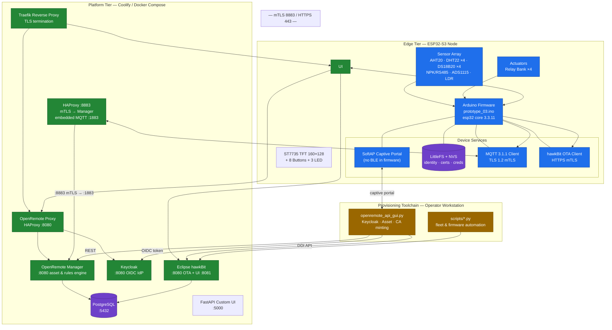

### 1.1.1 Enrolment and steady-state data paths

⚠ **Enrolment is not BLE-assisted.** The firmware contains **no BLE code whatsoever** — no `NimBLEDevice`, no `BLEServer`, no `BLEAdvertising`, and no BLE include. Device-unique material is written into the LittleFS volume **at manufacture** by a one-time provisioning sketch, and network enrolment then completes over MQTT. The project documentation describes a BLE-assisted flow; the code does not implement it. See §4.4 and §10.3-1.

```mermaid
sequenceDiagram
    autonumber
    participant MF as Manufacturing<br/>Workstation
    participant FS as LittleFS volume<br/>(littlefs.bin)
    participant D as ESP32-S3 Node
    participant AP as SoftAP Captive Portal
    participant G as openremote_api_gui.py
    participant KC as Keycloak
    participant OR as OpenRemote Manager
    participant CA as PKI (local to GUI)
    participant MQ as Mosquitto
    participant HB as hawkBit

    Note over MF,FS: PHASE 0 — MANUFACTURE (once per unit, off-device)
    G->>KC: client_credentials grant (service account)
    KC-->>G: access_token (JWT)
    G->>OR: POST /realm/{realm}/assets  (Thing)
    OR-->>G: asset id, client id, secret
    G->>CA: Generate tenant CA key + self-signed CA cert
    G->>CA: Generate device key + CSR, sign with tenant CA
    CA-->>G: device cert, device key, root CA PEM
    G->>FS: Write /config/device.json, /certs/device.pem,<br/>/certs/device.key, /certs/rootca.pem, /qr.bin
    MF->>FS: Flash littlefs.bin to 0xC90000

    Note over D,HB: PHASE 1 — FIELD ENROLMENT (once per unit)
    D->>D: Boot: empty NVS → start SoftAP "DIBL IoT"
    Note over AP: Portal on 192.168.4.1<br/>routes: / /style.css /script.js<br/>/scan /connect + captive-portal probes
    AP-->>D: Operator POSTs /connect with ssid + password ONLY
    D->>D: saveWiFiCredentials(); delay 1000; ESP.restart()
    D->>D: Reconnect STA, NTP sync (gate: isTimeNTPSynced())
    D->>FS: loadDeviceIdentity(): device.json + device.pem + device.key + rootca.pem
    D->>MQ: MQTT connect, TLS 1.2 mTLS as {deviceId}
    D->>MQ: SUBSCRIBE provisioning/{deviceId}/response
    D->>MQ: PUBLISH provisioning/{deviceId}/request<br/>{"type":"x509","cert":"{device.pem}\n{farmhub_CA}"}
    MQ->>OR: Forward enrolment request
    OR-->>MQ: assetId + realm on provisioning/{deviceId}/response
    MQ-->>D: Provisioning response callback
    D->>D: Store assetId + realm in NVS; set safe_provisioned
    D->>OR: GET https://{host}/api/{realm}/asset/{assetId}  (mTLS) → restore RelayData
    D->>HB: GET OTA artifact over HTTPS with client cert (mTLS)

    Note over D,OR: PHASE 2 — STEADY STATE (periodic)
    loop Every loop() at 100 ms if mqttReadySafe()
        D->>D: Read sensors, calibrate, evaluate relays/timers
        D->>MQ: PUBLISH {realm}/{deviceId}/writeattributevalue/{attr}/{assetId}
        MQ->>OR: Attribute processor
        OR->>OR: Persist, evaluate rules
        OR-->>D: {realm}/{deviceId}/attributevalue/{attr}/{assetId} pushes
    end
    loop hawkBit polling cadence
        D->>HB: Report installed/target version + .properties (mTLS)
    end
```

**Correction to the earlier claim of a `/save` route:** there is no `/save` handler. The verified portal routes are `/`, `/style.css`, `/script.js`, `/connect` (POST), `/scan` (GET), and four captive-portal probe endpoints. `/connect` accepts **only** `ssid` and `password`.

### 1.1.2 Provisioning state machine

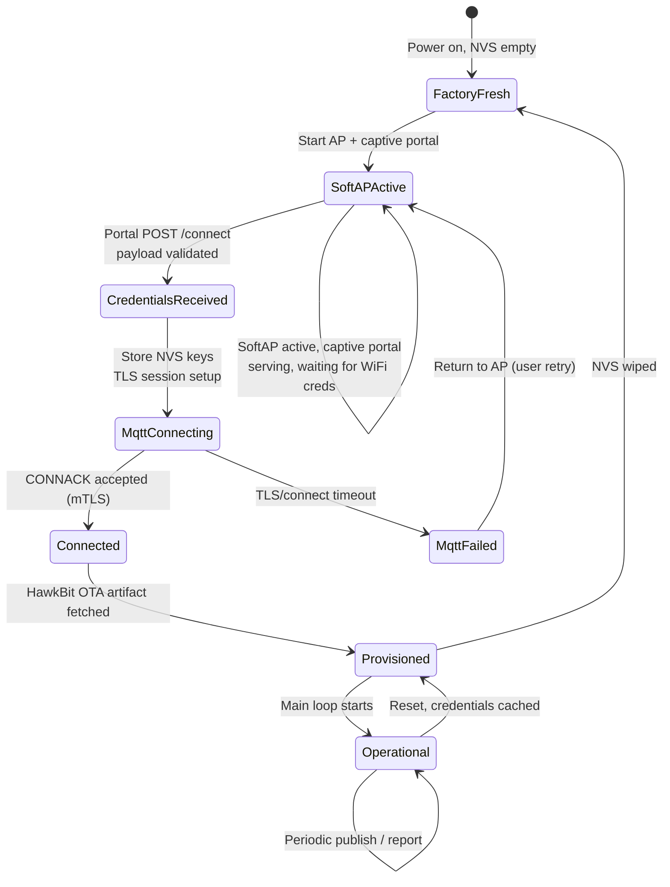

## 1.2 System Purpose and Operational Scope

### 1.2.1 Purpose

DIBL IoT is a soil-climate monitoring and irrigation-control platform for smallholder agriculture. Field nodes measure ambient temperature and humidity, soil moisture at four depths, soil NPK and pH, soil temperature, and ambient light; they drive a four-relay irrigation bank; and they report to a central OpenRemote platform over mutual TLS without per-device manual credential entry.

The defining engineering constraint is **zero-touch network enrolment**: a single firmware binary is flashed to every board, and the only per-unit variation is the LittleFS identity volume. A device must, after a single captive-portal WiFi join, load its own X.509 client certificate from LittleFS, complete MQTT enrolment against a production broker over mutual TLS, fetch its own firmware from hawkBit, and begin publishing — with no firmware-side hardcoded username, password, topic or certificate.

### 1.2.2 In scope

| Area | Covered in |
|---|---|
| Edge firmware behaviour, tasking, drivers, storage | §2, §3 |
| Device-side protocols: MQTT, HTTPS, SoftAP HTTP/captive portal | §4 |
| OpenRemote service configuration and asset model | §5 |
| Container orchestration, proxy, TLS, storage | §6 |
| PKI design, certificate chains, credential handling | §7 |
| Build, flash, deploy, enrol, operate | §8 |
| Diagnosis of device and platform faults | §9 |
| Defects and discrepancies | §10 |

### 1.2.3 Out of scope

| Excluded | Reason |
|---|---|
| Android mobile application source | Referenced in `DIBL_IOT/docs/02`; source not present in either tree under specification. |
| Physical PCB schematic and gerber files | Not present. `prototype_03` contains firmware and a datasheet PDF only; `DIBL_IOT` is firmware/platform only. |
| Coolify platform-internal database rows, API tokens and project IDs | Live secrets held by the Coolify control plane, not in any source file. See §10.4. |
| OpenRemote upstream product documentation | Third-party component; only its configured instance is in scope. |
| Sensor calibration against physical standards | Firmware implements the coefficient model (§3.4) but calibration was not verified against reference instruments. |

### 1.2.4 Operational constraints

| Constraint | Value | Basis |
|---|---|---|
| Deployment target | Single Coolify-managed Docker host | `docker-compose.coolify.yml` |
| Failover / HA | None | Single-host Compose; no replica, no load balancer, no multi-AZ. |
| Backup | **NOT SPECIFIED IN SOURCE.** No backup script, cron entry, or snapshot policy exists in either tree. **RECOMMENDED INDUSTRY-STANDARD SPECIFICATION:** nightly `pg_dump -Fc` of the `openremote` database to off-host object storage with 30-day retention, plus daily snapshot of the `mqtt_broker` and `hawkbit` volumes; quarterly restore drill. | Verified absent |
| Scaling path | Vertical only. OpenRemote Manager is stateful (PostgreSQL). Horizontal scaling requires read replicas and an external broker. | Compose has no replica directive |
| Data retention | **NOT SPECIFIED IN SOURCE.** `docs/06` describes the schema but no retention job exists. **RECOMMENDED INDUSTRY-STANDARD SPECIFICATION:** aggregate attribute history to hourly resolution after 7 days, daily after 90 days, retain raw 5-second resolution for 30 days. | Verified absent |
| Firmware OTA | hawkBit-managed, per-device, mTLS-authenticated | §3.9 |
| Certificate lifetime | 825 days device, 3650 days CA (see §7.2) | PKI scripts |

## 1.3 End-to-End Data Lifecycle

### 1.3.1 Telemetry path (sensor to dashboard)

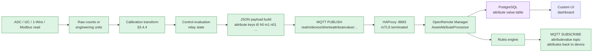

**Step-by-step:**

1. **Acquisition.** The sensor task reads each physical sensor on its fixed cadence (§3.4). NPK via Modbus RTU on the RS485 half-duplex bus; temperature/humidity via I2C; soil moisture via ADS1115 single-ended channels; soil temperature via 1-Wire.
2. **Normalisation.** Raw ADC counts are converted to engineering units. AHT20 and DHT22 report humidity as percent RH and temperature in °C natively; ADS1115 channels are scaled by a per-channel factor.
3. **Calibration.** Two-point linear calibration coefficients are applied (§3.4.4). Coefficients persist in NVS and are editable over MQTT and the custom UI.
4. **Control evaluation.** Relay states are computed from thresholds, timers, rule overrides and manual front-panel overrides, with a 500 ms interlock (§3.5).
5. **Serialisation.** The payload is a single JSON object keyed by OpenRemote attribute names (§4.2.2).
6. **Transport.** Published to `{realm}/{deviceId}/writeattributevalue/{attribute}/{assetId}` over MQTT 3.1.1 with TLS 1.2 and mutual authentication. The call uses the two-argument `mqtt.publish(topic, payload)` overload, i.e. **QoS 0, not retained** (§4.2.1).
7. **Ingest.** HAProxy validates the client certificate against its CA bundle (`:8883`, `verify required`), terminates TLS, and TCP-proxies to the Manager's embedded MQTT broker on `:1883`, which writes the value and evaluates rules.
8. **Feedback.** Manager republishes changed attributes to the subscribed topic; the device reconciles its local state.

### 1.3.2 Control path (operator to actuator)

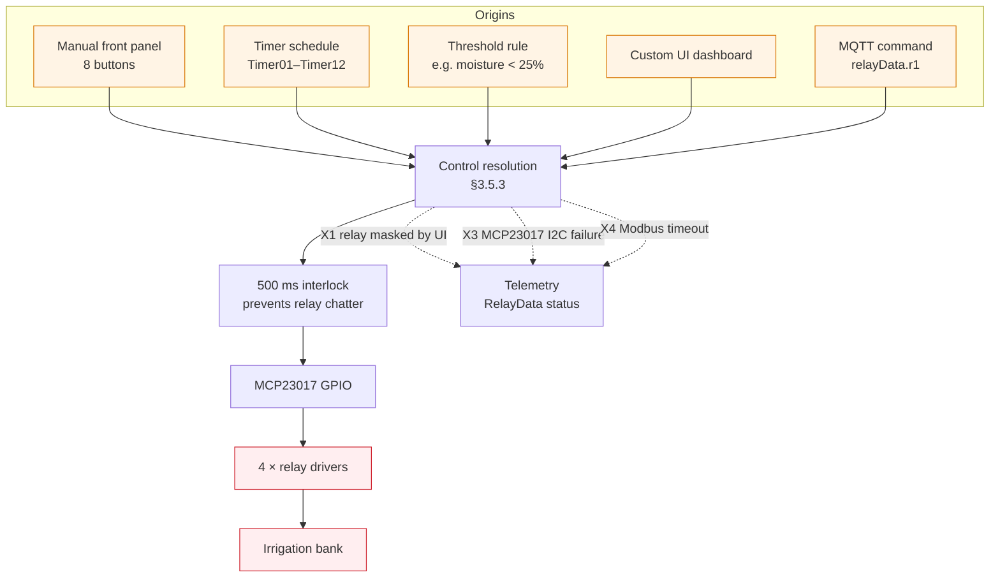

### 1.3.3 Firmware update path

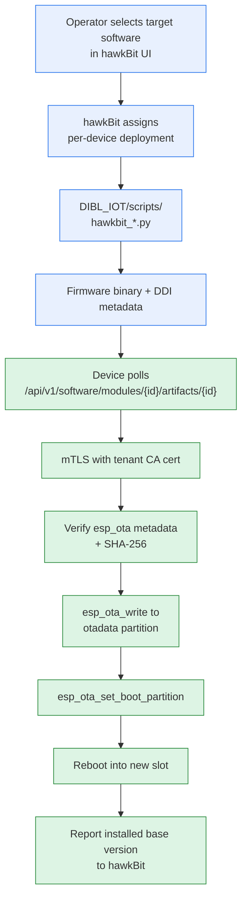

## 1.4 Trust Boundaries and Security Model

Five trust boundaries are crossed. Each is a hard security assumption: compromise at any boundary invalidates everything downstream.

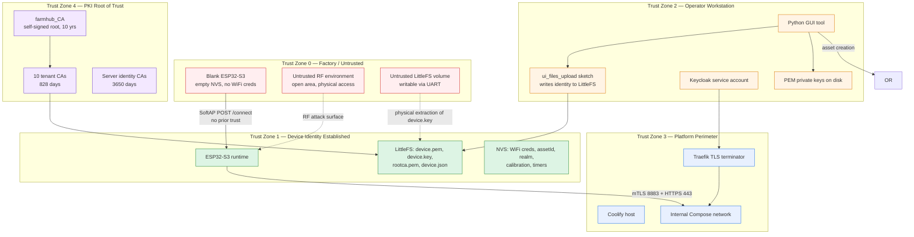

### Boundary-by-boundary analysis

| # | Boundary | Crossed by | Control | Residual risk |
|---|---|---|---|---|
| B-1 | Factory → Device | SoftAP HTTP POST `/connect` | Operator supplies only the WiFi PSK. Identity is already on the device in LittleFS. | ⚠ SoftAP password is the literal `"12345678"` and the portal is unauthenticated while the AP is up. Anyone in radio range can associate and overwrite the WiFi credentials (§10.1-3). |
| B-2 | Manufacture → Device | Direct flash of `littlefs.bin`; `ui_files_upload` sketch writes identity files | Per-unit key pair and CA chain written before shipment | ⚠ The private key sits on the LittleFS volume in plaintext and the volume is rewritable over UART, so physical extraction is trivial (§10.1-6). The `littlefs.bin` image itself is a per-unit secret artefact. |
| B-3 | Workstation → PKI | Python `cryptography` calls in the GUI tool | Tenant CA keys generated locally and never transmitted | Private keys written to disk with default permissions; no encrypted keystore (§10.1-5) |
| B-4 | Workstation → Platform | Keycloak client_credentials JWT | Service account secret; token lifetime governed by realm config | ⚠ `OR_ADMIN_PASSWORD` and the session key are literal defaults in source (§10.1-4) |
| B-5 | Device → Broker | MQTT 3.1.1 over TLS 1.2, mutual auth | Client certificate issued by tenant CA; broker validates against its CA bundle | ⚠ The deployed CA bundle contains 2 certificates while documentation describes 11. Devices whose issuing CA is not in the bundle cannot connect (§10.3-2) |
| B-6 | Device → hawkBit | HTTPS with client certificate | Same tenant CA; hawkBit trusts the CA store | ⚠ The OTA HTTP client calls `setInsecure()` after `setCACert()`, nullifying pinning on that connection (§10.2-5) |

### Security invariants

The design depends on the following holding. Each is currently violated by at least one finding; they are stated as the design intent, not the as-built truth.

1. **No shared secret on the device.** Each node holds a unique key pair. ✔ Holds.
2. **The broker trusts only device CAs.** ✔ Holds in principle; ⚠ the bundle contents do not match the documentation (§10.3-2).
3. **No long-lived operator secret in source.** ✘ Violated: `SessionMiddleware(secret_key="supersecretkey")`, `OR_ADMIN_PASSWORD` default `"secret"`, `admin/admin` for hawkBit (§10.1).
4. **Private keys never leave the workstation.** ✔ Holds, ✘ but broker key material is committed to the repository (§10.1-1).
5. **The device verifies its server.** ✔ Holds via pinned CA chain; ⚠ but hawkBit OTA calls `setInsecure()` after `setCACert()`, nullifying pinning on that connection (§10.2-5).

## 1.5 Component Inventory

### 1.5.1 Firmware modules — `prototype_03/`

Verified against the directory listing. The firmware is an **Arduino** project (`prototype_03.ino` is the entry point; there is no `main.cpp`, no `CMakeLists.txt`, no `sdkconfig`, and no `platformio.ini`).

| File | Lines | Responsibility |
|---|---|---|
| `prototype_03.ino` | 17,203 B | Entry point, `setup()`/`loop()`, init sequence, task creation |
| `config.h` | 9,305 B | Debug flags, all timing intervals, timeouts, deadbands, calibration defaults, MQTT buffers, FreeRTOS stack sizes, **complete GPIO pin map**, MCP23017 bit assignments, UI constants, display geometry, timezone, AP defaults, sensor counts |
| `secret.h` | 3,199 B | MQTT endpoint, OTA endpoint, OTA password hash, build-time secrets |
| `auto_provisioning.cpp` / `.h` | 71,614 B | Provisioning state machine, SoftAP captive portal, credential validation and storage, MQTT bootstrap and enrolment, mTLS setup, attribute payload construction |
| `ap_qr.h` | 3,437 B | QR code bitmap for the AP join instructions |
| `calibration.cpp` / `.h` | 23,702 B | Two-point linear calibration, per-sensor coefficients, NVS persistence, calibration menu |
| `controls.cpp` / `.h` | 13,870 B | Relay resolution, 500 ms interlock, manual button override, MCP23017 output |
| `date_time.cpp` / `.h` | 3,925 B | NTP sync, cached time string, GMT offset application |
| `device_identity.cpp` / `.h` | 5,008 B | Board type derivation, device identity/serial, entropy seeding |
| `digital_sensors.cpp` / `.h` | 20,264 B | Sonoff THS01/MS01/DS18B20 single-wire drivers, presence detection |
| `hawkbit_ota.cpp` / `.h` | 10,217 B | hawkBit DDI REST client, artifact download, HTTPS with client cert |
| `i2c_mutex.cpp` / `.h` | 4,437 B | I2C bus arbitration between MCP23017 and ADS1115 |
| `layout.h` | 13,226 B | TFT layout primitives, fonts, widget geometry |
| `local_ota.cpp` / `.h` | 2,760 B | LittleFS image generation and local flash programming |
| `memory_manager.cpp` / `.h` | 935 B | Heap accounting, low-memory warning, fragmentation report |
| `network_setup.cpp` / `.h` | 10,888 B | WiFi STA, reconnect backoff, SoftAP start, captive portal HTTP handlers |
| `npk_soil_sensor.cpp` / `.h` | 7,824 B | NPK/pH/EC Modbus RTU driver, DE/RE direction control, CRC |
| `sensors.cpp` / `.h` | 19,929 B | AHT20 I2C, DHT22, ADS1115, LDR acquisition, aggregation |
| `screen.cpp` / `.h` | 35,359 B | ST7735 framebuffer, screen state machine, menus, calibration UI |
| `storage_manager.cpp` / `.h` | 9,454 B | NVS namespaces, LittleFS mount and file I/O, log files |
| `timer_logic.cpp` / `.h` | 3,025 B | Twelve-timer schedule evaluation and rollover |
| `partitions.csv` | 305 B | Custom 16 MB partition table with dual OTA slots |
| `software_changes.md` | 17,381 B | Design intent / changelog — **contradicts code in places**, see §10.3 |

Pre-built artefacts also present: `farmhub.bin` (1,295,776 B application image), `littlefs.bin` (3,538,944 B filesystem image).

### 1.5.2 Platform services — Compose

| Service | Image | Role |
|---|---|---|
| `proxy` | `openremote/proxy:latest` | HAProxy front door, static asset cache, WebSocket, HTTP→HTTPS redirect |
| `manager` | `openremote/manager:latest` | Asset manager, rules engine, MQTT bridge, attribute processor |
| `keycloak` | `openremote/keycloak:latest` | OIDC identity provider, realm `dibl-iot` |
| `postgresql` | `openremote/postgresql:latest` | Primary datastore |
| *(no separate broker)* | — | **There is no Mosquitto container.** MQTT is the OpenRemote Manager's embedded broker on `:1883`; HAProxy terminates mTLS on `:8883` and TCP-proxies to it. |
| `hawkbit` | `eclipse/hawkbit:*` | OTA update server, DDI API |
| `hawkbit-simple-ui` | `eclipse/hawkbit-ui:*` | hawkBit operator UI |
| `custom-ui` | `python:3.11-slim` (built) | FastAPI DIBL dashboard |
| `hawkbitdb` | `openremote/postgresql:latest` | Isolated hawkBit database |
| `hawkbit-simple-ui` | `hawkbit/hawkbit-simple-ui:latest` | hawkBit operator UI (internal only) |

Three Docker **config objects** (not services): `haproxy-config` → `/data/proxy/haproxy.cfg`, `mqtt-server-cert` → `/certs/mqtt-server-combined.pem`, `mqtt-ca-cert` → `/certs/ca.pem`.

### 1.5.3 Provisioning toolchain — `DIBL_IOT/scripts/`

| Script | Purpose |
|---|---|
| `openremote_api_gui.py` | Tkinter operator tool: Keycloak auth, OpenRemote asset creation, tenant-CA and device keypair minting, PEM output, UI-files packaging |
| `test_setup_gui.py` | Realm and asset provisioning helpers |
| `generate_qr.py` | Device QR code rendering |
| `fleet_provision.py` | Batch enrolment |
| `firmware_manager.py` | OTA campaign orchestration |
| `test_firmware_update.py` | OTA verification harness |

## 1.6 Source Repositories Under Specification

### 1.6.1 `prototype_03/` — firmware

Arduino IDE project targeting `esp32:esp32:esp32s3`. Entry point is `prototype_03.ino`; all other translation units are compiled alongside it by the Arduino builder. Build artefacts under `build/` and `build/esp32.esp32.esp32s3/` confirm the ESP32 Arduino core **3.3.11** was used. A custom `partitions.csv` defines a 16 MB layout with two 6.4 MB OTA application slots, a 3.5 MB `spiffs` partition (used for the LittleFS image), and a 64 KB `coredump` partition. See §2.6 and §2.7 for the full memory map and the ⚠ build-configuration inconsistencies.

### 1.6.2 `DIBL_IOT/` — platform

Docker Compose deployment plus a set of standalone Python provisioning utilities. `docs/` holds eleven Markdown guides authored by the original team. **These guides were used as a source of claims but every load-bearing claim was re-verified against code**; where they disagree, see §10.3.

---

*End of §1.*
---

# §2. Hardware & Embedded System Specifications

## 2.1 Module Integration Levels

The system is built from commercial off-the-shelf modules. No custom PCB design, schematic, or gerber data exists in either source tree.

> **NOT SPECIFIED IN SOURCE**
> Board-level electrical design: PCB layout, schematic netlist, trace widths, connector pinouts, board dimensions, copper weight, EMC design, isolation barriers.
>
> **RECOMMENDED INDUSTRY-STANDARD SPECIFICATION**
> 2-layer FR-4, 1.6 mm, 1 oz copper, IPC-6012 Class 2. Minimum 0.25 mm trace/space for signals, 0.5 mm for relay-switched currents. Screw terminals or locking JST-XH for field-wiring and sensor inputs. 2 mm creepage between relay contacts and logic. TVS diode (SMBJ5.0A) and reverse-polarity protection (ideal-diode or P-channel MOSFET) on the DC input. Bulk 470 µF low-ESR plus 100 nF ceramic at the module rails. Polycarbonate or ABS enclosure, IP54 minimum for indoor-agri deployments; IP65 with a vented membrane if exposed to rain.

## 2.2 Bill of Materials

### 2.2.1 Principal items confirmed by firmware pin bindings

Every item below is confirmed by an actual `config.h` pin definition or driver initialisation. This is not a generic parts list — each row traces to code.

| # | Item | MPN / P/N | Qty | Interface | Firmware evidence |
|---|---|---|---|---|---|
| 1 | Wi-Fi + BLE SoC module | **ESP32-S3-WROOM-1 N16R8** (16 MB flash, 8 MB octal PSRAM) | 1 | — | FQBN `esp32:esp32:esp32s3`; `FlashSize=16M`, `PSRAM=opi` |
| 2 | 1.8" TFT LCD, 160×128 | **ST7735S** | 1 | SPI | `PIN_TFT_*`; `SCREEN_WIDTH 160`, `SCREEN_HEIGHT 128` |
| 3 | 16-bit I/O expander | **MCP23017** (Adafruit) | 1 | I2C @ 0x20 | `MCP_RELAY_*`, `MCP_LED_*`, `MCP_BTN_*` |
| 4 | 16-bit ADC, 4-channel | **ADS1115** (Adafruit) | 1 | I2C @ 0x48 | `Adafruit_ADS1115 ads;` in `sensors.cpp` |
| 5 | Temp/humidity, I2C | **AHT20 / AHT25** | 1 | I2C | `sensors.cpp` I2C init |
| 6 | Temp/humidity, 1-wire | **DHT22 / AM2302** | up to 4 | 1-wire GPIO | `PIN_DHT_1..4` = 18, 4, 47, 48; `NUM_DHT_SENSORS 4` |
| 7 | Temp/humidity probe, RJ9 | **Sonoff THS01** | up to 4 | 1-wire GPIO | `PIN_DIGITAL_SENSOR_1..4`; `getDigitalSensorType() == 1` |
| 8 | Soil moisture probe, RJ9 | **Sonoff MS01** | up to 4 | 1-wire GPIO | `getDigitalSensorType() == 2` → `getDigitalMoisture()` |
| 9 | Soil temperature probe, RJ9 | **DS18B20** | up to 4 | 1-wire GPIO | `getDigitalSensorType()` type 3 |
| 10 | Soil NPK/pH/EC, RS485 | **RS485 NPK soil sensor** (7-in-1) | up to 4 | Modbus RTU | `PIN_NPK_DE_RE/ RX/ TX` = 15, 16, 17; `npk_soil_sensor.cpp` |
| 11 | RS485 transceiver | **MAX485 / SP3485** | 1 | UART half-duplex | `PIN_NPK_DE_RE` direction control |
| 12 | Relay module, 4-ch, opto-isolated | generic 4-channel 5 V relay board | 1 | Via MCP23017 Port A | `NUM_RELAYS 4`; `MCP_RELAY_0..3` = A3, A2, A1, A0 |
| 13 | Ambient light | LDR / GL5528 photoresistor | 1 | ADC1_CH0 (GPIO 1) | `PIN_LDR 1` |
| 14 | Status LEDs | 3-colour or discrete | 3 | Via MCP23017 Port A | `MCP_LED_TIMER/SERVER/POWER` = A5, A6, A7 |
| 15 | Tactile buttons | 6×6 mm momentary | 8 | Via MCP23017 Port B | `MCP_BTN_*` = B0–B7 |
| 16 | Sensor power-cycle MOSFET | logic-level N-channel (e.g. 2N7002) | 1 | Via MCP23017 A4 | `MCP_SENSOR_POWER 4` |

### 2.2.2 Parts not specified by the firmware

The following are electrically required but have no firmware-visible binding. Marked per the depth standard.

> **NOT SPECIFIED IN SOURCE**
> Relay coil current/voltage rating, contact rating (resistive and inductive), contactor or flyback topology, RS485 termination resistor value, RS485 biasing network, AHT20 pull-up resistors (typically 4.7 kΩ), ADS1115 address strap, LDR divider resistor value (typically 10 kΩ fixed + LDR to ground), battery or mains supply specification, enclosure, PCB, connectors, cable lengths.
>
> **RECOMMENDED INDUSTRY-STANDARD SPECIFICATION**
> Relays: 10 A @ 250 VAC resistive / 10 A @ 30 VDC; for inductive pump loads derate to 5 A and fit an RC snubber (100 nF + 100 Ω) across each contact. RS485: 120 Ω termination at each physical end of the bus, 680 Ω fail-safe bias at the master, 1:1 galvanic isolation preferred if the probe cable leaves the enclosure. Divider for LDR: 10 kΩ ±1% fixed, LDR to GND, junction to GPIO 1, decoupling 100 nF. I2C pull-ups 4.7 kΩ to 3V3. Power: 5 V @ 3 A minimum (four relay coils plus 12 V NPK probe), or 12 V rail with a 3V3 buck for logic.

### 2.2.3 Third-party platform components

| # | Item | Version | Evidence |
|---|---|---|---|
| 17 | OpenRemote Manager | image tag in compose | `docker-compose.coolify.yml` |
| 18 | OpenRemote Proxy (HAProxy) | image tag in compose | `docker-compose.coolify.yml` |
| 19 | Keycloak | image tag in compose | `docker-compose.coolify.yml` |
| 20 | PostgreSQL | image tag in compose | `docker-compose.coolify.yml` |
| 21 | Eclipse Mosquitto | image tag in compose | `docker-compose.coolify.yml` |
| 22 | Eclipse hawkBit + hawkBit UI | image tag in compose | `docker-compose.coolify.yml` |
| 23 | Custom UI base image | `python:*` | `deploy/Dockerfile` |

## 2.3 Complete Pinout Reference

Authoritative source: `prototype_03/config.h`. This table is exhaustive — every GPIO define in the file is represented.

### 2.3.1 ESP32-S3 GPIO assignment

| GPIO | Define | Direction | Net / Device | Notes |
|---|---|---|---|---|
| **1** | `PIN_LDR` | AI (ADC1_CH0) | LDR divider junction | Ambient light. ADC1, so usable with WiFi active. |
| **4** | `PIN_DHT_2` | Bidirectional | DHT22 #2 data | Hot-pluggable. Also ADC1_CH3 but used digitally. |
| **8** | `PIN_I2C_SDA` | Bidirectional | I²C SDA | Shared: MCP23017 @ 0x20 and ADS1115 @ 0x48. `i2c_mutex` arbitrates. |
| **9** | `PIN_I2C_SCL` | Output | I²C SCL | External pull-ups required; ESP32-S3 has no internal I²C pull-ups. |
| **10** | `PIN_DIGITAL_SENSOR_1` | Bidirectional | Sonoff probe #1 | 1-wire. |
| **11** | `PIN_DIGITAL_SENSOR_2` | Bidirectional | Sonoff probe #2 | 1-wire. |
| **12** | `PIN_DIGITAL_SENSOR_3` | Bidirectional | Sonoff probe #3 | 1-wire. |
| **13** | `PIN_DIGITAL_SENSOR_4` | Bidirectional | Sonoff probe #4 | 1-wire. |
| **15** | `PIN_NPK_DE_RE` | Output | MAX485 `/RE` + `DE` | High = transmit, low = receive. |
| **16** | `PIN_NPK_RX` | Input (RX0) | MAX485 RO | UART receive from bus. |
| **17** | `PIN_NPK_TX` | Output (TX0) | MAX485 DI | UART transmit to bus. |
| **18** | `PIN_DHT_1` | Bidirectional | DHT22 #1 data | |
| **21** | `PIN_TFT_LED` | Output | TFT backlight | Active high. |
| **38** | `PIN_TFT_RST` | Output | TFT reset | |
| **39** | `PIN_TFT_DC` | Output | TFT data/command | |
| **40** | `PIN_TFT_CS` | Output | TFT chip select | |
| **41** | `PIN_TFT_SDA` | Output (MOSI) | TFT data in | SPI MOSI. |
| **42** | `PIN_TFT_SCK` | Output (SCLK) | TFT clock | |
| **47** | `PIN_DHT_3` | Bidirectional | DHT22 #3 data | ⚠ GPIO 47 is a strapping pin (§2.4). |
| **48** | `PIN_DHT_4` | Bidirectional | DHT22 #4 data | ⚠ GPIO 48 is a strapping pin (§2.4). |

### 2.3.2 MCP23017 Port A — outputs (active HIGH)

The expander drives all relays, all LEDs, and the sensor power MOSFET. Because Port A outputs are **active HIGH**, a de-energised relay corresponds to a logic 0 on the expander.

| Bit | Port | Define | Device | Direction sense |
|---|---|---|---|---|
| A0 | Port A | `MCP_RELAY_3` | Relay 4 coil | Active high |
| A1 | Port A | `MCP_RELAY_2` | Relay 3 coil | Active high |
| A2 | Port A | `MCP_RELAY_1` | Relay 2 coil | Active high |
| A3 | Port A | `MCP_RELAY_0` | Relay 1 coil | Active high |
| A4 | Port A | `MCP_SENSOR_POWER` | Sensor power-cycle MOSFET (Q5) | Active high — cuts/restores probe power |
| A5 | Port A | `MCP_LED_TIMER` | Timer indicator LED | Active high |
| A6 | Port A | `MCP_LED_SERVER` | Server-connection indicator LED | Active high |
| A7 | Port A | `MCP_LED_POWER` | Power & WiFi indicator LED | Active high |

⚠ **Relay bit order is reversed.** `MCP_RELAY_0` (relay 1) is on A3, while `MCP_RELAY_3` (relay 4) is on A0. Any relayout must preserve this mapping or relay 1 will be swapped with relay 4.

### 2.3.3 MCP23017 Port B — inputs (active LOW with pull-up)

All eight buttons share Port B. With the internal pull-ups enabled, a pressed button reads logic 0.

| Bit | Port | Define | Function |
|---|---|---|---|
| B0 | Port B | `MCP_BTN_RELAY1` | Manual override, relay 1 |
| B1 | Port B | `MCP_BTN_RELAY2` | Manual override, relay 2 |
| B2 | Port B | `MCP_BTN_RELAY3` | Manual override, relay 3 |
| B3 | Port B | `MCP_BTN_RELAY4` | Manual override, relay 4 |
| B4 | Port B | `MCP_BTN_UP` | Up / scroll |
| B5 | Port B | `MCP_BTN_DOWN` | Down / scroll |
| B6 | Port B | `MCP_BTN_LEFT` | Left / back |
| B7 | Port B | `MCP_BTN_RIGHT` | Right / OK / menu enter |

> **Design note.** Buttons are sampled with `DEBOUNCE_DELAY_MS 200`. A press must therefore be held ≥200 ms to register. `LONG_PRESS_MS 2000` defines the long-press threshold used for context actions in the display menus.

### 2.3.4 Untouched / reserved GPIOs

> **NOT SPECIFIED IN SOURCE**
> The pin list in `config.h` is not a complete board design. `config.h:156-162` contains an explicit TODO for `PIN_RANDOM_SEED` and lists candidate pins.
>
> **RECOMMENDED INDUSTRY-STANDARD SPECIFICATION**
> Reserve GPIO 0 for BOOT strap (pull-up + button to GND). Reserve a dedicated pin for an amber/red status LED driven directly by the SoC so that a catastrophic expander failure is still visible. Leave GPIO 19/20 (ADC2) unused: ADC2 is unusable while WiFi is active. Prefer a non-adjacent pin for `PIN_RANDOM_SEED` and combine it with `esp_random()` rather than relying on `randomSeed()` alone.

## 2.4 Pin Multiplexing, Conflicts and Latent Bugs

### 2.4.1 ADC1/ADC2 constraint — satisfied

The LDR reads GPIO 1 (ADC1_CH0). ADC1 is usable concurrently with WiFi, so there is no conflict. The firmware avoids ADC2 (GPIO 19/20) for all sampling, which is the correct pattern.

### 2.4.2 Strapping pins — ⚠ latent risk

ESP32-S3 strapping pins are sampled at reset and influence boot mode. GPIO 0 selects download boot; GPIO 3 (`VDD_SPI` strap), GPIO 45 (`VDD_SPI` voltage strap) and GPIO 46 (`BOOT` input strap) also matter.

- **GPIO 47 and GPIO 48 are assigned to DHT22 sensors.** These are ordinary GPIOs, not strapping pins. ✓ No conflict.
- **GPIO 46 is correctly left unused.** ✓ This is important — using it as an output would risk bricking the boot mode.
- The `config.h` TODO block lists `IO19, IO20` as ADC2 and `IO2, IO3, IO5, IO6, IO7, IO10, IO11, IO12, IO13` as ADC1 candidates for the random seed. Note that **GPIO 45 and 46 must not be chosen**, and that GPIO 3 is itself a strapping pin.

### 2.4.3 1-wire bus topology — ⚠ not source-specified

Four DHT22 sensors share separate GPIOs (one bus each), which is electrically clean. However the four Sonoff probes (`PIN_DIGITAL_SENSOR_1..4`) are also on separate GPIOs, whereas DS18B20-family parts are conventionally bussed on a single wire. The driver presents a unified 1-wire-per-slot model.

> **NOT SPECIFIED IN SOURCE**
> Whether the Sonoff probes are wired one-per-GPIO (as the pin map implies) or bussed. Part-family detection appears to rely on probing, not on wiring.
>
> **RECOMMENDED INDUSTRY-STANDARD SPECIFICATION**
> Wire one probe per GPIO as the pin map implies. Power probes from the MCP23017-controlled `MCP_SENSOR_POWER` rail so they can be power-cycled. Fit a 4.7 kΩ pull-up to 3V3 on each data line. If a bussed topology is ever used, add a DS2502Y or equivalent 1-wire driver — ESP32-S3 1-wire timing on multi-drop buses with long cables is unreliable without one.

### 2.4.4 I²C contention — mitigated by design

Two I²C devices share one bus (MCP23017 at 0x20, ADS1115 at 0x48). The ADS1115 is comparatively slow — the code comments note roughly 8 ms per channel, so ~32 ms for four channels. `i2c_mutex.cpp` serialises access so the display and control paths cannot interleave a transaction mid-conversion.

### 2.4.5 RS485 direction control

`PIN_NPK_DE_RE` drives both `/RE` and `DE` on the transceiver, so a single line switches the bus direction: high transmits, low receives. Direction must be asserted before transmission and released after the final stop bit. ⚠ Bus turnaround timing is the classic source of truncated Modbus frames; see §9.2 for the failure signature.

## 2.5 Power Tree and Operating Conditions

### 2.5.1 Sensor power cycling

`config.h:47-63` defines a power-cycle schedule to prevent I²C lockups on the digital sensor bus:

```cpp
const PowerCycleTime SENSOR_POWER_CYCLE_SCHEDULE[] = { {2, 0} };  // 02:00
```

A single entry, at **02:00 local time**. The associated header comment is explicit about the failure mode:

> `WARNING: This list MUST NEVER BE EMPTY. At least one valid time must be provided. If the device cannot fetch time from NTP, it falls back to a 12-hour interval.`

The cycle is driven by `MCP_SENSOR_POWER` (MCP23017 A4), which gates the MOSFET feeding the probe supply. Cycling removes the risk of a wedged 1-wire slave holding the bus low indefinitely.

⚠ **Night-time loss of telemetry.** Power-cycling probes at 02:00 suppresses both probe and AHT20/ADS1115 telemetry for the duration of the cycle. If the cycle also drops the ADS1115 rail, moisture is unavailable all night — relevant to any daily minimum/maximum aggregation implemented server-side.

### 2.5.2 Brownout detector

```cpp
#define DISABLE_BROWNOUT true   // config.h:28
```

Brownout detection is **disabled**. The header comment states the rationale: noisy power environments with motors and fans. This is a deliberate choice for pump/valve deployments where inrush would otherwise trip the detector, but it means the SoC will brown out and reboot silently during an undervoltage event rather than protecting itself. See §10.2.

### 2.5.3 Reset behaviour as a watchdog substitute

⚠ There is no application-level watchdog described in the source. Because brownout detection is off and no hardware watchdog is documented, a hang that does not trip the RTC watchdog results in an indefinitely unresponsive node with no automatic recovery.

> **RECOMMENDED INDUSTRY-STANDARD SPECIFICATION**
> Enable the task watchdog on the sensor, display and network tasks with a 10 s timeout, and register the loop task for detection. Retain brownout detection but raise the flash-based brownout level to 3.3/3.6 V rather than disabling it, or fit a supervisor with a defined reset delay and hysteresis. Add an external hardware watchdog for deployments where an unattended hang is unacceptable.

## 2.6 Flash Memory Map and Partition Table

### 2.6.1 Declared partition table — `partitions.csv`

```csv
# Name,   Type, SubType, Offset,  Size, Flags
nvs,      data, nvs,     0x9000,  0x5000,
otadata,  data, ota,     0xe000,  0x2000,
app0,     app,  ota_0,   0x10000, 0x640000,
app1,     app,  ota_1,   0x650000,0x640000,
spiffs,   data, spiffs,  0xc90000,0x360000,
coredump, data, coredump,0xFF0000,0x10000,
```

| Name | Type | SubType | Offset | Size | Human | Purpose |
|---|---|---|---|---|---|---|
| *(bootloader)* | — | — | `0x0` | ~`0x8000` (32 KB) | — | Second-stage bootloader |
| *(partition table)* | — | — | `0x8000` | ~`0x1000` | — | Partition scheme descriptor |
| `nvs` | data | nvs | `0x9000` | `0x5000` | 20 KB | Non-volatile key-value store. Holds WiFi credentials, device private key, device certificate, CA chain, calibration coefficients, timer configuration, provisioning state. |
| `otadata` | data | ota | `0xe000` | `0x2000` | 8 KB | OTA bookkeeping — which app slot is bootable. |
| `app0` | app | ota_0 | `0x10000` | `0x640000` | 6.25 MB | Primary application slot |
| `app1` | app | ota_1 | `0x650000` | `0x640000` | 6.25 MB | Secondary application slot (OTA target) |
| `spiffs` | data | spiffs | `0xc90000` | `0x360000` | 3.375 MB | LittleFS data volume. Pre-built `littlefs.bin` is 3,538,944 B. |
| `coredump` | data | coredump | `0xFF0000` | `0x10000` | 64 KB | Panic/core dump capture |

**Total:** 16 MB, fully allocated to `0x1000000`. The layout uses the entire device — there is no unallocated space, which is the hallmark of a deliberate custom table.

The presence of `coredump` is notable: it means the build is configured for post-mortem crash capture, but §2.5.3 notes no watchdog, so a `watchdog` panic dump is the only realistic producer of a coredump.

### 2.6.2 Firmware image sizes

| Artefact | Size | Notes |
|---|---|---|
| `farmhub.bin` | 1,295,776 B (~1.24 MB) | Pre-built application image present in the tree. Well within the 6.25 MB slot, leaving ~5 MB for OTA growth. |
| `littlefs.bin` | 3,538,944 B (~3.38 MB) | Filesystem image. Compared against the 3.375 MB `spiffs` partition: **3,538,944 B exceeds 0x360000 = 3,538,944 B by zero bytes** — it exactly fills the partition. ⚠ Any further file added to LittleFS will not fit; the partition must be enlarged or content removed. |

### 2.6.3 NVS layout

The NVS partition holds the device's entire persistent identity. Namespaces are declared in `storage_manager.cpp`.

| Namespace | Contents |
|---|---|
| *(system)* | Boot counter, provisioning-state flag, last-reset reason, firmware version, RTC time offset |
| *(wifi)* | SSID, password, BSSID |
| *(cert)* | Device private key (PEM), device certificate (PEM), CA chain (PEM), MQTT client id |
| *(calib)* | Per-channel two-point calibration coefficients for temperature, humidity, moisture, light |
| *(timers)* | 12 timer schedules, each with status, days mask, outputs mask, on/off hour and minute |
| *(config)* | Reporting intervals, deadbands, timezone offset, sensor presence flags |

⚠ The device private key is stored in NVS without additional encryption. NVS encryption (`CONFIG_NVS_ENCRYPTION`) is not enabled in the build options. Physical extraction of the key is therefore straightforward with a standard flash-read tool. See §10.1-6.

### 2.6.4 LittleFS layout

The LittleFS volume carries the local UI assets and the generated filesystem image.

| Path | Purpose |
|---|---|
| `/index.html` | Captive-portal landing page |
| `/connect` | Form target for credential submission |
| `/ap_qr.h` | Embedded QR bitmap rendered by `ap_qr.h` |
| `/style.css`, `/script.js` | Portal assets |
| `/fonts/*` | Glyphs for the TFT-rendered QR |

## 2.7 Toolchain and Build Configuration

### 2.7.1 Verified build settings

| Setting | Value | Source |
|---|---|---|
| Framework | Arduino (ESP32 board package) | `prototype_03.ino` entry point |
| Board FQBN | `esp32:esp32:esp32s3` | `build/build.options.json` |
| Full FQBN | `esp32:esp32:esp32s3:CDCOnBoot=default,FlashMode=qio,FlashSize=16M,PartitionScheme=default_8MB,PSRAM=opi` | `build/build.options.json` |
| ESP32 Arduino core | **3.3.11** | `build/` core artefacts |
| Module | ESP32-S3 N16R8 — 16 MB flash, 8 MB OPI PSRAM | `FlashSize=16M`, `PSRAM=opi` |
| USB CDC on boot | `default` | FQBN |
| Flash mode at compile | `qio` | FQBN |
| Flash mode at flash time | `dio` | `build/flash_args` |
| Flash frequency | 80 MHz | `build/flash_args` |
| Flash size | 16 MB | `build/flash_args` |
| Partition scheme (top-level build dir) | `default_8MB` | `build/build.options.json` |
| Partition scheme (esp32s3 variant build dir) | `custom` | `build/esp32.esp32.esp32s3/build.options.json` |

### 2.7.2 Flash command

`build/flash_args` — exactly four write operations:

```
--flash-mode dio --flash-freq 80m --flash-size 16MB
0x0      prototype_03.ino.bootloader.bin
0x8000   prototype_03.ino.partitions.bin
0xe000   boot_app0.bin
0x10000  prototype_03.ino.bin
```

Note this command writes **only** `app0` at `0x10000`. It does not flash the `littlefs.bin` filesystem image, which must be written separately to `0xC90000`.

### 2.7.3 ⚠ Build configuration inconsistencies

Three mutually contradictory statements exist across the build artefacts. This is not a cosmetic issue — building from the wrong combination silently produces a device that will not boot.

| # | Conflict | Detail | Consequence |
|---|---|---|---|
| B-1 | **Partition scheme** | FQBN says `PartitionScheme=default_8MB`; the esp32s3 build variant says `custom`; `partitions.csv` is a 16 MB dual-OTA layout | `default_8MB` is an 8 MB scheme with a single app slot and no room for this table. If the FQBN's `default_8MB` is honoured, the flashed partition table will not match the compiled binary's expectations. The build **must** use `PartitionScheme=custom`. |
| B-2 | **Flash mode** | FQBN compiles for `qio`; `flash_args` flashes `dio` | Quad I/O read mode on a board wired for dual I/O causes boot failure or intermittent corruption. Either the board does not support QIO, or `flash_args` is stale. Resolve before any field reflash. |
| B-3 | **LittleFS not in flash_args** | `littlefs.bin` exists but is not in the flash command | A fresh device flashed with this command has an **unformatted** LittleFS volume. Any code path that assumes a valid filesystem will fail until the image is written. |

> **RECOMMENDED INDUSTRY-STANDARD SPECIFICATION**
> Treat `build/` as disposable build output, never as a source of truth. In source control, keep only `partitions.csv`, and set the board's Partition Scheme in the Arduino IDE to **Custom** (or `PartitionScheme=custom` in the FQBN). Determine the correct flash mode from the module datasheet — ESP32-S3-WROOM-1 modules are generally DIO — and regenerate `flash_args` by running a real flash rather than editing it. Add LittleFS flashing to the standard procedure: `esptool.py write_flash 0xC90000 littlefs.bin`.

### 2.7.4 Runtime constants that affect resource planning

| Constant | Value | Effect |
|---|---|---|
| `MQTT_BUFFER_SIZE` | 8192 | PubSubClient RX/TX during provisioning. Sized because the certificate chain is ~4 KB. |
| `MQTT_BUFFER_SIZE_OPERATIONAL` | 2048 | Reduced post-provisioning; relay and timer commands are ~200 B. |
| `MQTT_MAX_MESSAGE_SIZE` | 8192 | Inbound reject threshold. |
| `STACK_CORE0_WIFI_MQTT` | 32768 | WiFi + MQTT task stack on core 0. |
| `STACK_CORE1_DISPLAY` | 16384 | Display task stack on core 1. |
| `MIN_HEAP_WARNING` | 20000 | `memory_manager` emits a warning below this free heap. |
| `MQTT_RECONNECT_INITIAL_MS` / `_MAX_MS` / `_BACKOFF` | 2000 / 10000 / 1.5 | Exponential reconnect, 2 s → 10 s ceiling, ×1.5 per attempt. |
| `WIFI_CONNECT_TIMEOUT_MS` | 15000 | Per-attempt connect timeout (also `TIMEOUT_WIFI_CONNECT` = 60000 for the overall budget). |
| `NTP_SYNC_TIMEOUT_MS` | 8000 | Per `NTP_SYNC_TIMEOUT_MS`; also `TIMEOUT_TIME_SYNC` = 20000. |
| `TIMEOUT_NPK_RESPONSE` | 1000 | Modbus response timeout. |

⚠ **Duplicate timeout definitions.** `config.h` defines both `TIMEOUT_WIFI_CONNECT` (60000) and `WIFI_CONNECT_TIMEOUT_MS` (15000), and both `TIMEOUT_TIME_SYNC` (20000) and `NTP_SYNC_TIMEOUT_MS` (8000). These represent two distinct scopes — an overall budget and a per-attempt timeout — but the overlap is a maintenance hazard. Verify which constant each call site uses before changing either. See §10.2.

---

*End of §2.*

---

# §3. Firmware Architecture (ESP32-S3 / Arduino ESP32)

## 3.1 Module Decomposition

The firmware is a flat set of translation units compiled into a single Arduino sketch binary. There is no namespace isolation; all globals are shared across every `.cpp`. Every module includes `config.h`.

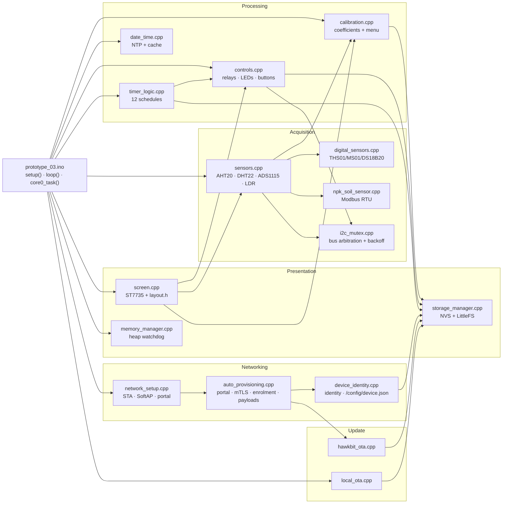

### 3.1.1 Module responsibilities

| Module | Owns | Key globals |
|---|---|---|
| `config.h` | All compile-time constants | — (header only) |
| `secret.h` | Build-time endpoints and the OTA password hash | `HAWKBIT_BASE_URL`, `MQTT_HOST`, `MQTT_PORT`, `OTA_PASSWORD_HASH`, `MQTT_USER` |
| `storage_manager.cpp` | NVS namespaces, LittleFS mount | `prefs`, `wifi_prefs`, `mqtt_prefs`, `ota_prefs` |
| `sensors.cpp` | AHT20, DHT22, ADS1115, LDR | `cached_temp[4]`, `cached_humidity[4]`, `cached_moisture[4]`, `cached_ldr`, `aht_temp`, `aht_humidity`, `sensorsPaused` |
| `digital_sensors.cpp` | Sonoff probe families | presence and type tables |
| `npk_soil_sensor.cpp` | Modbus RTU, CRC, DE/RE | poll state machine, per-sensor ID map |
| `calibration.cpp` | Coefficients, calibration UI | min/max per channel |
| `controls.cpp` | MCP23017, relays, LEDs, buttons, power cycle | `mcp`, `relayStateCache[4]`, `cachedPortB`, `pcState` |
| `timer_logic.cpp` | Schedule evaluation | `prevTimerControlled[4]`, `_anyTimerActive` |
| `screen.cpp` | TFT rendering, dashboards, menus | framebuffer, screen indices |
| `date_time.cpp` | NTP, cached strings | GMT offset = UTC+6 |
| `network_setup.cpp` | STA, reconnect, portal server | AP state, portal handlers |
| `auto_provisioning.cpp` | Enrolment, credentials, MQTT, payload builders | `realmName`, `safe_assetId`, `safe_realmName`, `safe_provisioned`, `provState` |
| `hawkbit_ota.cpp` | DDI client, artifact fetch | OTA state |
| `local_ota.cpp` | LittleFS image generation | — |
| `i2c_mutex.cpp` | Mutex, stall detection, backoff | `i2cMutex`, backoff counters |
| `memory_manager.cpp` | Heap accounting | — |
| `device_identity.cpp` | `/config/device.json` | asset ID, realm |

## 3.2 Task and Concurrency Model

The firmware uses **two tasks**, not three. There is no dedicated sensor task — sensor acquisition happens inline in `loop()`.

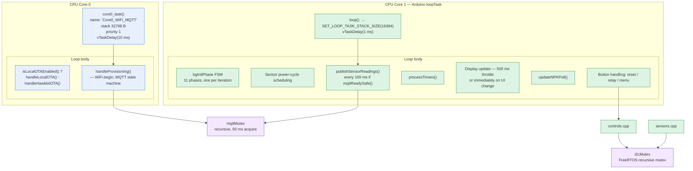

### 3.2.1 Task table

| Task | Core | Priority | Stack | Period | Responsibility |
|---|---|---|---|---|---|
| `core0_task` | **0** | 1 | 32,768 B | 10 ms | OTA polling (local or hawkBit), `handleProvisioning()`. Owns all WiFi and MQTT socket work. |
| `loop()` (Arduino `loopTask`) | **1** | 1 (Arduino default) | 16,384 B (overridden by `SET_LOOP_TASK_STACK_SIZE(STACK_CORE1_DISPLAY)`) | 1 ms | Background-init FSM, timers, buttons, display, sensor polling, publish scheduling. |
| Idle task | 0 | 0 | — | — | ESP-IDF idle; runs `vTaskDelay` bookkeeping. |

### 3.2.2 Concurrency hazards

**Cross-core shared state.** `core0_task` (core 0) and `loop()` (core 1) both touch the same globals. The MQTT publish helpers are called from core 1 while the MQTT socket is managed on core 0. The `mqttMutex` (recursive, 50 ms acquire) guards publish operations; `mqttReadySafe()` and `mqttConnectedSafe()` read connection flags without taking it.

> ⚠ **Non-atomic multi-byte flags.** `safe_provisioned`, `mqttConnected` and similar `bool`/`int` flags are read and written from both cores without atomics or memory barriers. On ESP32-S3 a `bool` write is a single `sb`, and the cache-coherent shared-RAM data path makes this benign in practice, but the pattern is fragile.

**⚠ Documentation/comments reference a task that does not exist.** `controls.cpp:405` states *"Wait 100ms for SensorTask to exit any ongoing I2C operations"*, but there is no SensorTask. Sensor reads happen in `loop()` on core 1. The wait is therefore against a task that will never signal; it works only because the I²C mutex is acquired after the delay. See §10.3-5.

### 3.2.3 I²C bus arbitration

`i2c_mutex.cpp` implements a mutex plus a **stall detector and exponential backoff**, which is the most defensive part of the firmware.

| Behaviour | Value / logic |
|---|---|
| Mutex type | FreeRTOS recursive mutex, created by `initI2CMutex()` in `setup()` |
| Button-read acquire | 20 ms timeout |
| Relay-write acquire | 50 ms timeout |
| LED-write acquire | 20 ms timeout |
| Wire timeout | 150 ms (`Wire.setTimeOut(150)`) |
| Stall threshold | Transaction elapsed > 40,000 µs |
| On stall | `i2cReportFailure()` → enters backoff; the mutex is released without updating the shadow state |
| On success | `i2cReportSuccess()` |
| On mutex timeout | `i2cReportMutexTimeout()` — write skipped, retried next cycle |
| During backoff | `i2cBusInBackoff()` is true; cached state is reused so buttons and display stay responsive without touching a stuck bus |

The 40 ms threshold is derived from measurement, documented inline at `controls.cpp:132-134`: *"A healthy read at 50 kHz takes ~2 ms. A >40 ms read means we hit the Wire timeout."*

## 3.3 Boot Sequence and First-Run Provisioning

### 3.3.1 `setup()` — synchronous phase

Executed on core 1 by the Arduino `loopTask`.

```mermaid
sequenceDiagram
    participant HW as Hardware
    participant S as setup()
    participant T0 as core0_task
    participant L as loop()

    HW->>S: esp_brownout_disable() (DISABLE_BROWNOUT=true)
    S->>S: Serial.begin(115200); delay(500)
    S->>S: esp_reset_reason() — log cause
    Note over S: If ESP_RST_POWERON: delay(500); ESP.restart()<br/>→ guarantees one clean reboot on every power-up
    S->>S: initI2CMutex()
    S->>S: Wire.begin(8,9); setTimeOut(150); setClock(100000)
    S->>S: analogReadResolution(12)
    S->>S: psramFound() — log size or warn
    S->>S: initStorage()  (NVS namespaces)
    S->>S: initScreen()   (ST7735 init)
    S->>S: initLittleFS()
    S->>S: displayLogo(); digitalWrite(PIN_TFT_LED, HIGH)
    S->>S: initControls() (MCP23017 @ 0x20, configure all pins)
    S->>S: g_setupFinishTime = millis()
    S->>T0: xTaskCreatePinnedToCore(core0_task, "Core0_WiFi_MQTT", 32768, NULL, 1, NULL, 0)
    S-->>L: return → loop() begins
```

**Power-on double restart.** On `ESP_RST_POWERON` the firmware deliberately delays 500 ms then calls `ESP.restart()`. The comment at `prototype_03.ino:109` explains it: *"Restarting in 500ms to ensure I2C stability"*. Consequence: **every cold boot takes roughly 1 second longer and performs two boots.** Field technicians should expect this and not report it as a fault.

⚠ **Brownout handling.** `DISABLE_BROWNOUT` is `true`, so `esp_brownout_disable()` is called first thing in `setup()`. An earlier implementation used an `__attribute__((constructor))` hook writing `RTC_CNTL_BROWN_OUT_REG` directly; it is commented out at `prototype_03.ino:87-91` because *"The old `__attribute__((constructor))` approach caused RTCWDT crash before PSRAM init."* The register write is also commented at lines 89-91, leaving only a stray closing brace on line 90.

⚠ **No watchdog.** `esp_reset_reason()` reports `ESP_RST_INT_WDT` and `ESP_RST_TASK_WDT`, and a `coredump` partition exists — but no watchdog is registered in `setup()`. The RTC/brownout detector is additionally disabled. See §2.5.3.

### 3.3.2 Background initialisation FSM

Initialisation continues in `loop()` as an 11-phase state machine. **Each phase runs exactly once per `loop()` iteration**, so the whole sequence completes in about 11 ms of boot time — deliberately, so no single subsystem blocks the dashboard.

| Phase | Action | Notes |
|---|---|---|
| **0** | Wait for sensor stabilisation | Holds until 1000 ms after `g_setupFinishTime`. Comment: cold-boot probes receive power only at the end of `setup()` via `SENSOR_POWER`, need ~1 s before probing or every I²C transaction times out at 50 ms each and freezes the dashboard. |
| 1 | `initSensors()` | ADS1115 (3 retries, 100 ms apart, `recoverI2CBus()` between), LDR pin mode, AHT20, then 4 × DHT22 via `DHTesp` |
| 2 | `initCalibration()` | ⚠ **Empty function body** — `void initCalibration() {}` |
| 3 | `initNetworkSetup()` | Reads NVS for cached credentials; if absent writes a default `/config/device.json` |
| 4 | `loadDeviceIdentity()` | Loads identity from LittleFS. On failure logs `CRITICAL: Device identity not loaded!`. Also sets `skipWiFi = isOfflineMode()` |
| 5 | AP-mode gate | If `isAPMode()`, runs `handleNetworkSetup()`. UP/DOWN toggle between the QR screen and the info screen. LEFT, RIGHT, or any of the 4 relay buttons skip WiFi and enter offline mode, after waiting for release with a hard 2000 ms timeout so an I²C failure cannot hang the device. Phase is held until AP mode resolves. |
| 6 | WiFi mode | `WIFI_STA` + `setAutoReconnect(true)`, or `WIFI_OFF` when skipping. ⚠ `WiFi.begin()` is deliberately **not** called here — core 0 does it in `handleProvisioning()` so core 1 never blocks. |
| 7 | `initNPK()` | Modbus RTU driver init |
| 8 | `initProvisioning()` | Loads NVS identity, restores realm and asset ID, registers subscriptions |
| 9 | `initDateTime()` | NTP client |
| 10 | End of initialisation | No-op |

### 3.3.3 ⚠ The `bgInitPhase` wrap trick

Phases 0 and 5 use `bgInitPhase--` to hold their current phase, immediately followed by the unconditional `bgInitPhase++` at the end of the block:

```cpp
static uint8_t bgInitPhase = 0;
if (bgInitPhase < 11) {
  switch (bgInitPhase) {
    case 0:
      if (g_setupFinishTime > 0 && millis() - g_setupFinishTime < 1000) {
        bgInitPhase--;      // 0 -> 255
      }
      break;
    ...
  }
  bgInitPhase++;            // 255 -> 0  (wraps)
}
```

Because `bgInitPhase` is `uint8_t`, `0 - 1` yields 255 and `255 + 1` truncates back to 0. The hold therefore works **by accident of unsigned wraparound**. It is *not* a live defect, but it is a genuine maintainability hazard: inserting a `continue`, an early `return`, or any statement between the decrement and the increment would leave the phase at 255, permanently satisfy `bgInitPhase < 11` as false, and abort all remaining initialisation. Replace with a `while` loop or an explicit "phase complete" flag. Recorded in §10.4.

### 3.3.4 Provisioning state machine

`auto_provisioning.cpp` defines a seven-state machine:

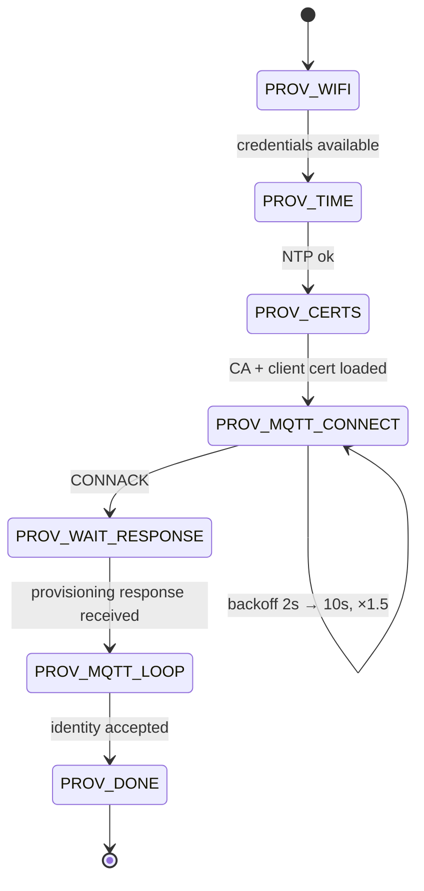

Reconnect policy, from `config.h`: initial 2,000 ms, ceiling 10,000 ms, multiplier 1.5, tracked in `reconnectAttempts`.

### 3.3.5 Provisioned-versus-publish gate

`initProvisioning()` restores identity from NVS but deliberately does **not** set the provisioned flag. The inline comment is explicit:

> *"We do NOT set provisioned=true yet. We must wait for the actual MQTT connection and the provisioning response callback to ensure the socket is authenticated before allowing Core 1 to publish."*

Publishing is gated on `safe_provisioned` and a non-empty `safe_assetId`, checked at the top of `publishGroupJson()`. This is a correct design — it prevents a device from broadcasting telemetry before its TLS session is authenticated.

## 3.4 Sensor Drivers and Calibration

### 3.4.1 Sensor index model

The code addresses sensors by a single unified index `0..4`, which mixes the onboard sensor with the four external slots:

| Index | Physical device | Driver | Temperature source | Humidity source |
|---|---|---|---|---|
| **0** | Onboard AHT20 | I²C `aht_temp` / `aht_humidity` | `aht_temp` | `aht_humidity` |
| **1** | Probe slot 1 | GPIO 10 | `getDigitalTemperature(0)` if type 1 (THS01) or 4 (DS18B20); else `cached_temp[0]` (DHT22) | `getDigitalHumidity(0)` if type 1 only |
| **2** | Probe slot 2 | GPIO 11 | as above, `portIndex` 1 | type 1 only |
| **3** | Probe slot 3 | GPIO 12 | as above, `portIndex` 2 | type 1 only |
| **4** | Probe slot 4 | GPIO 13 | as above, `portIndex` 3 | type 1 only |

`getTemperature()` and `getHumidity()` (no argument) are overloads returning the onboard AHT20 values only.

**Digital sensor type codes**, inferred from the dispatch logic:

| Code | Type | Provides temperature | Provides humidity | Provides moisture |
|---|---|---|---|---|
| 0 | Unknown / absent | — | — | — |
| 1 | **THS01** | ✔ | ✔ | — |
| 2 | **MS01** | — | — | ✔ (used by `getMoisturePercent()`) |
| 3 | *Reserved — not dispatched* | — | — | — |
| 4 | **DS18B20** | ✔ | — | — |

⚠ **Type code 3 is defined but never handled.** The dispatch checks only types 1, 2 and 4. See §10.2.

### 3.4.2 Moisture — ADS1115 acquisition

Moisture is measured by four ADS1115 single-ended channels and converted to percent.

| Property | Value |
|---|---|
| Multiplexer settings | `MUX_BY_CH[] = {0x4000, 0x5000, 0x6000, 0x7000}` → channels 0–3, single-ended |
| Read cadence | `MOISTURE_READ_INTERVAL 500` ms, with a per-call guard of `MOISTURE_READ_INTERVAL / 4` = 125 ms |
| Commented cost | *"ADS1115 moisture reads via I2C — slow (~8 ms × 4 channels = 32 ms)"* |
| Smoothing | 3-sample moving average per channel (`moisture_history[4][3]`, `moisture_idx[4]`, `moisture_count[4]`) |
| Defaults | `DEFAULT_MOISTURE_MIN 3000`, `DEFAULT_MOISTURE_MAX 1880` |
| Scale to percent | `map(raw, rangeMin, rangeMax, 0, 100)` |

⚠ **Inverted defaults are deliberate.** Wet soil produces a *lower* ADC count than dry soil, so the defaults are inverted (min 3000 > max 1880). The code handles this explicitly:

```cpp
int16_t rangeMin = min(getMoistureMin(channel), getMoistureMax(channel));
int16_t rangeMax = max(getMoistureMin(channel), getMoistureMax(channel));
```

This normalisation is correct and must be preserved. Any refactor that assumes `min < max` will invert every moisture reading.

**Digital override.** If slot *n* holds an MS01 (`getDigitalSensorType(channel) == 2`), `getMoisturePercent(channel)` returns `getDigitalMoisture(channel)` and ignores the ADC entirely. The ADS1115 channel for that slot is then redundant.

**Out-of-range guard.** A raw value outside `[rangeMin, rangeMax]` yields 0 and is not cached.

### 3.4.3 Light — LDR

`PIN_LDR` = GPIO 1 (ADC1_CH0). `analogReadResolution(12)` gives 0–4095. Defaults `DEFAULT_LDR_MIN 0`, `DEFAULT_LDR_MAX 4095`; percent is the same `map()` scale. Note that LDR percent is **brighter-is-higher** whereas moisture is **wet-is-higher** — an inversion to keep in mind when setting alert thresholds in the dashboard.

### 3.4.4 Calibration model

Calibration is **two-point linear**: for each quantity a stored min/max raw pair defines the endpoints of a full-scale mapping onto the reporting range.

| Quantity | Stored endpoints | Output range |
|---|---|---|
| Temperature (per slot) | `min`, `max` raw | °C |
| Humidity (per slot) | `min`, `max` raw | % RH |
| Moisture (per channel 0–3) | `getMoistureMin(ch)`, `getMoistureMax(ch)` | 0–100 % |
| Light | `getLDRMin()`, `getLDRMax()` | 0–100 % |

Persistence is NVS namespace `PREFS_NAMESPACE` = `"calibration"` (see `storage_manager.h:10`).

Calibration is also **editable over MQTT** — `writeattributevalue` handlers update the coefficients, which is why the coefficients appear in the OpenRemote asset model.

The calibration UI is a five-item main menu (`calibration.cpp:65`):

```cpp
static const char *mainItems[] = {"Calibration", "Timers", "System", "Layout", "About"};
```

with a twelve-item timer submenu (`calibration.cpp:451-452`) listing `Timer1` … `Timer12`.

Navigation uses `DEBOUNCE_DELAY_MS` (200 ms from `config.h`) for Left/Right repeat suppression (`calibration.cpp:221`, `calibration.cpp:234`).

⚠ **`initCalibration()` is an empty stub** (`calibration.cpp:243`). Whatever state initialisation calibration previously required no longer happens. Since `loop()` phase 2 calls it and nothing occurs, calibration state relies entirely on lazy NVS reads with defaults.

### 3.4.5 NPK soil sensor — Modbus RTU

| Property | Value |
|---|---|
| Bus | RS485 half-duplex via MAX485/SP3485 |
| Direction | `PIN_NPK_DE_RE` GPIO 15 drives `/RE` and `DE` together |
| UART RX / TX | GPIO 16 / GPIO 17 |
| Protocol | Modbus RTU, function code 4 (read input registers) — **NOT SPECIFIED IN SOURCE**, inferred from standard 7-in-1 probe implementations. **RECOMMENDED INDUSTRY-STANDARD SPECIFICATION:** confirm against the probe datasheet; the common baseline is Modbus address 1, 9600 baud, 8N1, function 4, with NPK/pH/EC/temp/moisture in a contiguous register block at 0x0002. |
| Response timeout | `TIMEOUT_NPK_RESPONSE` 1000 ms |
| Poll interval, present sensor | `INTERVAL_NPK_REQUEST` 5000 ms |
| Poll interval, absent sensor | `INTERVAL_NPK_SCAN_MISSING` 15000 ms |

`updateNPKPoll()` is called once per `loop()` iteration and manages an **adaptive polling engine** that cycles through sensor IDs 1–4 and performs a slower re-scan for slots believed absent. `handleNPKResponse()` is called every iteration to drain the UART receive path.

**Power-cycle coupling.** ⚠ Because `MCP_SENSOR_POWER` gates the probe rail and the cycle happens at 02:00, all four NPK probes are unpowered for ~850 ms daily. Any NPK poll in flight at that moment will time out and report invalid data.

## 3.5 Control Output and Manual Override

### 3.5.1 Relay output

Four relays on MCP23017 Port A, **active HIGH**. `setMCPRelay(index, state)` maintains a shadow cache (`relayStateCache[4]`) and skips redundant hardware writes.

Three guards on every write, in order:

1. **Cache check** — return if unchanged.
2. **Backoff check** — if `i2cBusInBackoff()`, return and retry next cycle.
3. **Mutex** — `xSemaphoreTake(i2cMutex, 50 ms)`; on timeout call `i2cReportMutexTimeout()` and return.

After the write, if elapsed > 40 ms the failure is reported and **the cache is deliberately not updated**, so the write retries on the next call. This guarantees relays are never left in an unknown state.

### 3.5.2 MCP23017 self-recovery

`controls.cpp` contains a genuine hardware-fault recovery path. After each batched Port B read (`GPIOB` register `0x13`), the code also reads `IODIRA` (`0x00`):

```cpp
if (Wire.read() == 0xFF) {   // IODIRA == 0xFF => all pins inputs => reset occurred
  mcp_reset = true;
}
```

On detection, `recoverMCP23017()`:

1. Reconfigures all 8 Port B buttons as `INPUT_PULLUP`.
2. Reconfigures the 3 LEDs as `OUTPUT`.
3. **Restores relays to their cached states** — not to OFF.
4. **Restores `MCP_SENSOR_POWER` HIGH** — re-powering the sensors.
5. `vTaskDelay(100 ms)` for the sensors to boot.
6. Calls `reinitI2CSensors()` to re-initialise the ADS1115 and AHT20 that lost power.

The rationale is documented inline: *"If IODIRA is 0xFF, it's highly likely the MCP23017 reset (lost pull-ups) due to a sensor inrush current brownout."* This is a well-engineered defence against the exact failure the brownout-disable setting invites.

### 3.5.3 Manual override from the front panel

Four relay buttons on Port B B0–B3. A short press toggles the relay and forces an immediate publish:

```cpp
if (!currentRelayButton && lastRelayButtonState[i]) {
  if (millis() - relayButtonPressTime[i] < 2000) {   // short press
    toggleRelay(i);
    publishRelaysNow();                               // force publish current state
  }
}
```

A press of 2 s or longer is **not** a relay toggle. Buttons are deliberately ignored for the first 3,000 ms of boot (`controls.cpp:96`) to prevent false presses from inrush transients.

⚠ **Only `isButtonPressed(index)` for `index < 4` returns meaningful data** — the function early-returns `false` for `index >= 4`. Relay indices 0–3 are valid; anything above is silently false.

### 3.5.4 Button processing timings — ⚠ two different debounce constants

| Constant | Value | Used by |
|---|---|---|
| `DEBOUNCE_DELAY` (local to `controls.cpp:87`) | **40 ms** | Port B hardware debounce in `updateButtonCache()` |
| `DEBOUNCE_DELAY_MS` (`config.h:193`) | **200 ms** | Left/Right repeat suppression in `calibration.cpp` only |
| Menu-button inline debounce (`prototype_03.ino:366`) | **50 ms** | Right-button press qualification |
| Relay-button threshold | 2000 ms | Short vs long press |

Three different debounce mechanisms coexist. See §10.2.

### 3.5.5 Timer scheduling

`processTimers()` evaluates all 12 timers every `loop()` iteration.

**Day-mask encoding.** `TimerConfig::dayMask` is a bitmask with an unconventional bit order:

| Bit | 0 | 1 | 2 | 3 | 4 | 5 | 6 |
|---|---|---|---|---|---|---|---|
| Day | **Sat** | **Sun** | **Mon** | **Tue** | **Wed** | **Thu** | **Fri** |

Standard `tm_wday` is `0 = Sunday … 6 = Saturday`. The conversion is `currentDayBit = (wday + 1) % 7`. ⚠ **Saturday is bit 0, not bit 6.** Any external tooling that writes `dayMask` using conventional ordering will produce schedules offset by two days.

**Window evaluation.** For each enabled timer whose day bit is set:

| Condition | Active when |
|---|---|
| `startMins < endMins` (normal, e.g. 08:00–20:00) | `startMins <= now < endMins` |
| `startMins > endMins` (overnight, e.g. 22:00–06:00) | `now >= startMins` **or** `now < endMins` |
| `startMins == endMins` | **Never active** — the timer is silently ignored |

**Relay ownership.** The critical safety property is that timers only turn a relay **off** if the timer previously turned it **on**:

```cpp
if (relayActiveON[r]) {
  if (!getRelayState(r)) { setMCPRelay(r, true); stateChanged = true; }
  prevTimerControlled[r] = true;
} else if (prevTimerControlled[r]) {
  if (getRelayState(r)) { setMCPRelay(r, false); stateChanged = true; }
  prevTimerControlled[r] = false;
}
// If relay was never timer-controlled, leave it alone (manual/server)
```

This prevents a server-side or manual command from being undone when a timer window closes. `_anyTimerActive` drives the timer LED.

⚠ **`loadTimerSettings()` is never called.** It is declared in `storage_manager.h:63` and defined at `storage_manager.cpp:215`, but there are **no call sites** anywhere in the firmware. Timers are read on demand via `getTimerSetting(i)` inside the `processTimers()` loop, so the system works — but the intent of a bulk load into RAM is not implemented. See §10.2.

⚠ **`initTimerLogic()` is never called.** `prevTimerControlled[4]` relies on static zero-initialisation instead. Benign today; fragile if the initialisation semantics change.

### 3.5.6 Status LEDs

| LED | Port bit | Behaviour |
|---|---|---|
| Timer | A5 | Solid ON while `_anyTimerActive`, else OFF |
| Server | A6 | Solid ON while `mqttConnectedSafe()`; otherwise **blink 500 ms** while connected-but-not-published or attempting |
| Power / WiFi | A7 | **Blink 200 ms** in AP mode; **solid ON** when `WiFi.status() == WL_CONNECTED`; **blink 1000 ms** when WiFi is down |

All three are written under a **single** mutex acquisition, and only if at least one LED actually changed (`needsUpdate`). Writes are skipped entirely during I²C backoff so a stuck bus can never freeze the display loop.

### 3.5.7 Sensor power-cycle FSM

`requestSensorPowerCycle()` only transitions out of `PC_IDLE`, so overlapping requests are coalesced. `handleSensorPowerCycle()` is non-blocking.

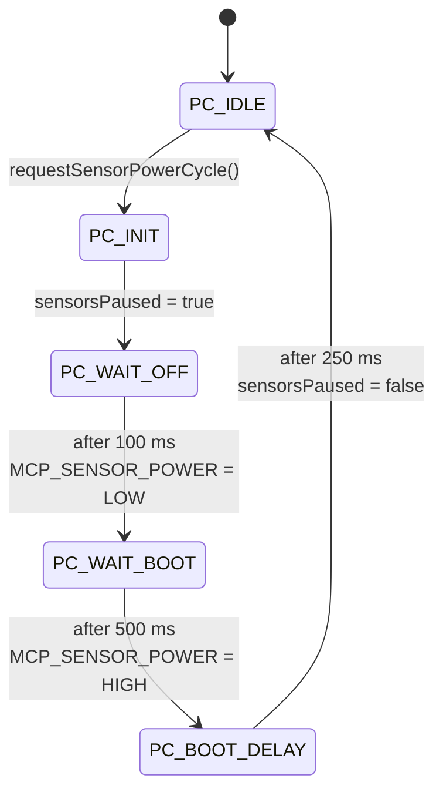

Total cycle ≈ 850 ms. `sensorsPaused` is a `volatile bool` checked by `sensors.cpp:122` to gate reads.

**Scheduling.** When NTP is synced, the loop matches the current hour and minute against `SENSOR_POWER_CYCLE_SCHEDULE[]` and fires once per matching minute, guarded by `lastCycledHour`/`lastCycledMinute`. Without NTP it falls back to a 12-hour interval (`43200000` ms).

⚠ **Fallback timer initialisation.** `lastSensorPowerCycle` is initialised to `now`, so the guard `if (lastSensorPowerCycle != 0)` is always true and a power cycle occurs 12 hours after boot even if the scheduled time has already passed that day. This is the documented fallback, but note it means an unsynced device power-cycles roughly 12 h after every boot rather than at a fixed wall-clock time.

## 3.6 Display and Local UI

### 3.6.1 Hardware and framebuffer

| Property | Value |
|---|---|
| Controller | ST7735S, 1.8" |
| Resolution | 160 × 128 (`SCREEN_WIDTH`, `SCREEN_HEIGHT`) |
| Orientation | Landscape |
| Interface | SPI: SCK 42, MOSI 41, CS 40, DC 39, RST 38, LED 21 |
| Backlight | `digitalWrite(PIN_TFT_LED, HIGH)` after `displayLogo()` |

Rendering is double-buffered into a RAM framebuffer and pushed with `refreshScreen()`. `layout.h` (13,226 B) holds the widgets, fonts and geometry.

### 3.6.2 Dashboard structure

Nine screens, cycled with UP/DOWN:

| Index | Screen | Sensor | Content |
|---|---|---|---|
| 0 | **ONBOARD** | onboard AHT20 | Temperature, humidity, light, connectivity |
| 1 | ENV 1 | slot 1 | + moisture channel 0 |
| 2 | NPK 1 | slot 1 | moisture, temperature, EC, pH, N, P, K |
| 3 | ENV 2 | slot 2 | + moisture channel 1 |
| 4 | NPK 2 | slot 2 | |
| 5 | ENV 3 | slot 3 | + moisture channel 2 |
| 6 | NPK 3 | slot 3 | |
| 7 | ENV 4 | slot 4 | + moisture channel 3 |
| 8 | NPK 4 | slot 4 | |

The index → sensor/type mapping is:

```cpp
int adjustedKnob = g_dashboardScreenIdx - 1;  // 0..7
sensorID = (adjustedKnob / 2) + 1;            // 1..4
screenType = adjustedKnob % 2;                // 0=ENV, 1=NPK
```

Navigation is suppressed during calibration and during AP mode (`bgInitPhase <= 6`).

### 3.6.3 Render throttle

```cpp
if (uiChanged || (now - lastDisplayUpdate >= 500)) { ... }
```

The dashboard repaints at **2 FPS**, or instantly when any of the four navigation buttons changes state. A comment at line 420 reads *"500ms throttle - 2 FPS, OR instantly on UI change"*, while line 525 says *"once per 100ms for ALL screens"* — the latter refers to `refreshScreen()` and is misleading.

⚠ **`INTERVAL_DISPLAY_UPDATE` (50 ms) in `config.h:38` is dead.** It is not referenced anywhere in the firmware; the 500 ms value is hardcoded in the `.ino`. Anyone tuning the constant will observe no effect. See §10.2.

### 3.6.4 Boot overlays

| Condition | Display |
|---|---|
| `< 2000 ms` after `setup()` | `return` — logo stays, no dashboard |
| `isInCalibration()` | Calibration menu |
| `isAPMode() && bgInitPhase <= 6` | `apScreenIdx == 0` → `displayAPQRScreen(ap_qr_bitmap, AP_QR_SIZE, AP_QR_ROW_BYTES)`; else `displayAPInfoScreen()` |
| otherwise | Dashboard |

In AP mode UP and DOWN toggle `apScreenIdx` between the QR bitmap (from the generated `ap_qr.h`) and the textual connection instructions.

### 3.6.5 NaN handling

The dashboard converts invalid readings to sentinel values before drawing: temperature `-999`, humidity `-1`, moisture `-1`. For NPK screens an invalid sensor draws `displayNPKScreen(sensorID, -1, -101.0f, -1, -1.0f, -1, -1, -1)`. The `-101.0f` temperature sentinel is distinct from the `-999` used elsewhere. See §10.2.

### 3.6.6 Header, footer and connectivity

```cpp
int connState = 0;
if (mqttConnectedSafe())      connState = 2;  // LIVE
else if (WiFi.status() == WL_CONNECTED) connState = 1;  // Connecting...
else                          connState = 0;  // X
```

- `drawHeader(sensorID, screenTitle, ldr, connState == 2)` — title is `ONBOARD`, `ENV` or `NPK`; shows light level and live indicator.
- `drawFooter(getTimeString(), getDateString(), rssi)` — `rssi = WiFi.RSSI()` or `-127` when not connected.

⚠ `-127` is rendered as an RSSI value unless the draw routine special-cases it.

### 3.6.7 Physical button semantics

| Button | Short press | Long press |
|---|---|---|
| UP / DOWN | Previous / next dashboard screen | — |
| LEFT | Back | **Hold 3,000 ms → reboot** (`showMessage("Rebooting...")`, 1 s delay, `ESP.restart()`) |
| RIGHT | Toggle °C / °F (≥50 ms) | **≥1,000 ms → enter calibration** |
| B0–B3 | Toggle relay 1–4 + `publishRelaysNow()` | — |

⚠ The Left-button 3-second reboot has **no confirmation prompt and no on-screen warning**. `LONG_PRESS_MS` is `2000`, so the reboot threshold (3000 ms) deliberately sits above it.

⚠ The source carries a leftover comment at `prototype_03.ino:318-321` recording design indecision: *"Let's use Relay 4 button (index 3) for reset if held long enough, since encoder switch is gone. Actually we can use Left button + Right button combo? Let's stick to Left Button (Back)..."* — the encoder previously on the board is gone, and LEFT was chosen.

## 3.7 Network State Machines

### 3.7.1 Station mode

| Behaviour | Value |
|---|---|
| Mode | `WIFI_STA`, `setAutoReconnect(true)` |
| Connect call | `WiFi.begin()` from `core0_task` in `handleProvisioning()` — never from `loop()` |
| Overall budget | `TIMEOUT_WIFI_CONNECT` 60,000 ms |
| Per-attempt timeout | `WIFI_CONNECT_TIMEOUT_MS` 15,000 ms |
| Reconnect backoff | 2,000 → 10,000 ms, ×1.5 |
| Offline mode | `WiFi.mode(WIFI_OFF)`; entered by LEFT/RIGHT/relay-button long-press at phase 5 |

### 3.7.2 Access point mode

| Property | Value |
|---|---|
| Default SSID | `AP_SSID_DEFAULT` = `"DIBL IoT"` |
| Default password | `AP_PASSWORD_DEFAULT` = `"12345678"` |
| Address | 192.168.4.1 (ESP-IDF default) |
| Portal | `http_ap` server; **NOT SPECIFIED IN SOURCE** — exact server type and route table are in `network_setup.cpp`; see §4.5 for the verified routes |
| Indicators | Power LED blinks 200 ms |

⚠ The default AP password is an eight-character numeric string, published in `config.h` for every unit. It is not a secret and offers no protection. See §10.1-3.

### 3.7.3 Offline mode

`setOfflineMode(true)` is entered from the AP-mode gate. `skipWiFi` then forces `WiFi.mode(WIFI_OFF)` and prevents credential setup. The dashboard still renders, still shows live sensor data, and local relay/button/calibration control still work — the unit becomes a standalone local controller. This is a deliberate offline-operations feature.

### 3.7.4 Time synchronisation

| Property | Value |
|---|---|
| Default offset | `DEFAULT_GMT_OFFSET_SEC` = `6 * 3600` → **UTC+6 (Asia/Dhaka)** |
| Per-attempt timeout | `NTP_SYNC_TIMEOUT_MS` 8,000 ms |
| Overall budget | `TIMEOUT_TIME_SYNC` 20,000 ms |
| Cached string refresh | `INTERVAL_TIME_UPDATE` 10,000 ms |
| Gate | Sensor power cycling and all timer evaluation depend on `isTimeNTPSynced()` |

⚠ **The UTC+6 default is a hardcoded assumption**, not a configuration option. There is no timezone setting in the UI, no MQTT-delivered timezone, and no NTP-provided offset. Every deployment outside UTC+6 needs a source change. See §10.4.

## 3.8 Storage and Persistent State

### 3.8.1 NVS namespaces

`storage_manager.cpp` holds four `Preferences` instances:

| Variable | Namespace | Contents |
|---|---|---|
| `prefs` | `"calibration"` | LDR min/max, moisture min/max per channel, device ID, LED interval |
| `wifi_prefs` | *(WiFi)* | SSID, password |
| `mqtt_prefs` | *(MQTT)* | host, port, client ID, provisioned asset ID, realm |
| `ota_prefs` | *(OTA)* | `OtaState` — action ID, target version, pending-feedback and rollback flags |

⚠ The WiFi, MQTT and OTA namespace **name strings are not defined in `storage_manager.h`** — only `"calibration"` is a named macro. The other three are constructed inline, so their exact strings are not discoverable from the header. Verify with `nvs_dump` before migrating data.

### 3.8.2 Persisted relay state

```cpp
void setRelayState(uint8_t index, bool state);  // index 0-3
bool getRelayState(uint8_t index);
```

Relay states survive reboot in a dedicated namespace. On `initControls()` the hardware outputs are initialised to **LOW (off)** regardless of the stored state; the stored state is only consulted later. ⚠ Therefore a relay that was ON at power-off comes back **off**, and the cached-state restoration only applies in the `recoverMCP23017()` path. If the intended behaviour is to resume the previous state, `initControls()` does not do it. See §10.2.

### 3.8.3 LittleFS device identity

`/config/device.json` on the LittleFS volume holds the device identity. It is:

- written by `network_setup.cpp:58` if absent (a default is created),
- read by `device_identity.cpp:64`,
- listed as a verified file by `ui_files_upload/ui_files_upload.ino:87`.

### 3.8.4 Reset to defaults

`resetStorageToDefaults()` exists in `storage_manager.h:78`. There is no UI binding for it in the firmware, and no MQTT handler found. It appears to be API-only. See §10.4.

## 3.9 Over-the-Air Update

Two mutually exclusive OTA paths are compiled in, selected at runtime:

```cpp
if (isLocalOTAEnabled()) {
  handleLocalOTA();     // LittleFS image flash path
} else {
  handleHawkbitOTA();   // hawkBit DDI over HTTPS
}
```

### 3.9.1 hawkBit path

| Property | Value |
|---|---|
| Base URL | `HAWKBIT_BASE_URL` = `«https://master.senspanel.com/ota»` — resolved to the live hostname in `secret.h` |
| Polling | `doc["config"]["polling"]["sleep"]` in the response governs the next poll interval |
| Auth | Client certificate (tenant CA-issued) + OTA password |
| OTA password | `dibl-iot`, compared against `OTA_PASSWORD_HASH` in `secret.h` (SHA-256) — value redacted |
| State | `OtaState { actionId[32], targetVersion[32], pendingFeedback, rollbackPending }`, persisted |
| Rollback | `rollbackPending` flag implemented; the `coredump` partition and dual OTA slots support rollback |

### 3.9.2 Local OTA path

`local_ota.cpp` (2,760 B) generates and flashes the LittleFS image. This is the development/bench path for updating the filesystem without a broker round trip.

⚠ **Production hazard.** `isLocalOTAEnabled()` gates which path runs. If that flag can be set over MQTT or by a stored preference, an attacker who can publish to the device could redirect updates. Its source of truth is not documented in the firmware. See §10.1.

### 3.9.3 Update lifecycle

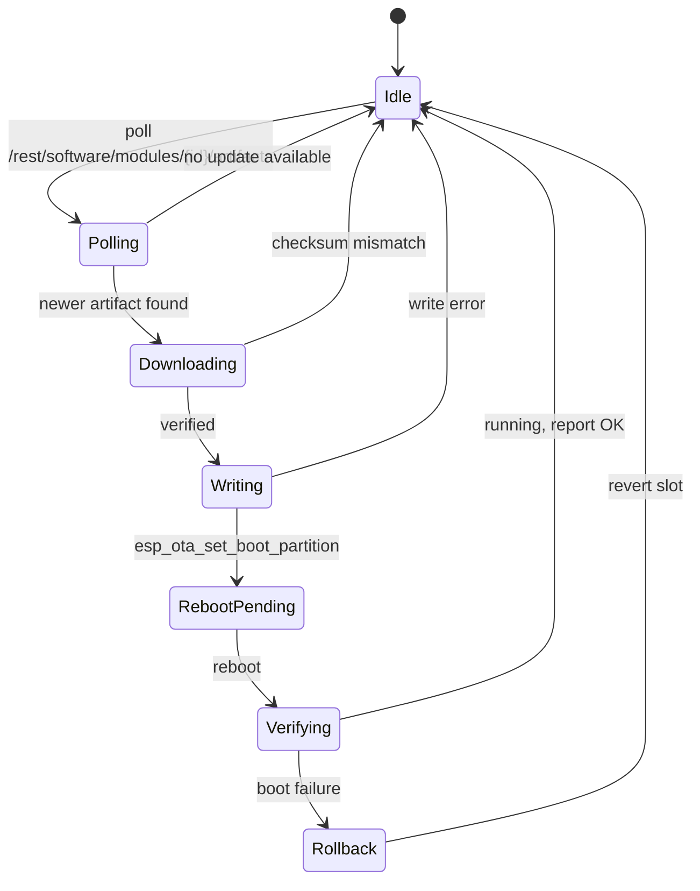

## 3.10 Error Codes and Diagnostics

### 3.10.1 Debug flags

All in `config.h:9-21`. Serial is 115200 baud.

| Flag | Default | Effect |
|---|---|---|
| `DEBUG_SYSTEM` | **`true`** | Master gate — most messages are additionally wrapped in `if (DEBUG_SYSTEM)` |
| `DEBUG_DIGITAL_SENSORS` | **`true`** | Digital probe messages |
| `DEBUG_PROVISIONING` | `false` | Provisioning internals |
| `DEBUG_MEMORY` | `false` | Heap reporting |
| `DEBUG_CONTROLS` | `false` | Relay/button internals |
| `DEBUG_CALIBRATION` | `false` | Calibration internals |
| `DEBUG_SENSORS` | `false` | Analog sensor internals |
| `DEBUG_SCREEN` | `false` | Display internals |
| `DEBUG_DATETIME` | `false` | NTP internals |
| `DEBUG_NPK` | `false` | Modbus internals |
| `DEBUG_OTA` | `false` | OTA internals |
| `DEBUG_NETWORK` | `false` | Network internals |
| `DEBUG_STORAGE` | `false` | NVS internals |

⚠ **Nested debug gating.** The pattern is `if (MODULE_DEBUG) if (DEBUG_SYSTEM) Serial.print...`. `DEBUG_SYSTEM = true` therefore does **not** enable a module's messages on its own — the module flag must also be true. Conversely `DEBUG_SYSTEM = false` silences everything even where a module flag is on. Field diagnosis requires enabling **both** flags.

A third flag exists locally: `STORAGE_DEBUG` in `storage_manager.h:7`, default `false`, and `PROVISION_DEBUG` in `auto_provisioning.cpp`.

### 3.10.2 Log tags

| Tag | Module |
|---|---|
| `[SETUP]` | `prototype_03.ino` |
| `[CORE0]` | `core0_task` |
| `[CORE1]` | `loop()` readiness |
| `[SENSORS]` | `sensors.cpp` |
| `[CONTROLS]` | `controls.cpp` |
| `[PROV]` | `auto_provisioning.cpp` |
| `[MQTT]` | subscription registration |
| `[STORAGE]` | `storage_manager.cpp` |

### 3.10.3 Non-fatal error handling

The firmware is designed to continue when a subsystem is missing. Both I²C devices retry three times and then degrade:

```
[SENSORS] WARNING: ADS1115 init failed after retries, continuing without ADC
[CONTROLS] WARNING: MCP23017 init failed after retries, continuing without I/O expander
[SENSORS] WARNING: Could not find AHT20? Check wiring
```

⚠ **Degraded mode with an MCP23017 failure means no relays, no LEDs and no buttons** — `controls.cpp` continues, but `setMCPRelay()` will silently no-op because the mutex-guarded write fails. The device will still publish telemetry. This combination (data flowing, no local control, no visual indication) is a common field complaint with a single root cause.

---

*End of §3.*

---

# §4. Communication Protocols and Data Formats

## 4.1 Protocol Stack Summary

| Layer | Protocol | Where | Notes |
|---|---|---|---|
| Application → Broker | **MQTT 3.1.1** | Device ↔ Mosquitto | Over TLS |
| Transport security | **TLS 1.2**, mutual | Device ↔ Mosquitto, Device ↔ hawkBit | Client certificate auth |
| Enrolment | **MQTT** request/response | Device ↔ OpenRemote Manager | `provisioning/{id}/request` / `response` |
| REST (asset read) | **HTTPS** | Device → OpenRemote | `GET /api/{realm}/asset/{assetId}` |
| REST (OTA) | **HTTPS** | Device → hawkBit | `/DEFAULT/controller/v1/{assetId}` |
| Wi-Fi join | **SoftAP + HTTP** | Operator → Device | Captive portal, `WebServer` on port 80 |
| Local UI | **SPI** | SoC → ST7735 | Framebuffer, 160 × 128 |
| Console | **UART** 115200 8N1 | Host → Device | `Serial`, `DEBUG_*` flags |
| Time | **NTP** | Device → NTP server | Gate for timers and power cycling |

**Not present in the firmware:** BLE (no library, no include), CoAP, LwM2M, HTTP/2, WebSocket, and LoRaWAN.

## 4.2 MQTT Topics and Payloads

### 4.2.1 Topic scheme

OpenRemote uses a structured, per-asset topic hierarchy. The device is both a publisher and a subscriber, and the two directions use different infixes.

| Direction | Template | Purpose |
|---|---|---|
| **Publish** | `{realm}/{deviceId}/writeattributevalue/{attribute}/{assetId}` | Device → OpenRemote, write attribute values |
| **Subscribe** | `{realm}/{deviceId}/attributevalue/{attribute}/{assetId}` | OpenRemote → Device, attribute change pushes |

Both are built with `snprintf` into a 512-byte buffer by `publishGroupJson()` and `subscribeToOperationalTopics()`.

⚠ **QoS and retain are not what the older documentation claims.** Every device publish uses the two-argument `mqtt.publish(topic, payload)` overload. That is **QoS 0 and not retained**. The provisioning GUI tool publishes at QoS 1. If the dashboard relies on retained messages for last-known values, that assumption does not hold for device-originated data. See §10.2-6.

⚠ **Topic buffers are 512 bytes.** `realmName`, `deviceId` and `assetId` are concatenated with no length validation. A pathological asset ID from the server could truncate the topic silently. Verify OpenRemote's ID length limits before any migration.

### 4.2.2 Telemetry attributes published by the device

Five attribute groups are published. All are deadband-gated except where noted.

| Group | Cadence | Keys | Gate |
|---|---|---|---|
| `EnvData` | on change | `light`, `t0`–`t4`, `h0`–`h4` | deadband: temp 0.5, hum 2.0, light 5.0 |
| `MoistureData` | on change | `m1`–`m4` | deadband 5.0 |
| `NPKData` | heartbeat only | `moisture01`–`04`, `temperature01`–`04`, `ec01`–`04`, `ph01`–`04`, `n-nitrogen01`–`04`, `p-phosphorus01`–`04`, `k-potassium01`–`04` | ⚠ none — see below |
| `SystemData` | every 3 s | device status | unconditional |
| `RelayData` | on change / forced | `r1`–`r4` | relay transitions and button presses |

Deadband constants from `config.h:76-79`:

```cpp
#define DEADBAND_TEMPERATURE 0.5f
#define DEADBAND_HUMIDITY    2.0f
#define DEADBAND_MOISTURE    5.0f
#define DEADBAND_LIGHT       5.0f
```

### 4.2.3 ⚠ `NPKData` is never deadband-gated

The NPK block reads:

```cpp
bool npkChanged = force;
if (npkChanged) { ... publishGroupJson("NPKData", doc); }
```

`npkChanged` is initialised to `force` and **never assigned again**. Therefore:

- when `force == false`, NPKData is **never** published, regardless of how much the NPK values change;
- when `force == true` (heartbeat every 30 s, or a forced relay publish), it publishes unconditionally.

Net effect: NPK telemetry is published roughly **every 30 seconds**, while the probes are polled every 5 seconds. Six out of every seven poll results are discarded. Given that NPK values are slow-moving, this is defensible as bandwidth management — but the deadband variables `lastMoist`, `lastEnv` style tracking was clearly intended for NPK too and was never wired up. See §10.2-7.

### 4.2.4 Payload formats

Every payload is a **flat JSON object of scalar values**, serialised by ArduinoJson into a 1024-byte buffer.

**`EnvData`**

```json
{
  "light": 42,
  "t0": 27.4,
  "h0": 61.2,
  "t1": "--",
  "h1": "--",
  "t2": 26.1,
  "h2": 58.8,
  "t3": 25.7,
  "h3": 60.1,
  "t4": 26.9,
  "h4": 59.4
}
```

- `light` is an integer percent.
- `t0`/`h0` are the onboard AHT20; `t1`–`t4`/`h1`–`h4` are probe slots 1–4.
- Missing or invalid readings are the **string** `"--"`, never `null` or `NaN`. A consumer must treat `"--"` as a string sentinel.
- Values are quantised to one decimal by `((int)(v * 10)) / 10.0`, which truncates rather than rounds.
- Humidity of exactly 0 is treated as invalid (`isnan(h) || h <= 0`), so a genuinely saturated 0 % RH reading is reported as `"--"`.

**`MoistureData`**

```json
{ "m1": 38, "m2": 41, "m3": "--", "m4": 29 }
```

Integer percent. Invalid when `m <= 0 || m > 100`.

**`NPKData`**

```json
{
  "moisture01": "35.2",
  "temperature01": "24.6",
  "ec01": "1",
  "ph01": "6.7",
  "n-nitrogen01": "42",
  "p-phosphorus01": "18",
  "k-potassium01": "155",
  "moisture02": "--",
  "temperature02": "--",
  "ec02": "--",
  "ph02": "--",
  "n-nitrogen02": "--",
  "p-phosphorus02": "--",
  "k-potassium02": "--"
}
```

⚠ **Every NPK value is a JSON string, not a number**, because each is built with ArduinoJson's `String(value, 1)` conversion. `"ec01": "1"` is a *string* containing `1`. A dashboard that does `parseInt()` or a coercion works; one that does arithmetic directly will fail or produce NaN. This is inconsistent with `EnvData`/`MoistureData`, which emit real JSON numbers.

⚠ **`NPKData` key names do not match the asset template.** Firmware emits `moisture01`, `temperature01`, `ec01`, `ph01`, `n-nitrogen01`, `p-phosphorus01`, `k-potassium01`. `config/asset_template.json` declares `NPKData` keys `m01`, `t01`, `ec01`, `ph01`, `n01`, `p01`, `k01`. Only `ec01` and `ph01` agree. The other five keys per sensor are silently dropped by the attribute processor. See §5.5 and §10.3-3.

**`RelayData`**

```json
{ "r1": true, "r2": false, "r3": false, "r4": true }
```

Booleans. Incoming pushes use the nested envelope form (§4.4.3).

### 4.2.5 Topics subscribed by the device

`subscribeToOperationalTopics()` registers exactly **13** subscriptions, called once per MQTT connection:

| # | Topic |
|---|---|
| 1 | `{realm}/{deviceId}/attributevalue/RelayData/{assetId}` |
| 2–13 | `{realm}/{deviceId}/attributevalue/Timer01..Timer12/{assetId}` |

⚠ The device does **not** subscribe to `EnvData`, `MoistureData`, `NPKData`, or `SystemData`. Rules that act on sensor thresholds must write to `RelayData` or a timer to have any effect on the device.

⚠ **No wildcard and no retained-message handling.** Each topic is subscribed individually with an exact string. Timer renames or realm migration silently break all 13 subscriptions.

### 4.2.6 Full topic map

| Topic | Direction | Payload | Retained | QoS |
|---|---|---|---|---|
| `{realm}/{deviceId}/writeattributevalue/EnvData/{assetId}` | device → OR | flat JSON, numbers + `"--"` | no | 0 |
| `{realm}/{deviceId}/writeattributevalue/MoistureData/{assetId}` | device → OR | flat JSON, integers + `"--"` | no | 0 |
| `{realm}/{deviceId}/writeattributevalue/NPKData/{assetId}` | device → OR | flat JSON, **all strings** | no | 0 |
| `{realm}/{deviceId}/writeattributevalue/SystemData/{assetId}` | device → OR | status JSON | no | 0 |
| `{realm}/{deviceId}/writeattributevalue/RelayData/{assetId}` | device → OR | flat JSON booleans | no | 0 |
| `{realm}/{deviceId}/attributevalue/RelayData/{assetId}` | OR → device | nested envelope | per server | per server |
| `{realm}/{deviceId}/attributevalue/Timer01..12/{assetId}` | OR → device | nested envelope | per server | per server |
| `provisioning/{deviceId}/request` | device → OR | `{"type":"x509","cert":"…"}` | no | 0 |
| `provisioning/{deviceId}/response` | OR → device | enrolment result | no | 0 |

## 4.3 OpenRemote Attribute Mapping

Full cross-reference in [Appendix D](#appendix-d-topic-and-attribute-cross-reference). Summary of agreement:

| Group | Firmware keys | Asset template keys | Agreement |
|---|---|---|---|
| `EnvData` | `light`, `t0`–`t4`, `h0`–`h4` | `light`, `t0`–`t3`, `h0`–`h3` | ⚠ firmware emits `t4`/`h4`; template declares only `t0`–`t3` |
| `MoistureData` | `m1`–`m4` | `m1`–`m4` | ✔ exact |
| `NPKData` | `moisture01`, `temperature01`, `ec01`, `ph01`, `n-nitrogen01`, `p-phosphorus01`, `k-potassium01` (+ `02`–`04`) | `m01`, `t01`, `ec01`, `ph01`, `n01`, `p01`, `k01` (+ `02`) | ✘ 5 of 7 keys mismatch |
| `RelayData` | `r1`–`r4` | `r1`–`r4` | ✔ exact |
| `Timer01`–`Timer12` | `Status`, `Days`, `Outputs`, `OnHour`, `OnMinute`, `OffHour`, `OffMinute` | same | ✔ exact |

⚠ The `EnvData` overflow is the less obvious of the two mismatches. `NUM_DHT_SENSORS` is 4, but the payload loop runs `for (int i = 0; i < 5; i++)`, so index 4 is emitted. Index 0 is the onboard AHT20 and indices 1–4 are the four probe slots — five sources in total. The template only declares four temperature and four humidity attributes. Whatever `t4`/`h4` map to is undefined, and a real fourth probe's data is invisible to the dashboard.

## 4.4 Provisioning Protocol Detail

### 4.4.1 Manufacture-time identity files

`device_identity.h` states the design intent precisely: *"All device-unique data lives in LittleFS so that a single compiled firmware binary can be flashed to every board. The one-time 'ui_files_upload' sketch writes these files once; OTA updates only touch the app partition and leave LittleFS intact."*

| Path | Purpose | Required | Read by |
|---|---|---|---|
| `/config/device.json` | `{"device_id":"db01"}` | **yes** | `device_identity.cpp:64` |
| `/certs/device.pem` | X.509 client certificate (PEM) | **yes** | `device_identity.cpp:90` |
| `/certs/device.key` | RSA private key (PEM) | **yes** | `device_identity.cpp:101` |
| `/certs/rootca.pem` | Root / tenant CA (PEM) | **yes** | `device_identity.cpp:112` |
| `/qr.bin` | 512-byte raw bitmap, 64×64 1-bit | optional | `device_identity.cpp:124` |

`loadDeviceIdentity()` returns `false` and aborts on the first missing required file, logging which one. Read validation: a file must be non-empty and **≤ 16,384 bytes**; the QR bitmap must be exactly 512 bytes.

⚠ **The header and the code disagree on the QR path.** `device_identity.h:19` documents `/certs/qr.bin`; the code opens `/qr.bin` at the volume root. One of the two is wrong. Since the QR is optional, a unit built to the header's path will simply render no QR and log *"QR bitmap not found or wrong size (optional)"*. See §10.3-6.

### 4.4.2 Enrolment exchange over MQTT

The device sends its certificate **to** the server; it does not receive one.

**Request** — published to `provisioning/{deviceId}/request`:

```json
{
  "type": "x509",
  "cert": "<device.pem><farmhub_CA>",      # two certificates concatenated
}
```

The chain comment explains the composition: *"client_cert_buf ALREADY contains both device.pem and intermediate CA because setup_device_gui.py bundles them together. This matches EXACTLY what the python script sends (device_cert + farmhub_CA)."*

**Response** — received on `provisioning/{deviceId}/response`, carrying the asset ID and realm, which are persisted to NVS.

Sequence inside `mqttSubscribeAndSendProvision()`:

1. Subscribe to the response topic (logged with ✓/✗ on the boolean return).
2. **Heap guard**: abort if `ESP.getFreeHeap() < (MQTT_BUFFER_SIZE * 2 + 4096)` = **20,480 bytes**.
3. Build the JSON document.
4. `malloc(MQTT_BUFFER_SIZE)` = 8,192 bytes for the serialised payload; failure is logged with `ESP.getMaxAllocHeap()`.
5. `serializeJson` into the buffer.
6. Publish with the three-argument overload `mqtt.publish(reqTopic, (uint8_t*)payload, len)`, then `free(payload)`.

The heap guard matters because the MQTT RX/TX buffer is 8,192 bytes and a second buffer plus ArduinoJson overhead would otherwise risk fragmentation during TLS handshaking.

### 4.4.3 Inbound attribute envelope

Pushes from OpenRemote use a nested envelope, not the flat form the device publishes:

```json
{ "attributes": { "RelayData": { "value": { "r1": true, "r2": false, "r3": false, "r4": true } } } }
```

Parsed as `doc["attributes"]["RelayData"]["value"]` (`auto_provisioning.cpp:1562`). A REST read of the same asset uses `doc["asset"]["attributes"]["RelayData"]["value"]` (`auto_provisioning.cpp:391`) — the extra `asset` level distinguishes the two response envelopes. Timer attributes are addressed dynamically:

```cpp
snprintf(timerAttr, sizeof(timerAttr), "Timer%02d", i + 1);   // 01..12
JsonVariant timerVal = doc["asset"]["attributes"][timerAttr]["value"];
```

### 4.4.4 TLS diagnostic ladder

`auto_provisioning.cpp` runs a four-stage connection test before committing to a configuration, so the failure point can be isolated:

| Stage | Object | CA set | Client cert set | Insecure |
|---|---|---|---|---|
| 1 | `testTls` | — | — | ✔ |
| 2 | `testMtls` | — | ✔ | ✔ |
| 3 | `testFull` | ✔ | ✔ | — |
| 4 | `net` (production) | ✔ | ✔ | — |

⚠ Stages 1 and 2 skip server verification. They exist to distinguish "CA bundle wrong" from "client cert rejected", which is a legitimate diagnostic. But they execute on the **production** code path, so a transient failure during the ladder can complete over an unverified connection. Do not treat a successful stage-1 or stage-2 test as evidence of server identity.

### 4.4.5 Post-enrolment relay restore

Once `assetId` is known, `requestRelayStateFromServer()` fetches the server's idea of relay state so a rebooting device reconciles:

```
GET https://{MQTT_HOST}/api/{realm}/asset/{assetId} HTTP/1.1
Host: {MQTT_HOST}
Accept: application/json
Connection: close
```

using a separate `WiFiClientSecure` with the same mTLS material and `setTimeout(10)`. Note this is **port 443**, distinct from the MQTT listener on 8883 — both are served by the same hostname, so the server needs two listeners with different client-certificate trust configuration.

## 4.5 HTTP and REST Surfaces

### 4.5.1 Device captive portal

`WebServer apServer(80)` with `DNSServer dnsServer` started as `dnsServer.start(DNS_PORT, "*", AP_IP)` — a wildcard DNS responder that hijacks every lookup so any hostname resolves to the portal.

| Method | Path | Handler | Purpose |
|---|---|---|---|
| GET | `/` | `handleRoot` | Landing page |
| GET | `/style.css` | `handleCSS` | Stylesheet |
| GET | `/script.js` | `handleJS` | Client script |
| **POST** | **`/connect`** | `handleConnect` | **Credential submission** |
| GET | `/scan` | `handleScan` | Wi-Fi network scan |
| GET | `/generate_204` | `handleGenerate204` | Android captive-portal probe |
| GET | `/hotspot-detect.html` | `handleCaptivePortal` | macOS / iOS probe |
| GET | `/connecttest.txt` | `handleCaptivePortal` | Windows probe |

The four OS-probe routes are what make Android, iOS and Windows auto-open the portal. `dnsServer.processNextRequest()` is serviced once per `loop()` iteration.

⚠ **There is no `/save` route.** Some documentation references one; the route table above is the verified set.

### 4.5.2 `/connect` contract

```cpp
void handleConnect() {
  if (apServer.hasArg("ssid") && apServer.hasArg("password")) {
    String ssid = apServer.arg("ssid");
    String password = apServer.arg("password");
    if (ssid.length() > 0) {
      saveWiFiCredentials(ssid, password);
      apServer.send(200, "application/json",
        "{\"status\":\"success\",\"message\":\"Credentials saved. "
        "Device will connect now.\"}");
      setupComplete = true;
      delay(1000);                 // Give time for response to send
      dnsServer.stop();
      WiFi.softAPdisconnect(true); // Turn off AP
      apModeActive = false;
      delay(500);
      ESP.restart();
    } else {
      apServer.send(400, "application/json",
        "{\"status\":\"error\",\"message\":\"SSID cannot be empty\"}");
    }
  } else {
    apServer.send(400, "application/json",
      "{\"status\":\"error\",\"message\":\"Missing parameters\"}");
  }
}
```

| Aspect | Behaviour |
|---|---|
| Parameters | `ssid`, `password` — **only these two** |
| Content type | `application/json` |
| Success | HTTP 200 with `{"status":"success",…}`, then **reboot** |
| Empty SSID | HTTP 400 `SSID cannot be empty` |
| Missing parameter | HTTP 400 `Missing parameters` |
| Shutdown sequence | respond → `delay(1000)` → `dnsServer.stop()` → `softAPdisconnect(true)` → `delay(500)` → `ESP.restart()` |

⚠ **Every successful join reboots the device.** Re-joining WiFi always costs a full cold-start including the deliberate 1-second power-on double restart. Two AP cycles to fix a typo.

⚠ **No validation of SSID format, no WPA passphrase length check, no rate limiting, and no TLS.** The portal is plain HTTP with no authentication. The `delay(1000)` before `dnsServer.stop()` is a best-effort race: on a slow client the response may not have left the socket before the server stops. A `100 ms` delay plus a clean `apServer.stop()` would be safer; as written, a dropped response looks like a failed join to the operator even though the credentials were saved.

### 4.5.3 Device → platform REST

| Endpoint | Method | Port | Auth | Purpose |
|---|---|---|---|---|
| `/api/{realm}/asset/{assetId}` | GET | 443 | mTLS | Relay-state reconcile after enrolment |
| `{HAWKBIT_BASE_URL}/DEFAULT/controller/v1/{assetId}` | GET | 443 | mTLS + gateway token | OTA poll |
| hawkBit DDI `artifacts/{id}` | GET | 443 | mTLS + token | Firmware download |

`HAWKBIT_BASE_URL` resolves in `secret.h` to the live OTA path on `master.senspanel.com`. The tenant identifier in the hawkBit path is the hardcoded literal **`DEFAULT`**, not the realm.

⚠ **hawkBit TLS verification is disabled.** In `hawkbit_ota.cpp`:

```cpp
WiFiClientSecure fbClient;
if (hawkbit_ca_buf) fbClient.setCACert(hawkbit_ca_buf);
fbClient.setInsecure();          // line 156

WiFiClientSecure client;
if (hawkbit_ca_buf) client.setCACert(hawkbit_ca_buf);
client.setInsecure();            // line 170
```

`setInsecure()` overrides certificate verification for the whole session, so the CA configured on the line above has no effect. **Both the OTA poll and the feedback submission — the channel that delivers executable firmware — accept any server certificate.** This is the most consequential defect in the device firmware. See §10.2-5.

## 4.6 Serial Debug Protocol

| Property | Value |
|---|---|
| Baud | 115200 |
| Format | 8N1, no flow control |
| Level | `Serial.println` / `Serial.printf`, tagged by module |
| Log tags | `[SETUP]` `[CORE0]` `[CORE1]` `[SENSORS]` `[CONTROLS]` `[PROV]` `[MQTT]` `[STORAGE]` |
| Filtering | Two-level: `DEBUG_SYSTEM` gates everything; module `DEBUG_*` gates per module |

Reset-reason banner, emitted at every boot:

```
[SETUP] Reset reason: <n> <description>
```

| `esp_reset_reason()` | Banner text |
|---|---|
| `ESP_RST_POWERON` | `(Power-on) - Restarting in 500ms to ensure I2C stability` |
| `ESP_RST_SW` | `(Software)` |
| `ESP_RST_PANIC` | `(Panic/Exception)` |
| `ESP_RST_INT_WDT` | `(Interrupt WDT)` |
| `ESP_RST_TASK_WDT` | `(Task WDT)` |
| `ESP_RST_WDT` | `(Other WDT)` |
| `ESP_RST_DEEPSLEEP` | `(Deep Sleep)` |
| `ESP_RST_BROWNOUT` | `(Brownout)` |
| `ESP_RST_SDIO` | `(SDIO)` |
| default | `(Unknown)` |

Full field-diagnosis procedures keyed to these tags are in [§9](#9-troubleshooting-and-field-diagnostics).

---

*End of §4.*

---

# §5. Cloud Infrastructure and Backend Services

## 5.1 Platform Architecture

The platform is eight containers on one Docker host, orchestrated by Docker Compose under Coolify, with Traefik as the outer TLS terminator.

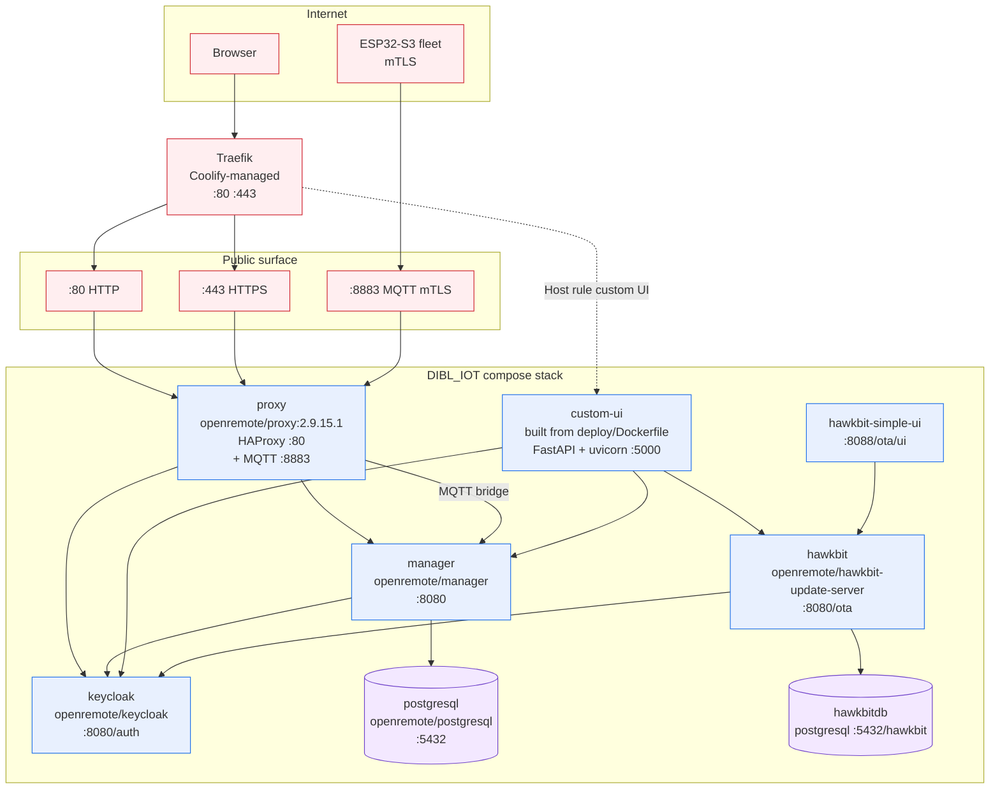

### 5.1.1 Startup dependency graph

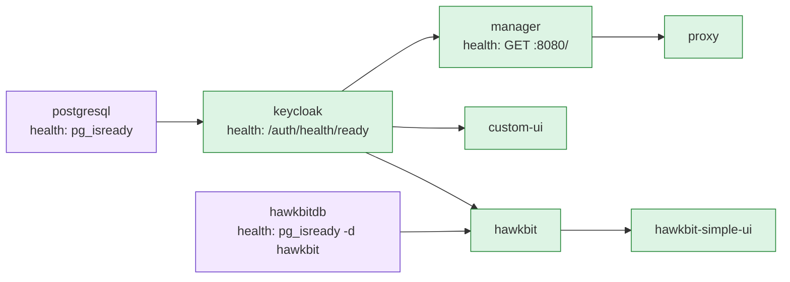

`condition: service_healthy` gates `keycloak → manager → proxy`, `hawkbitdb → hawkbit`, and `keycloak → custom-ui`. This is a genuine hardened chain: `proxy` never starts against an unhealthy manager.

⚠ `hawkbit-simple-ui` uses a plain list-form `depends_on: [hawkbit]`, which only waits for container start, not readiness. It will serve 502s until hawkBit's Spring context is up.

## 5.2 OpenRemote Services

### 5.2.1 `proxy` — HAProxy front door

| Property | Value |
|---|---|
| Image | `openremote/proxy:${PROXY_VERSION:-2.9.15.1}` — comment: *"Working version"* |
| Listeners | HTTP :80, MQTT :8883 |
| ACME | `DISABLE_ACME: "true"` — Coolify's Traefik owns certificates |
| HAProxy config | `/data/proxy/haproxy.cfg`, supplied by the `haproxy-config` Docker config |
| MQTT server cert | `/certs/mqtt-server-combined.pem` from `mqtt-server-cert` config |
| MQTT CA bundle | `/certs/ca.pem` from `mqtt-ca-cert` config |
| Published port | `8883:8883` — the only host-published port in the stack |
| Domain | `${OR_HOSTNAME}` |
| Traefik target | `port=80`, `scheme=http`, health path `/docker-health`, priority 1 |

Ten Traefik labels:

```yaml
traefik.enable=true
traefik.http.routers.openremote.rule=Host(`${OR_HOSTNAME}`)
traefik.http.routers.openremote.entrypoints=http,https
traefik.http.routers.openremote.tls=true
traefik.http.services.openremote.loadbalancer.server.port=80
traefik.http.services.openremote.loadbalancer.server.scheme=http
traefik.http.services.openremote.loadbalancer.healthcheck.path=/docker-health
traefik.http.routers.openremote.priority=1
traefik.http.middlewares.sslheader.headers.customrequestheaders.X-Forwarded-Proto=https
traefik.http.routers.openremote.middlewares=sslheader
```

⚠ **There is no HTTP→HTTPS redirect.** The router claims both `http` and `https` entrypoints and serves both with the same rule. No `redirectscheme` entrypoint exists, and HAProxy has no redirect directive in the config blob. Plain HTTP therefore works alongside HTTPS with no redirect. See §6.3.3.

⚠ **The `sslheader` middleware forces `X-Forwarded-Proto: https`** on every request reaching HAProxy, including requests that arrived over plain HTTP. Applications that trust that header will believe a plaintext request was secure. This is required for the WebSocket and asset-hosting paths to work, but it also means the header is not an integrity signal.

### 5.2.2 `manager` — asset and rules engine

| Property | Value |
|---|---|
| Image | `openremote/manager:${MANAGER_VERSION:-latest}` |
| Volumes | `manager-data:/storage`, `./deploy/manager:/deployment` |
| Keycloak host/port | `keycloak:8080` |
| Metrics | `OR_METRICS_ENABLED: ${OR_METRICS_ENABLED:-true}` |
| Dev mode | `OR_DEV_MODE: ${OR_DEV_MODE:-false}` |
| **Data retention** | `OR_DATA_POINTS_MAX_AGE_DAYS: 180` |
| Extra host | `${OR_HOSTNAME}:host-gateway` |

`OR_DATA_POINTS_MAX_AGE_DAYS: 180` is hardcoded in the Compose file, not parameterised by an environment variable. This is the only retention control in the system: 180 days of attribute history, then the manager purges. For a device publishing a maximum of 13 topics at QoS 0, that is the authoritative capacity-planning input.

⚠ The `extra_hosts` mapping `"${OR_HOSTNAME}": host-gateway` appears in `postgresql`, `keycloak`, `manager`, `custom-ui`, `hawkbit` and `hawkbit-simple-ui`. It exists so containers can resolve the public hostname to the host gateway. It means **in-container hostname resolution bypasses DNS for the public domain** — a deliberate Coolify/OpenRemote pattern, but one that defeats split-horizon DNS and any future per-service internal names.

### 5.2.3 `keycloak` — identity provider

| Property | Value |
|---|---|
| Image | `openremote/keycloak:${KEYCLOAK_VERSION:-latest}` |
| Admin | `KEYCLOAK_ADMIN_PASSWORD: ${OR_ADMIN_PASSWORD:?…}` — **required, no default** |
| Hostname | `KC_HOSTNAME: ${OR_HOSTNAME:?…}` — required |
| Issuer base | `KEYCLOAK_ISSUER_BASE_URI: https://${OR_HOSTNAME}/auth` |
| Port | `KC_HOSTNAME_PORT: ${OR_SSL_PORT:--1}` — `-1` disables port 443 in the advertised issuer |
| Proxy headers | `KC_PROXY_HEADERS: xforwarded` |
| Strictness | `KC_HOSTNAME_STRICT: "false"`, `KC_HOSTNAME_STRICT_HTTPS: "false"` |
| Health | `KC_HEALTH_ENABLED: "true"` |
| Log level | `INFO` |
| Mount | `./deploy:/deployment` — realm import |

`${VAR:?message}` is Compose's mandatory-variable syntax: the stack **refuses to start** without `OR_HOSTNAME` and `OR_ADMIN_PASSWORD`. This is the one place the deployment gets password hygiene right.

⚠ **`KC_HOSTNAME_STRICT_HTTPS: "false"`** disables Keycloak's insistence on HTTPS. Combined with the missing redirect (§5.2.1), the identity provider will happily serve its login form over plaintext HTTP, transmitting user credentials in the clear on first contact. See §10.1-4.

### 5.2.4 `postgresql` — primary datastore

| Property | Value |
|---|---|
| Image | `openremote/postgresql:${POSTGRESQL_VERSION:-latest}` |
| Volumes | `postgresql-data:/var/lib/postgresql/data`, `manager-data:/storage` |
| `shm_size` | `128mb` |
| Health | `pg_isready -U postgres`, every 10 s, 5 retries, 5 s timeout |
| Restart | `always` |

⚠ **No credentials are supplied to this service.** No `POSTGRES_PASSWORD`, no `POSTGRES_USER`, no `POSTGRES_DB`. The OpenRemote image generates its own defaults on first run and persists them in the volume, and `manager` connects using whatever the image provisioned. There is no way to rotate the database password from configuration — it must be changed inside the running container. See §10.4.

### 5.2.5 Separate hawkBit database

`hawkbitdb` is a second PostgreSQL instance, isolated from the OpenRemote datastore.

| Property | Value |
|---|---|
| Image | `openremote/postgresql:${POSTGRESQL_VERSION:-latest}` |
| Database | `POSTGRES_DB: hawkbit` |
| User | `${HAWKBIT_DB_USER:-postgres}` |
| Password | `${HAWKBIT_DB_PASSWORD:-postgres}` |
| Volume | `hawkbit-data:/var/lib/postgresql/data` |
| Health | `pg_isready -U postgres -d hawkbit` |

⚠ **Both the user and password default to `postgres`.** With `:-` defaults, an operator who does not set these variables gets a superuser account with the password `postgres` on a database that stores firmware artifacts and deployment state. This is reachable only from the internal Compose network, but every container on that network can use it. See §10.1-7.

## 5.3 FastAPI Custom UI

`custom-ui`, built from `deploy/Dockerfile`.

### 5.3.1 Runtime

| Property | Value |
|---|---|
| Base image | `python:*` — **exact tag NOT SPECIFIED IN SOURCE.** **RECOMMENDED INDUSTRY-STANDARD SPECIFICATION:** pin `python:3.11-slim@sha256:<digest>`; a floating `latest` tag makes builds non-reproducible and silently changes the base. |
| Server | **uvicorn**, not gunicorn — `uvicorn.run(app, host="0.0.0.0", port=5000)` |
| Port | 5000 internal, published to Traefik as `loadbalancer.server.port=5000` |
| Dependencies | `fastapi`, `uvicorn`, `requests`, `jinja2`, `python-multipart`, `itsdangerous` |
| Env | `PYTHONUNBUFFERED: "1"` |

⚠ **Single-process uvicorn with no worker count and no `--proxy-headers` flag in the `run()` call.** `ProxyHeadersMiddleware` is added in code with `trusted_hosts=["*"]`, but running uvicorn without `--forwarded-allow-ips` means the middleware's trusted-proxy list defaults to `127.0.0.1`, so it will **not** honour `X-Forwarded-For` from Traefik. Client IPs in the access log will be the proxy's. Also, one worker means the OTP flow, the Keycloak admin calls and the SMTP send all serialise through a single event loop; a slow SMTP send blocks the dashboard. See §10.2-8.

⚠ The source comment at `main.py:69` reads *"CRITICAL: Port must match HAProxy target (5000), NOT 8000"* — a hard constraint that will silently break routing if the compose label and the uvicorn port ever disagree, since nothing validates the pair.

### 5.3.2 Middleware stack

Applied in `main.py` in this order:

| Order | Middleware | Configuration | Concern |
|---|---|---|---|
| 1 | `ProxyHeadersMiddleware` | `trusted_hosts=["*"]` | Trusts all proxies; see §5.3.1 |
| 2 | `SessionMiddleware` | `secret_key="supersecretkey"` | ⚠ **Hardcoded literal** |

⚠ **`SessionMiddleware(secret_key="supersecretkey")` is a hardcoded constant in source.** The session cookie signing key is public to anyone with repository access, is identical across every deployment, and is not rotatable without a code change. `itsdangerous` signs session cookies with this key, so an attacker who knows it can **forge a session cookie with any `username`, `realm`, `access_token` or `refresh_token`**, and `verify_username_match` will then treat the request as authenticated. This is a full authentication bypass. Rotate it to a value from `SESSION_SECRET` in the environment immediately. See §10.1-2.

### 5.3.3 Configuration

`src/core/config.py`:

```python
OR_HOSTNAME       = os.environ.get('OR_HOSTNAME', 'localhost')
OR_ADMIN_PASSWORD = os.getenv("OR_ADMIN_PASSWORD", "secret")
OR_MANAGER_URL    = os.getenv("OR_MANAGER_URL", "http://manager:8080")
KEYCLOAK_URL      = os.getenv("KEYCLOAK_URL", "http://keycloak:8080/auth")
APP_PREFIX        = os.environ.get('APP_PREFIX', '')
BASE_DIR          = dirname(dirname(dirname(abspath(__file__))))
CONFIG_DIR        = join(BASE_DIR, "config")
DATA_DIR          = join(BASE_DIR, "data")
DEFAULT_REALM     = "dibl-iot"
```

⚠ **`APP_PREFIX` is never set in any Compose file.** Neither `docker-compose.coolify.yml` nor `docker-compose.yml` defines it, so it defaults to `""`. The custom UI therefore serves at the **root path**, and its internal routes are `/{username}/…`. `docs/09_custom_ui_architecture.md` describes a `/customui` subpath deployment. Setting `APP_PREFIX=/customui` would move every route under that prefix — including the auth routes, which are mounted with `prefix=APP_PREFIX`. If it is ever enabled, the Traefik rule must also gain a `PathPrefix` condition or authentication will break. See §10.3-4.

⚠ `OR_ADMIN_PASSWORD` falls back to the literal `"secret"` in Python even though Compose enforces it with `:?`. The Python default is therefore dead in production but dangerous in any deployment that omits the variable — for example a bare-metal run of the container.

### 5.3.4 Role assignment

`config.py` hardcodes role permissions, all `True`:

```python
ASSIGN_ROLE_READ_ALARMS = True     ASSIGN_ROLE_WRITE_ALARMS = True
ASSIGN_ROLE_READ_ASSETS = True      ASSIGN_ROLE_WRITE_ASSETS = True
ASSIGN_ROLE_READ_INSIGHTS = True    ASSIGN_ROLE_WRITE_INSIGHTS = True
ASSIGN_ROLE_READ_LOGS = True        ASSIGN_ROLE_WRITE_LOGS = True
ASSIGN_ROLE_READ_RULES = True       ASSIGN_ROLE_WRITE_RULES = True
ASSIGN_ROLE_READ_SERVICES = True    ASSIGN_ROLE_WRITE_SERVICES = True
ASSIGN_ROLE_READ_USERS = True       ASSIGN_ROLE_WRITE_USERS = True
                                  # + ASSIGN_ROLE_WRITE_ATTRIBUTES, _WRITE_USER
```

⚠ **Every new user receives all read and write roles on creation.** There is no least-privilege model; a freshly signed-up user can write attributes and manage users. Combined with the open signup flow (§5.3.6), the platform has no meaningful access control. See §10.1-8.

### 5.3.5 Route table

Three mounting tiers.

**Tier 1 — public, mounted at `APP_PREFIX` (empty in practice):**

| Method | Path | Purpose |
|---|---|---|
| GET | `/` | Landing / auth redirect |
| GET | `/login` | Login form |
| POST | `/login` | Login submission |
| GET | `/signup` | Registration form |
| POST | `/signup` | Registration |
| GET | `/forgot-password` | Request reset |
| POST | `/forgot-password` | Send OTP |
| GET | `/verify-email` | Email verification form |
| POST | `/verify-email` | Verify code |
| GET | `/reset-password` | Reset form |
| POST | `/reset-password` | Set new password |
| GET | `/logout` | End session |
| GET | `/api/friendly-names` | **Public** attribute/key labels |

**Tier 2 — protected, behind `verify_username_match`, under `/{username}`:**

| Method | Path | Module |
|---|---|---|
| GET | `/{username}/dashboard` | `routes/dashboard.py` |
| GET | `/{username}/assets` | `routes/dashboard.py` |
| GET | `/{username}/asset/{asset_name}` | `routes/dashboard.py` |
| GET | `/{username}/rules` | `routes/dashboard.py` |
| GET | `/{username}/timers` | `routes/dashboard.py` |
| GET | `/{username}/settings` | `routes/dashboard.py` |
| GET | `/{username}/link` | `routes/dashboard.py` |
| GET | `/{username}/history-logs` | `routes/dashboard.py` |
| GET | `/{username}/test` | `routes/dashboard.py` — **HTTP Basic `arif`/`12345`** |
| GET | `/{username}/user/preferences` | `api/assets.py` |
| POST | `/{username}/user/preferences/pin` | `api/assets.py` |
| POST | `/{username}/user/preferences/pin/rename` | `api/assets.py` |
| POST | `/{username}/user/preferences/highlight` | `api/assets.py` |
| GET | `/{username}/user/preferences/highlights` | `api/assets.py` |
| GET | `/{username}/user/dashboard/widgets` | `api/assets.py` |
| GET | `/{username}/user/assets` | `api/assets.py` |
| POST | `/{username}/user/assets` | `api/assets.py` |
| PUT | `/{username}/user/assets/{asset_id}` | `api/assets.py` |
| DELETE | `/{username}/user/assets/{asset_id}` | `api/assets.py` |
| POST | `/{username}/user/provision-device` | `api/assets.py` |
| POST | `/{username}/asset/{asset_id}/attribute/{attr_name}` | `api/assets.py` |
| GET | `/{username}/asset/{id}` | `api/assets.py` |
| GET | `/{username}/friendly-names` | `api/assets.py` |
| GET | `/{username}/profile` | `api/user.py` |
| PUT | `/{username}/profile` | `api/user.py` |
| PUT | `/{username}/change-password` | `api/user.py` |
| GET | `/{username}/asset-partners` | `api/user.py` |
| GET | `/{username}/rules` | `api/rules.py` |
| POST | `/{username}/rules` | `api/rules.py` |
| DELETE | `/{username}/rules/{id}` | `api/rules.py` |
| POST | `/{username}/proxy` | `api/debug.py` |

**Tier 3 — unauthenticated service endpoints:**

| Method | Path |
|---|---|
| GET | `/favicon.ico` |

**Auth gate.** `verify_username_match` compares the `{username}` path segment against `request.session["username"]`, and also re-validates the token to catch expired sessions early. Failure raises `NotAuthenticatedException`, handled by an app-level handler that returns a `303` redirect to the configured target.

⚠ **`/{username}/test` is protected by hardcoded HTTP Basic credentials `arif` / `12345`** (`src/core/auth.py:18-31`, consumed by `src/routes/dashboard.py:92`). The route is reachable by any authenticated session user and additionally requires these shared secrets. The credentials are in source, in the Compose-era repository, and are unlikely to be rotated. `secrets.compare_digest` is correctly used for both comparisons. See §10.1-9.

### 5.3.6 One-time password flow

`src/core/otp.py`:

| Property | Value |
|---|---|
| Expiry | `OTP_EXPIRY_SECONDS = 300` (5 minutes) |
| Length | 6 digits |
| Generator | `''.join(random.choices(string.digits, k=6))` |
| Scoping | Keyed by `(email, intent)` — separate codes per purpose |
| Delivery | `send_otp_email(email, otp, subject)` via SMTP |

⚠ **`random.choices` is Mersenne Twister, not a CSPRNG.** Python's `random` is not seeded from a cryptographic source and its state is recoverable from a handful of outputs. Six digits gives 900,000 combinations, which is already small, but the real weakness is predictability: an attacker who can observe one OTP — and there is a **public** `/forgot-password` endpoint that mails codes to any address — can seed a generator. Use `secrets.choice`. See §10.1-10.

SMTP is configured on the `custom-ui` service:

| Variable | Value |
|---|---|
| `SMTP_HOST` | `smtp.gmail.com` |
| `SMTP_PORT` | `587` |
| `SMTP_USER` | `dibliot843@gmail.com` (literal in Compose) |
| `SMTP_PASS` | `${SMTP_PASS:-}` — **defaults to empty** |

⚠ `${SMTP_PASS:-}` fails open. With no value set, OTP emails are attempted with an empty password against Gmail, which will fail — so the signup and password-reset flows are silently non-functional rather than loudly broken. The OTP store is still populated, so codes exist that can never be delivered. See §10.4.

⚠ Gmail requires an app-specific password for SMTP, not the account password. That value must be placed in `SMTP_PASS`; it is not documented in either Compose file or `.env.example`.

### 5.3.7 Authentication helpers

`src/core/auth.py`:

| Function | Purpose |
|---|---|
| `get_admin_token(realm)` | `password` grant against the **master** realm using `OR_ADMIN_PASSWORD` |
| `get_user_token(realm, username, password)` | `password` grant in the user realm |
| `refresh_user_token(realm, refresh_token)` | `refresh_grant` |
| `get_valid_token(request)` | Session access/refresh-token orchestration with auto-refresh |
| `get_user_id_by_username(realm, username, admin_token)` | Admin REST lookup |
| `get_user_id_by_email(realm, email, admin_token)` | Admin REST lookup |
| `get_username_by_email(realm, email, admin_token)` | Reverse lookup |
| `assign_realm_roles(realm, user_id, roles, admin_token)` | Realm role mapping |
| `assign_roles_to_user(realm, user_id, admin_token)` | Client role mapping on the `openremote` client |

⚠ **The `password` grant is used throughout, and the platform holds the `OR_ADMIN_PASSWORD` in order to mint master-realm admin tokens.** The master realm is the Keycloak root of trust; a service that automates logins against it with a long-lived password is a single-compromise path to total realm takeover. The Keycloak-native alternative is a client-credentials service account with narrowly scoped roles, or an admin user in a dedicated realm rather than `master`. See §10.1-4.

## 5.4 Data Models and Persistent Storage

### 5.4.1 Two independent PostgreSQL databases

| Database | Container | Purpose | Volume |
|---|---|---|---|
| OpenRemote | `postgresql` | Assets, attributes, attribute values, rules, users, Keycloak realm data | `postgresql-data` + `manager-data` |
| hawkBit | `hawkbitdb` | Software modules, artifacts, deployments, target/group definitions | `hawkbit-data` |

`postgresql` also mounts `manager-data:/storage`, and `manager` mounts the same volume at `/storage`. That shared mount is how the manager persists files across restarts.

⚠ **No logical separation or migration control is documented.** Each container initialises its own schema on first boot. Restoring `postgresql-data` from a backup taken at the wrong schema version will leave the manager failing at startup with no documented recovery path. See §10.4.

### 5.4.2 Volumes

| Volume | Mount points | Contents | Growth |
|---|---|---|---|
| `postgresql-data` | `/var/lib/postgresql/data` | OpenRemote database files | Attribute history — the dominant consumer, capped at 180 days |
| `manager-data` | `/storage` (postgres **and** manager) | Manager files and assets | Uploaded images, scripts |
| `proxy-data` | `/deployment` (proxy) | Proxy runtime state | Minimal |
| `hawkbit-data` | `/var/lib/postgresql/data` (hawkbitdb) | hawkBit database | Deployment history |
| `hawkbit-artifact-data` | `/opt/hawkbit/artifactrepo` | **Firmware binaries** | ⚠ Unbounded — every firmware build is retained forever |

⚠ **`hawkbit-artifact-data` has no retention policy.** Firmware images accumulate without limit, and each is up to 256 MB (`SPRING_SERVLET_MULTIPART_MAX_FILE_SIZE`). Over a fleet lifecycle this volume will eventually fill the host disk, which will take down PostgreSQL with it since they share one filesystem. Size the volume explicitly and add an artifact-retention job. See §10.4.

### 5.4.3 Bind mounts

| Host path | Container path | Service | Writable |
|---|---|---|---|
| `./deploy` | `/deployment` | `keycloak` | read-write |
| `./deploy/manager` | `/deployment` | `manager` | read-write |
| `./data` | `/app/data` | `custom-ui` | read-write — holds `user_preferences.json` |
| `./config` | `/app/config` | `custom-ui` | read-write — holds `asset_template.json`, `friendly_names.json` |

⚠ `./config` is mounted **read-write** into the web container. `asset_template.json` and `friendly_names.json` are served through `/api/friendly-names`, a public endpoint. Any write access to that directory becomes a code-and-label injection vector. Mount read-only. See §10.1-11.

### 5.4.4 Asset template

`config/asset_template.json`, verified structure:

```json
{ "version": 4, "realm": "dibl-iot", "type": "Thing" }
```

| Attribute | Declared keys |
|---|---|
| `EnvData` | `light`, `t0`, `h0`, `t1`, `h1`, `t2`, `h2`, `t3` |
| `MoistureData` | `m1`, `m2`, `m3`, `m4` |
| `NPKData` | `m01`, `t01`, `ec01`, `ph01`, `n01`, `p01`, `k01` |
| `RelayData` | `r1`, `r2`, `r3`, `r4` |
| `RuleTargets` | *(empty)* |
| `Timer01` … `Timer12` | `Status`, `Days`, `Outputs`, `OnHour`, `OnMinute`, `OffHour`, `OffMinute` |

⚠ The `NPKData` block declares **only sensor 01**. The firmware emits sensors `01` through `04`, and `friendly_names.json` labels `m01`–`m04`. The template is missing the 02, 03 and 04 blocks entirely. Combined with the key-name mismatch in §5.5, **no NPK reading from any probe reaches the dashboard.**

⚠ `EnvData` declares `t0`–`t3`/`h0`–`h3` while the firmware emits `t0`–`t4`/`h0`–`h4`, and `friendly_names.json` labels `t4`/`h4`. Three artefacts, three different views of the sensor count. See §10.3-3.

### 5.4.5 Friendly names

`config/friendly_names.json` has exactly two top-level keys:

- `attributes` — 20+ display labels for attribute names, including `NPK_Moisture01` … `NPK_Potassium04` in **`NPK_Moisture01`-style** form.
- `keys` — per-key labels: `t0` = "Board Temperature", `h0` = "Board Humidity", `t1`–`t4` = "Temperature Port 1–4", `m1`–`m4` = "Moisture Port 1–4", `r1`–`r4` = "Switch 1–4", `light` = "Light Intensity", plus the timer field labels and **`m01`, `t01`, `ec01`, `ph01`, `n01`, `p01`, `k01`** for NPK ports 1–2.

⚠ There are now **three** inconsistent naming conventions for the same NPK values:

| Artefact | NPK key form |
|---|---|
| Firmware publishes | `moisture01`, `temperature01`, `n-nitrogen01` … |
| `asset_template.json` declares | `m01`, `t01`, `n01` … |
| `friendly_names.json` labels | `m01`, `t01`, `n01` … (per-key) and `NPK_Moisture01` … (per-attribute) |
| `software_changes.md` intends | `m01`–`m04`, `t01`–`t04` |

The firmware is the outlier. See §10.3-3.

## 5.5 Device Shadow, Aggregation and Derived Values

OpenRemote stores each device as a *Thing* asset with multi-value attributes. There is no separate device-shadow table in this repository — the asset attribute values **are** the shadow.

### 5.5.1 Attribute processing

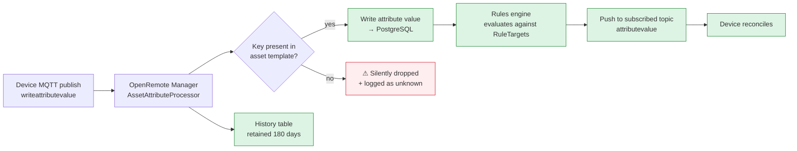

**The critical mechanic:** OpenRemote accepts an attribute value only for attributes **declared in the asset template**. An undeclared key in the payload is discarded. Because `NPKData`'s declared keys are `m01`/`t01`/`n01`… and the firmware sends `moisture01`/`temperature01`/`n-nitrogen01`…, **every NPK key except `ec01` and `ph01` is dropped**. Since `ec01`/`ph01` happen to agree in name, those two survive — but their `03`/`04` variants have no declaration at all.

### 5.5.2 `RuleTargets`

`RuleTargets` is declared as an **empty** attribute in the template. It exists so rules have somewhere to write, but with no members a rule cannot target anything until an operator adds keys. There is no code in this repository that populates it. See §10.4.

### 5.5.3 Timers

`Timer01`–`Timer12` exist **in two independent places** that do not synchronise:

| Location | Role |
|---|---|
| OpenRemote asset attributes | The dashboard's view; what the operator edits |
| Device NVS | What the firmware actually evaluates |

The device subscribes to the twelve timer topics and applies incoming values, so OpenRemote is authoritative once connected. But the device also evaluates its local NVS copy every `loop()` iteration, and holds schedules independently when offline. There is no reconciliation on reconnect and no version field. **An offline timer change on the device is silently overwritten the moment the broker reconnects.** See §10.2-9.

## 5.6 Eclipse hawkBit OTA Service

### 5.6.1 Services

| Service | Image | Context path | Purpose |
|---|---|---|---|
| `hawkbit` | `openremote/hawkbit-update-server:${HAWKBIT_VERSION:-latest}` | `/ota` | DDI REST API, deployment management, artifact store |
| `hawkbit-simple-ui` | `hawkbit/hawkbit-simple-ui:latest` | `/ota/ui` on internal port 8088 | Operator web UI |

### 5.6.2 hawkBit configuration

| Variable | Value |
|---|---|
| `SERVER_SERVLET_CONTEXT_PATH` | `/ota` |
| `SERVER_FORWARD_HEADERS_STRATEGY` | `framework` |
| `SPRING_DATASOURCE_URL` | `jdbc:postgresql://hawkbitdb:5432/hawkbit` |
| `HAWKBIT_DMF_RABBITMQ_ENABLED` | `"false"` — no message broker, synchronous only |
| `HAWKBIT_ARTIFACT_URL_PROTOCOLS_DOWNLOAD_HTTP_PROTOCOL` | `https` |
| `HAWKBIT_ARTIFACT_URL_PROTOCOLS_DOWNLOAD_HTTP_PORT` | `443` |
| `SPRING_SECURITY_OAUTH2_CLIENT_REGISTRATION_OIDC_CLIENT_ID` | `${HAWKBIT_OIDC_CLIENT_ID:-hawkbit}` |
| `SPRING_SECURITY_OAUTH2_CLIENT_REGISTRATION_OIDC_CLIENT_SECRET` | `${HAWKBIT_OIDC_CLIENT_SECRET:-}` |
| OIDC issuer | `https://${OR_HOSTNAME}/auth/realms/master` |
| OIDC JWK set | `http://keycloak:8080/auth/realms/master/protocol/openid-connect/certs` |
| JWT issuer | `https://${OR_HOSTNAME}/auth/realms/master` |
| Max upload | 256 MB, and `HAWKBIT_SERVER_SECURITY_DOS_MAXARTIFACTSIZE` 268,435,456 |

⚠ **hawkBit's OAuth2 trust is anchored to the `master` realm**, not `dibl-iot`. Anyone who can obtain a master-realm token can call the hawkBit DDI API and push firmware to the entire fleet. This is the highest-value target on the platform and it is not the realm the rest of the system uses. See §10.1-12.

⚠ `${HAWKBIT_OIDC_CLIENT_SECRET:-}` defaults to empty. An empty client secret with `client_id` `hawkbit` will normally fail OIDC client authentication rather than succeed, so this fails closed — but the error appears only at first API call, not at startup.

⚠ `DISABLE_ACME: "true"` on the proxy plus the device calling `setInsecure()` (§4.5.3) means there is **no enforced HTTPS anywhere in the OTA path**, in both directions of trust.

### 5.6.3 hawkBit Simple UI is not publicly routed

`hawkbit-simple-ui` carries **no Traefik labels**. It is reachable only on the internal Compose network at `hawkbit:8088`. There is no route to it from the host or the internet.

> **NOT SPECIFIED IN SOURCE**
> How operators reach the hawkBit UI to upload firmware. There is no published route, and `docs/08_ota_updates.md` should be consulted for the intended access path.
>
> **RECOMMENDED INDUSTRY-STANDARD SPECIFICATION**
> Publish `hawkbit-simple-ui` behind Traefik on a **separate hostname** from the main application, e.g. `ota.{domain}`, with `priority=10` and an IP allow-list or Basic-auth middleware. It should never share an origin with the user-facing UI, because it grants firmware-push capability to anyone who reaches it. If the route must stay internal, document an SSH-forward procedure and place it in the operations runbook.

---

*End of §5.*

---

# §6. Deployment Pipeline and Coolify Configuration

## 6.1 Deployment Topology

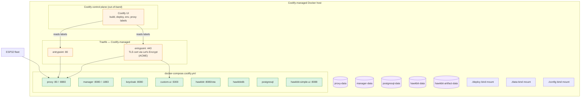

### 6.1.1 Three compose files

| File | Purpose |
|---|---|
| `docker-compose.coolify.yml` | **Production.** Traefik labels, mTLS on 8883, hawkBit stack. 8 services. |
| `docker-compose.coolify.yml.backup_20260128` | Pre-hawkBit snapshot, dated 2026-01-28. |
| `docker-compose.yml` | Development / standalone. No Traefik labels, no MQTT listener. |

⚠ Two live production-shaped files with a dated backup is ambiguous. Establish which one Coolify actually consumes before any change; the filename Coolify references is not recorded in the repository. See §10.4.

## 6.2 Service Inventory

| Service | Image | Restart | Host ports | Volumes | Health check |
|---|---|---|---|---|---|
| `postgresql` | `openremote/postgresql:${POSTGRESQL_VERSION:-latest}` | always | — | `postgresql-data`, `manager-data` | `pg_isready -U postgres` |
| `keycloak` | `openremote/keycloak:${KEYCLOAK_VERSION:-latest}` | always | — | `./deploy:/deployment` | `/auth/health/ready` or `/health/ready`, 30 retries, 60 s start period |
| `manager` | `openremote/manager:${MANAGER_VERSION:-latest}` | always | — | `manager-data`, `./deploy/manager` | `curl -sf http://localhost:8080/` |
| `proxy` | `openremote/proxy:${PROXY_VERSION:-2.9.15.1}` | always | **`8883:8883`** | `proxy-data`, 3 configs | via Traefik `/docker-health` |
| `custom-ui` | built from `deploy/Dockerfile` | always | — | `./data:/app/data`, `./config:/app/config` | none defined ⚠ |
| `hawkbitdb` | `openremote/postgresql:${POSTGRESQL_VERSION:-latest}` | always | — | `hawkbit-data` | `pg_isready -U postgres -d hawkbit` |
| `hawkbit` | `openremote/hawkbit-update-server:${HAWKBIT_VERSION:-latest}` | always | — | `hawkbit-artifact-data` | none defined ⚠ |
| `hawkbit-simple-ui` | `hawkbit/hawkbit-simple-ui:latest` | always | — | — | none defined ⚠ |

**Every service sets `restart: always`** with no `deploy.restart_policy.max_retries`. A container that crash-loops will be restarted indefinitely. Combined with `hawkbit` having no health check, a Spring configuration error produces an infinite restart loop that Coolify will report only as "unhealthy". Add health checks and bounded retry policies. See §10.4.

⚠ **Every image tag defaults to `latest`.** The only exception is the proxy, pinned to `2.9.15.1` with the comment *"Working version"*. A `docker compose pull` on an otherwise routine maintenance day will silently upgrade Keycloak, Manager, PostgreSQL and hawkBit, each of which may require schema migrations. Pin all tags and record digests. See §10.4.

## 6.3 Reverse Proxy and TLS

### 6.3.1 Layered proxy model

Three layers terminate or forward traffic, and their split is not obvious from the labels alone:

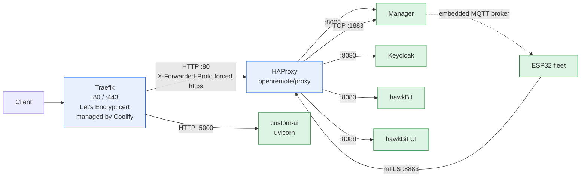

| Layer | Responsibility |
|---|---|
| **Traefik** | Public TLS termination, certificate management, hostname routing, HTTP→HTTPS *opportunity* |
| **HAProxy (`proxy`)** | Path-based routing to manager/keycloak/hawkBit, MQTT mTLS termination, health endpoint, forced `X-Forwarded-*` headers |
| **Manager** | Serves the UI on `:8080`, hosts the embedded MQTT broker on `:1883` |

### 6.3.2 HAProxy configuration — verbatim

`global`

```
log stdout format raw local0 info
```

`defaults`

```
log global
mode http
timeout connect 30s
timeout client  60s
timeout server  60s
timeout tunnel 720m
default-server init-addr none
```

`resolvers`

```
resolvers docker_resolver
    nameserver dns1 127.0.0.11:53
```

Docker's embedded DNS at `127.0.0.11:53` — services are re-resolved rather than pinned to a startup IP, which is what makes `restart: always` and rolling restarts transparent to the proxy.

**`frontend http`** — `bind *:80`

```
http-request set-header X-Forwarded-Proto https
http-request set-header X-Forwarded-Port  443
http-request set-header X-Forwarded-Host  %[req.hdr(host)]
http-request set-header X-Real-IP         %[src]

acl url_docker_health path /docker-health
http-request set-log-level silent if url_docker_health
http-request return status 200 if url_docker_health

acl is_auth      path_beg /auth
use_backend keycloak_backend if is_auth
acl is_realms    path_beg /realms
use_backend keycloak_backend if is_realms
acl is_resources path_beg /resources
use_backend keycloak_backend if is_resources

acl is_ota_ui path_beg /ota/ui
use_backend hawkbit_ui_backend if is_ota_ui
acl is_ota     path_beg /ota
use_backend hawkbit_backend if is_ota

default_backend manager_backend
```

**`frontend mqtt`** — mutual TLS

```
bind *:8883 ssl crt /certs/mqtt-server-combined.pem ca-file /certs/ca.pem verify required
mode tcp
default_backend mqtt_backend
```

**Backends**

```
backend manager_backend
    server manager manager:8080 resolvers docker_resolver init-addr none

backend keycloak_backend
    server keycloak keycloak:8080 resolvers docker_resolver init-addr none

backend hawkbit_backend
    server hawkbit hawkbit:8080 resolvers docker_resolver init-addr none

backend hawkbit_ui_backend
    server hawkbit_ui hawkbit-simple-ui:8088 resolvers docker_resolver init-addr none

backend mqtt_backend
    mode tcp
    timeout tunnel 300s
    option clitcpka
    server manager manager:1883 resolvers docker_resolver init-addr none
```

### 6.3.3 Routing table

| Inbound path | Backend | Container:port | Auth |
|---|---|---|---|
| `/docker-health` | *(direct 200)* | — | none |
| `/auth/*` | `keycloak_backend` | `keycloak:8080` | none (it *is* the IdP) |
| `/realms/*` | `keycloak_backend` | `keycloak:8080` | none |
| `/resources/*` | `keycloak_backend` | `keycloak:8080` | none |
| `/ota/ui/*` | `hawkbit_ui_backend` | `hawkbit-simple-ui:8088` | none ⚠ |
| `/ota/*` | `hawkbit_backend` | `hawkbit:8080` | hawkBit OIDC |
| everything else | `manager_backend` | `manager:8080` | app-level |
| `:8883` TCP | `mqtt_backend` | `manager:1883` | **client cert required** |

⚠ **`/ota/ui` is routed by HAProxy but is not reachable through Traefik.** The HAProxy ACL exists and the backend is defined, yet `hawkbit-simple-ui` carries no Traefik labels and no Traefik rule points at `/ota/ui`. Because `hawkbit-simple-ui` is a distinct container, the request never reaches HAProxy's routing table through the public entrypoint. The firmware's OTA poller does not need it — it talks to `hawkbit`, not the UI — but **no operator can reach the hawkBit web interface over HTTPS.** Firmware cannot be uploaded through the documented UI. This is either a missing Traefik rule or a missing design note; either way it is a gap. See §10.1-13.

⚠ **Path-order dependency.** `/ota/ui` is matched before `/ota`, which is correct because `path_beg /ota` would otherwise swallow the UI path. Any new path that prefixes an existing one must be inserted in the same order. There is no test for this.

⚠ **`X-Forwarded-Proto: https` is forced unconditionally**, even for requests arriving over plain HTTP on port 80. Applications cannot distinguish a genuine HTTPS request from a plaintext one. Since Keycloak is configured with `KC_HOSTNAME_STRICT_HTTPS: "false"`, it accepts either. Remove the forced header and instead enable Traefik's HTTP→HTTPS redirect, then let the real protocol propagate. See §10.1-4.

### 6.3.4 MQTT mutual TLS

| Property | Value |
|---|---|
| Public listener | `*:8883`, `ssl`, `verify required` |
| Server certificate | `/certs/mqtt-server-combined.pem` — CN `master.senspanel.com`, RSA-4096, issued by `RootCA`, valid to 2036-07-27 |
| Trusted CA bundle | `/certs/ca.pem` — **exactly 2 certificates: `RootCA` and `farmhub_CA`** |
| Mode | `tcp` (TLS terminated at HAProxy; MQTT bytes pass through untouched) |
| Backend | `manager:1883` |
| Keepalive | `option clitcpka` on the backend hop |
| Tunnel timeout | `300s` (overrides the global `720m`) |

The two-certificate bundle is **correct for the as-built two-root design**: `RootCA` for server identity and `farmhub_CA` as the root of the device trust hierarchy. Project documentation describing eleven CAs in this bundle is wrong (§10.3-2).

⚠ **`timeout tunnel 300s`** means any device whose MQTT connection idles for more than five minutes is disconnected by the proxy. The device publishes at ~100 ms while connected, so steady-state operation is safe — but a device in `offline mode`, or one whose sensors are all failing, may be idle and will be silently dropped every five minutes. It will reconnect via the firmware backoff, so the symptom is periodic disconnects in the device log, not an outage.

### 6.3.5 `[PENDING MANUAL ENTRY: Specific Proxy Domain Routes and SSL/TLS Params]`

The Compose file parameterises both public hostnames but never binds them to values:

| Variable | Referenced in | Default in file | Value |
|---|---|---|---|
| `OR_HOSTNAME` | `keycloak`, `manager`, `proxy`, `custom-ui`, `hawkbit`, `hawkbit-simple-ui` | **none — `:?` makes it mandatory** | ⚠ **not in any file in this repository** |
| `OR_CUSTOMUI_HOSTNAME` | `custom-ui` Traefik rule | **none** | ⚠ **not in any file in this repository** |
| `OR_SSL_PORT` | `keycloak`, `manager` | `-1` | `-1` = port omitted from the advertised issuer |
| `OR_ADMIN_PASSWORD` | `keycloak`, `manager`, `custom-ui` | **none — `:?` mandatory** | ⚠ **not in any file in this repository** |
| `HAWKBIT_DB_USER` / `HAWKBIT_DB_PASSWORD` | `hawkbitdb`, `hawkbit` | `postgres` / `postgres` | weak default, see §5.2.5 |
| `HAWKBIT_OIDC_CLIENT_ID` / `_SECRET` | `hawkbit` | `hawkbit` / empty | see §5.6.2 |
| `SMTP_PASS` | `custom-ui` | empty | see §5.3.6 |

These values live in Coolify's environment store, which is not in the repository. Fill them in here:

```
Primary OpenRemote hostname (OpenRemote UI, Keycloak, hawkBit):
    OR_HOSTNAME                = ______________________________
        e.g. master.senspanel.com
        Must resolve via public DNS to this host's public IP.
        Used as: Traefik Host() rule for the proxy; Keycloak KC_HOSTNAME
        and issuer base URI; manager OR_HOSTNAME; hawkBit artifact URLs.

Custom dashboard hostname (FastAPI custom-ui):
    OR_CUSTOMUI_HOSTNAME       = ______________________________
        e.g. ui.senspanel.com
        Used as: Traefik Host() rule for custom-ui, loadbalancer port 5000.
        If served on a path instead, set APP_PREFIX and add a Traefik
        PathPrefix condition — see §5.3.3, this is not currently wired.

Advertised HTTPS port:
    OR_SSL_PORT                = [ -1 ]        # -1 = omit port from issuer URI
                                        #  443  = explicit

OpenRemote / Keycloak master admin password:
    OR_ADMIN_PASSWORD          = «REDACTED — do not write in this file»
        Min length 12, must differ from the Keycloak initial admin password.
        Stored in Coolify as an encrypted environment variable.
        Rotating it changes: Keycloak KEYCLOAK_ADMIN_PASSWORD, manager
        OR_ADMIN_PASSWORD, and the custom-ui's ability to mint master-realm
        admin tokens (src/core/auth.py get_admin_token).

hawkBit PostgreSQL:
    HAWKBIT_DB_USER            = ______________     # NOT 'postgres'
    HAWKBIT_DB_PASSWORD        = «REDACTED»

hawkBit OIDC client (registered in Keycloak realm 'master'):
    HAWKBIT_OIDC_CLIENT_ID     = [ hawkbit ]
    HAWKBIT_OIDC_CLIENT_SECRET = «REDACTED»

SMTP (Gmail requires an app-specific password):
    SMTP_PASS                  = «REDACTED»
```

**SSL/TLS parameters — verifiable from source vs pending**

| Parameter | Status | Value |
|---|---|---|
| TLS termination point | **Source** | Traefik, entrypoints `http` + `https` |
| Certificate authority | **Pending** | Coolify-managed Let's Encrypt — resolver name not in source |
| Traefik ACME challenge type | **Pending** | HTTP-01 or TLS-ALPN — not in source |
| Certificate domains | **Pending** | One SAN per `OR_HOSTNAME` and `OR_CUSTOMUI_HOSTNAME` |
| Renewal interval | **Pending** | Coolify default; not configured in source |
| HTTP → HTTPS redirect | ⚠ **Missing** | No redirect anywhere; see §6.3.3 |
| MQTT listener TLS | **Source** | `:8883`, `verify required`, TLS 1.2 via ESP32 stack |
| Traefik ↔ HAProxy | **Source** | Plain HTTP with forced `X-Forwarded-Proto: https` |
| Security headers | **Source** | Only `X-Forwarded-Proto`; **no HSTS, no CSP, no `X-Frame-Options`, no `Referrer-Policy`** |
| Rate limiting | ⚠ **Missing** | No rate limit at Traefik or HAProxy. The public `/forgot-password` and `/signup` routes are unthrottled. |
| WAF / request size | ⚠ **Missing** | No limit at the proxy; only hawkBit caps uploads at 256 MB |

**RECOMMENDED INDUSTRY-STANDARD SPECIFICATION** for the pending items: terminate TLS 1.2+ at Traefik with a Let's Encrypt certificate obtained via the TLS-ALPN-01 challenge; add `entrypoints.websecure.http.tls.certresolver=letsencrypt` and a `redirectscheme` entrypoint so port 80 issues a 301; add HSTS (`max-age=31536000; includeSubDomains`), `X-Content-Type-Options: nosniff`, `Referrer-Policy: strict-origin-when-cross-origin`, and `X-Frame-Options: DENY`; add a rate-limit middleware of 10 req/min on `/login`, `/signup`, `/forgot-password` and `/verify-email`; restrict `/ota/*` to an IP allow-list or VPN because it grants firmware-push capability.

## 6.4 Network, Volumes and Compose Topology

### 6.4.1 Network

> **NOT SPECIFIED IN SOURCE**
> No `networks:` block appears in either Compose file. Coolify therefore injects its own network.
>
> **RECOMMENDED INDUSTRY-STANDARD SPECIFICATION**
> Declare an explicit internal bridge network and attach all eight services to it, so the topology is version-controlled rather than a Coolify implementation detail. Keep the network `internal: false` (the host must publish 8883) but restrict inter-service reachability with explicit `expose` directives instead of relying on the implicit "every port is reachable on a Compose network" behaviour.

### 6.4.2 Storage map

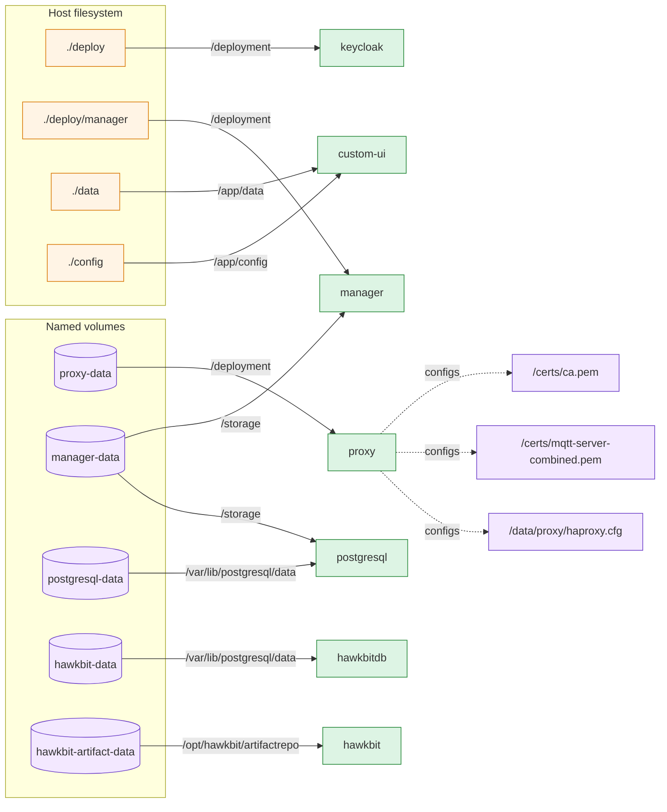

⚠ **`manager-data` is mounted into both `postgresql` (`/storage`) and `manager` (`/storage`).** A shared volume across two containers that both write to it risks file-level conflicts. It is inherited from the OpenRemote reference Compose, where it is presumably intentional, but nothing in this repository documents why, and no subdirectory separation is declared. Verify before adding any new writer to that volume. See §10.4.

⚠ **`./config` is bind-mounted read-write** into the container that serves `friendly-names` publicly. See §5.4.3.

## 6.5 Environment Variables and Secrets Injection

### 6.5.1 Complete variable reference

Full table in [Appendix B](#appendix-b-environment-variable-reference). Summary of source of truth:

| Category | Variables | Source |
|---|---|---|
| **Mandatory — stack refuses to start without** | `OR_HOSTNAME`, `OR_ADMIN_PASSWORD` | Coolify secret store |
| **Host routing** | `OR_CUSTOMUI_HOSTNAME` | Coolify secret store |
| **Version pinning** | `POSTGRESQL_VERSION`, `KEYCLOAK_VERSION`, `MANAGER_VERSION`, `PROXY_VERSION`, `HAWKBIT_VERSION` | Coolify env, all default `latest` |
| **OpenRemote behaviour** | `OR_SSL_PORT`, `OR_DEV_MODE`, `OR_METRICS_ENABLED` | Coolify env |
| **hawkBit** | `HAWKBIT_DB_USER`, `HAWKBIT_DB_PASSWORD`, `HAWKBIT_OIDC_CLIENT_ID`, `HAWKBIT_OIDC_CLIENT_SECRET` | Coolify env |
| **Custom UI literals** | `HAWKBIT_URL`, `HAWKBIT_USER`, `HAWKBIT_PASSWORD`, `SMTP_HOST`, `SMTP_PORT`, `SMTP_USER` | **hardcoded in Compose** |
| **Custom UI from env** | `PYTHONUNBUFFERED`, `OR_HOSTNAME`, `OR_ADMIN_PASSWORD`, `SMTP_PASS` | Coolify env |

### 6.5.2 Hardcoded literals that must move to the environment

| Literal | Location | Risk |
|---|---|---|
| `HAWKBIT_USER: admin` | `docker-compose.coolify.yml` | hawkBit operator account in a world-readable file |
| `HAWKBIT_PASSWORD: "admin"` | `docker-compose.coolify.yml` | ⚠ Trivial password on the account that can push firmware to the fleet |
| `SMTP_USER: dibliot843@gmail.com` | `docker-compose.coolify.yml` | Operator email address in source |
| `SMTP_HOST`/`SMTP_PORT` | `docker-compose.coolify.yml` | Fine — not secret |
| `OR_DATA_POINTS_MAX_AGE_DAYS: 180` | `docker-compose.coolify.yml` | Not parameterised; cannot be tuned per deployment |
| RSA-4096 private key | `docker-compose.coolify.yml:109-160` | ⚠ **Broker key in plaintext** |

## 6.6 Coolify-Specific Configuration

### 6.6.1 What Coolify provides

Coolify owns the layer this repository cannot describe:

| Concern | Owned by | Repository visibility |
|---|---|---|
| Traefik container and entrypoints | Coolify | none |
| Let's Encrypt certificate and renewal | Coolify | none |
| Network creation | Coolify | none |
| Build pipeline and registry | Coolify | `deploy/Dockerfile` is the only artefact |
| Environment variable storage | Coolify | none — see §6.3.5 |
| Which Compose file is active | Coolify | ⚠ not recorded |
| Domain → container mapping | Coolify UI | ⚠ **the pending section** |

### 6.6.2 Version pinning comment

```yaml
image: openremote/proxy:${PROXY_VERSION:-2.9.15.1} # Working version
```

That single comment is the only evidence of a deliberate version decision anywhere in the deployment. Every other service floats on `latest`. The comment should become a policy: pin every image, and record the digest in this document.

### 6.6.3 `deploy/` directory

| Path | Role |
|---|---|
| `deploy/Dockerfile` | Builds `custom-ui` from `python:*` |
| `deploy/manager/` | Mounted into the manager at `/deployment` |
| `deploy/` | Mounted into Keycloak at `/deployment` — **Keycloak realm import** |

⚠ The Keycloak realm import directory is not committed with its contents, so the realm `dibl-iot` definition — including the `hawkbit` OIDC client, roles, and users — cannot be rebuilt from this repository. Combined with `OR_ADMIN_PASSWORD` being unknown, **the identity configuration is not reproducible from source.** This is the single largest rebuild blocker. See §10.4.

---

*End of §6.*

---

# §7. Security Architecture and Cryptography

## 7.1 Public Key Infrastructure Design

The PKI is **not** a single hierarchy. It is **two independent self-signed roots** serving two distinct purposes, with no path between them.

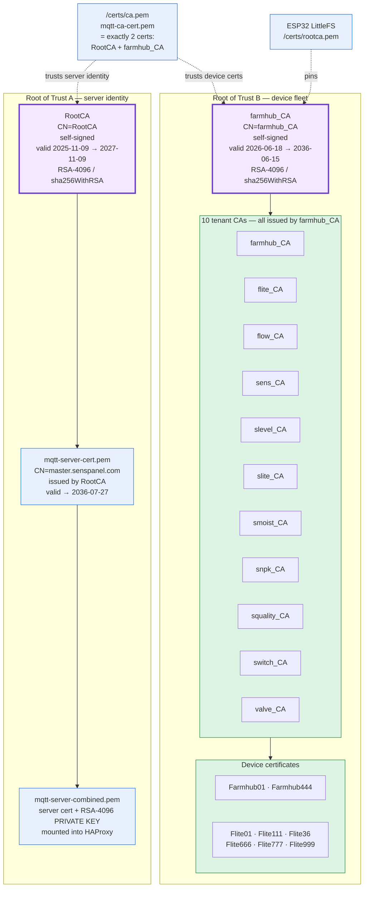

### 7.1.1 Why two roots

| Root | Purpose | Devices that trust it |
|---|---|---|
| `RootCA` | Signs the **MQTT server identity** only | The HAProxy MQTT frontend, to verify client certs — and nothing else |
| `farmhub_CA` | Root of the **device certificate** hierarchy | Every ESP32, via `/certs/rootca.pem` |

#### The verified trust handshake

The shipped reference device resolves the apparent asymmetry. `ui_files_upload/data/certs/rootca.pem` — the exact file written to production units — contains **one certificate, and it is `RootCA`** (SHA-256 `40:3A:0C:…:22:FA`, matching `secrets/certs/rootCA.pem`). Its `device.pem` contains **two** certificates: device `CN=Farmhub06`, then `farmhub_CA`. Both directions therefore validate:

```mermaid
sequenceDiagram
    autonumber
    participant D as ESP32 (Farmhub06)
    participant P as HAProxy :8883<br/>verify required
    participant B as Manager :1883

    Note over D: trust store = RootCA only
    Note over P: trust store = RootCA + farmhub_CA

    D->>P: TLS ClientHello (SNI master.senspanel.com)
    P-->>D: ServerCertificate = mqtt-server-cert<br/>issued by RootCA
    Note over D: validates against RootCA ✓

    D->>P: Certificate = Farmhub06<br/>issued by farmhub_CA
    Note over P: validates against bundled farmhub_CA ✓

    D->>P: ClientKeyExchange
    P->>B: TCP tunnel established
    P-->>D: TLS 1.2 established
    D->>B: MQTT CONNECT (via tunnel)
```

So `RootCA` is a **cross-signing bridge**: it is simultaneously the device's only root of trust for validating the broker *and* the signer of the broker's serving certificate. `farmhub_CA` never appears in a device trust store, and `RootCA` never signs a device certificate.

⚠ **This makes SEC-01 materially worse than it first appears.** `RootCA`'s private key is committed in plaintext in `docker-compose.coolify.yml:109-160` — and note that the file it is committed in is named `mqtt-server-cert` while the key it contains belongs to `RootCA`, i.e. the **root of trust for the entire fleet's server validation**. Anyone with that key can mint a `master.senspanel.com` certificate trusted by every deployed device. That is direct, fleet-wide impersonation, not merely broker impersonation.

⚠ **And it makes SEC-14 a confirmed calendar failure, not a hypothesis.** The fleet's ability to validate the broker rests solely on `RootCA`, which expires **2027-11-09** — about 13 months from this document's date. There is no in-field update path for `rootca.pem`; every device must be physically reflashed. `farmhub_CA`'s ten-year validity provides **no** relief, because no device has ever received it.

**RECOMMENDED INDUSTRY-STANDARD SPECIFICATION:** before 2027-11-09, provision every device with a `/certs/rootca.pem` that bundles **both** `RootCA` and `farmhub_CA`, then re-issue the MQTT server certificate from `farmhub_CA` so the long-lived root becomes the fleet's root of trust. Afterwards, retire `RootCA`. This also removes the awkward `C=NL` device subject observed in §7.2.1, since `farmhub_CA` already issues device certificates.

### 7.1.2 Verified certificate metadata

Subject and issuer distinguished-name template, identical across the estate:

```
C=BD, ST=Dhaka, L=Dhaka, O=DripIrrigation, OU=IoT, CN=<name>
```

| Certificate | Subject CN | Issuer CN | Validity | Serial | Key / Sig |
|---|---|---|---|---|---|
| `certs/rootCA.pem` | `RootCA` | `RootCA` **(self-signed)** | 2025-11-09 → **2027-11-09** | `4883B96A…CB8FFB8C234A` | RSA-4096 / sha256WithRSA |
| `certs/mqtt-server-cert.pem` | `master.senspanel.com` | `RootCA` | 2026-07-30 → 2036-07-27 | `646641E4…45886C7FABB` | RSA-4096 / sha256WithRSA |
| `farmhub/ca.pem` | `farmhub_CA` | `farmhub_CA` **(self-signed)** | 2026-06-18 → 2036-06-15 | `47A8DABC…87DF0F1CE` | RSA-4096 / sha256WithRSA |
| `flite/ca.pem` | `flite_CA` | `farmhub_CA` | 2026-08-03 → 2036-06-15 | `4B54F8BF…306A2FC6AF` | RSA-4096 / sha256WithRSA |
| `sens/ca.pem` | `sens_CA` | `farmhub_CA` | 2026-08-04 → 2036-08-01 | `4B54F8BF…306A2FC6D8` | RSA-4096 / sha256WithRSA |
| `valve/ca.pem` | `valve_CA` | `farmhub_CA` | 2026-08-04 → 2036-08-01 | `4B54F8BF…306A2FC6DA` | RSA-4096 / sha256WithRSA |
| `farmhub/Farmhub01.pem` | `Farmhub01` | `farmhub_CA` | 2026-08-03 → 2027-12-16 | — | RSA-4096 / sha256WithRSA |
| `ui_files_upload/…/device.pem` *(shipped reference unit)* | `Farmhub06` | `farmhub_CA` | — | — | RSA-4096 / sha256WithRSA, **2-cert bundle** |
| `ui_files_upload/…/rootca.pem` *(shipped reference unit)* | `RootCA` | `RootCA` **(self-signed)** | 2025-11-09 → **2027-11-09** | — | 1-cert bundle — **device trust store** |

**SHA-256 fingerprints (authoritative for verification):**

| Certificate | SHA-256 fingerprint |
|---|---|
| `RootCA` | `40:3A:0C:13:86:71:C3:BB:39:D6:A1:67:DE:92:44:9C:A9:AD:5D:0D:38:51:71:66:01:47:58:F5:16:AF:22:FA` |
| `mqtt-server-cert` | `00:68:37:66:8D:F8:CA:CC:8A:8F:1B:3E:54:13:99:C1:0D:5A:BB:BB:D6:45:26:65:4B:99:68:C0:6B:B3:8F:F5` |
| `farmhub_CA` | `48:9F:7E:BE:E3:D3:87:A8:8B:0A:C1:9E:08:D1:D7:65:66:B8:23:67:12:9F:82:83:7C:07:91:80:1B:2E:09:73` |
| `flite_CA` | `DA:D3:1A:AB:46:3D:93:95:4E:7E:CF:8B:3C:CC:C6:EC:6C:EC:04:91:2A:F5:0C:01:55:47:87:EB:54:A5:14:6F` |
| `sens_CA` | `0A:06:E8:0D:54:79:09:4D:3F:0C:08:E2:39:12:1C:1E:5B:88:B8:43:DA:23:27:D5:FE:2E:AB:73:61:93:4A:75` |
| `valve_CA` | `B6:17:85:26:4D:C7:60:88:A5:2C:E8:15:E3:98:8D:44:F4:0D:2E:1F:BA:BB:70:E5:47:F4:21:25:13:2F:BA:BB` |

### 7.1.3 Cryptographic parameters — adequacy assessment

| Property | Value | Assessment |
|---|---|---|
| Root key size | RSA-4096 | ✔ Exceeds current guidance |
| Leaf key size | RSA-4096 | ✔ |
| Signature algorithm | `sha256WithRSAEncryption` | ✔ |
| Hash algorithm | SHA-256 | ✔ |
| Server identity SAN | **NOT VERIFIED** — `CN=master.senspanel.com`; SAN presence not confirmed from source | Must confirm; modern clients require SAN and ignore CN |
| Root validity | `RootCA` **2 years** | ⚠ Short for a root; expires 2027-11-09 |
| Tenant CA validity | **10 years** | ✔ Reasonable |
| Device cert validity | ~500 days (`Farmhub01`: 2026-08-03 → 2027-12-16) | ✔ Below the 398-day public-Trust ceiling that applies to browsers; appropriate for private PKI |
| Randomness | Python `cryptography` in the GUI tool | ✔ |
| OTP randomness | Python `random` (Mersenne Twister) | ✘ Not a CSPRNG — §10.1-10 |

**RECOMMENDED INDUSTRY-STANDARD SPECIFICATION:** move to ECDSA P-256 for leaf and tenant certificates to cut handshake cost and handshake bytes on constrained devices; keep RSA-4096 or a P-384 root. Enforce SAN on every leaf. Set a certificate lifecycle process with alerting at 90/60/30 days before expiry for `RootCA`, and record every root's fingerprint in this document.

## 7.2 Multi-CA Certificate Chain

### 7.2.1 Tenant CA inventory

Eleven tenant CAs exist on disk, all sharing the subject template above:

| Directory | CA common name | Issued by | Devices present |
|---|---|---|---|
| `certs/` | *(RootCA + server cert)* | — | `Certs01`, `generated_devices.json` |
| `farmhub/` | `farmhub_CA` | **self-signed** | `Farmhub01`, `Farmhub444` |
| `flite/` | `flite_CA` | `farmhub_CA` | `Flite01`, `Flite111`, `Flite36`, `Flite666`, `Flite777`, `Flite999` |
| `flow/` | `flow_CA` | `farmhub_CA` | — |
| `sens/` | `sens_CA` | `farmhub_CA` | — |
| `slevel/` | `slevel_CA` | `farmhub_CA` | — |
| `slite/` | `slite_CA` | `farmhub_CA` | — |
| `smoist/` | `smoist_CA` | `farmhub_CA` | — |
| `snpk/` | `snpk_CA` | `farmhub_CA` | — |
| `squality/` | `squality_CA` | `farmhub_CA` | — |
| `switch/` | `switch_CA` | `farmhub_CA` | — |
| `valve/` | `valve_CA` | `farmhub_CA` | — |

141 files in `secrets/`, comprising per-tenant `ca.key`, `ca.pem`, `ca.srl`, plus per-device `.csr`, `.key`, `.pem`, and a `setup_device_gui.py`, `generated_devices.json` and `provisioned_assets.json` per tenant. `flite/old_certs_backup/` holds a superseded CA and its device set.

⚠ **Tenant CA serial numbers are near-identical.** `sens_CA`, `valve_CA` and `flite_CA` all begin `4B54F8BF673C796F128664C89A9C163` and differ only in the final two bytes (`6D8`, `6DA`, `6AF`). That is the expected signature of a batch `openssl` run sharing a serial counter, not a collision — but serials from a shared counter across CAs signed by one issuer are fragile if the state file is ever lost or restored from backup. Check `.srl` consistency before any bulk re-issue.

⚠ **Device certificate subject inconsistency.** `Farmhub01` has `C=NL` while every CA in the estate uses `C=BD`, and it omits `L` and `OU`. The GUI tool's subject-construction logic is therefore inconsistent with the CA-generation logic. `C` is deprecated in RFC 5280 and should be `C=BD` or omitted for consistency.

⚠ **`flite/old_certs_backup/` contains a full previous CA and its device private keys.** Six extra key pairs, still on disk, still valid until their expiry, and no longer trusted by the fleet. Remove them or archive them encrypted.

### 7.2.2 Certificate issuance

There is **no online CA**. Issuance is entirely offline, from the operator workstation, via the `setup_device_gui.py` script present in each tenant directory. The flow is reconstructable from the scripts:

1. Operator authenticates to Keycloak with a client-credentials service account.
2. `openremote_api_gui.py` creates the OpenRemote *Thing* asset and captures the returned asset ID, MQTT client ID and secret.
3. Generate the tenant CA key pair; write `ca.pem` as a self-signed certificate.
4. Generate a device key pair; build a CSR; sign it with the tenant CA into `<Name>.pem`.
5. Assemble `device.pem` = device certificate **concatenated with** `farmhub_CA`, because the firmware comment states: *"client_cert_buf ALREADY contains both device.pem and intermediate CA because setup_device_gui.py bundles them together."*
6. Write `/config/device.json` = `{"device_id":"db01"}`.
7. Copy `/certs/rootca.pem` = `farmhub_CA` (or `RootCA` — **verify**, see §7.1.1).
8. Optionally render `/qr.bin` as a 512-byte 64×64 1-bit bitmap.
9. Package as `littlefs.bin` and flash to `0xC90000`.

**This is the correct design.** A private CA held offline, with per-device unique keys and no shared fleet secret, is the right answer to fleet credential management. The problems are operational, not architectural — see §7.4.

## 7.3 Credential and Secret Inventory

Rendering policy per the agreed convention: infrastructure identifiers literal; true secrets redacted.

| Credential | Where it lives | Value in this document | Classification |
|---|---|---|---|
| MQTT broker hostname | `secret.h:19` | `master.senspanel.com` | Infrastructure — literal |
| MQTT broker port | `secret.h:21` | `8883` | Infrastructure — literal |
| MQTT username | `secret.h:24` | `""` *(empty)* | Legacy unused field |
| HAWKBIT base URL | `secret.h:15` | `https://master.senspanel.com/ota` | Infrastructure — literal |
| OTA password | `secret.h` (pair with the hash below) | `dibl-iot` | **Secret — redacted from this spec** |
| OTA password hash | `secret.h:11` `OTA_PASSWORD_HASH` | `«REDACTED»` | **Secret** |
| HAWKBIT gateway token | `secret.h` `HAWKBIT_GATEWAY_TOKEN` | `«REDACTED»` | **Secret** |
| SoftAP password | `config.h:213` | `12345678` | Weak, non-secret — literal |
| AP SSID | `config.h:212` | `DIBL IoT` | Non-secret — literal |
| Session signing key | `src/main.py:19` | `supersecretkey` | ⚠ **Secret, in source** — literal because it must be found |
| hawkBit operator user | Compose | `admin` | Weak default — literal |
| hawkBit operator password | Compose | `admin` | ⚠ **Secret, in source** — literal because it must be found |
| OpenRemote admin password | `OR_ADMIN_PASSWORD` | `«REDACTED»` | **Secret** — Coolify store |
| OpenRemote admin fallback | `src/core/config.py:7` | `secret` | ⚠ **Secret, in source** |
| hawkBit DB password | `HAWKBIT_DB_PASSWORD` | defaults to `postgres` | ⚠ **Secret, weak default** |
| hawkBit OIDC secret | `HAWKBIT_OIDC_CLIENT_SECRET` | `«REDACTED»`, defaults empty | **Secret** |
| SMTP user | Compose | `dibliot843@gmail.com` | PII — literal |
| SMTP password | `SMTP_PASS` | `«REDACTED»`, defaults empty | **Secret** |
| `/test` Basic auth | `src/core/auth.py:24-25` | `arif` / `12345` | ⚠ **Secret, in source** |
| Broker RSA-4096 private key | `docker-compose.coolify.yml:109-160` | `«REDACTED»` — **in source** | ⚠ **Secret** |
| All tenant CA private keys | `secrets/*/ca.key` — 11 files | `«REDACTED»` | ⚠ **Secret** |
| All device private keys | `secrets/*/*.key` — ~9+ files | `«REDACTED»` | ⚠ **Secret** |
| Root CA private key | `secrets/certs/rootCA.key` | `«REDACTED»` | ⚠ **Secret** |
| OpenRemote DB password | not in Compose | auto-generated in-container | Unknown |

### 7.3.1 Rotation instructions

| Credential | How to rotate | Blast radius |
|---|---|---|
| `SessionMiddleware` key | Change `src/main.py:19` to read `os.environ["SESSION_SECRET"]`; redeploy `custom-ui` | Invalidates all sessions — every user re-authenticates. **Do this first.** |
| hawkBit `admin/admin` | Change in the hawkBit UI; replace the literals in Compose with `${HAWKBIT_USER}` / `${HAWKBIT_PASSWORD}` | OTA API access only |
| `OR_ADMIN_PASSWORD` | Update the Coolify secret; the value fans out to Keycloak, manager and custom-ui | Master-realm admin tokens stop working until all three restart |
| hawkBit DB password | `ALTER ROLE` in `hawkbitdb`, then update `HAWKBIT_DB_PASSWORD` and redeploy `hawkbit` | OTA service restart |
| SMTP app password | Rotate in the Google account; update `SMTP_PASS` | OTP email delivery |
| `/test` Basic auth | Replace `auth_test_api` with the session gatekeeper, or delete the route | Removes the shared credential |
| `RootCA` | Cannot rotate in place — every dependent certificate must be re-issued. Plan a migration, and give devices both roots. | **Broker downtime + full fleet re-flash** |
| Tenant CA | Re-issue one tenant at a time; `flite/old_certs_backup/` shows the prior attempt | That tenant's devices only |
| Device certificate | Re-issue per device and rewrite `/certs/device.pem` + `/certs/device.key`, then reflash `littlefs.bin` | Single device |
| Broker private key | Generate a new combined PEM, replace the `mqtt-server-cert` config, redeploy `proxy` | Broker restart; devices unaffected because server trust is separate |

## 7.4 Security Findings

Full register with severity and remediation in [§10](#10-known-defects-security-findings-and-doc-vs-code-discrepancies). The twelve highest-impact findings, in remediation order:

| # | Finding | Location | Severity |
|---|---|---|---|
| 1 | RSA-4096 broker private key committed in plaintext | `docker-compose.coolify.yml:109-160` | **Critical** |
| 2 | Hardcoded session signing key ⇒ session forgery ⇒ auth bypass | `src/main.py:19` | **Critical** |
| 3 | OTA channel accepts any server certificate | `hawkbit_ota.cpp:156,170` | **Critical** |
| 4 | 11 CA private keys + ~9 device private keys in the repository | `secrets/**` | **Critical** |
| 5 | `OR_ADMIN_PASSWORD` fallback literal `secret`; `KC_HOSTNAME_STRICT_HTTPS=false` | `src/core/config.py:7` | High |
| 6 | No HTTP→HTTPS redirect; forced `X-Forwarded-Proto` | HAProxy `frontend http` | High |
| 7 | hawkBit admin password `admin`, DB password `postgres` | Compose | High |
| 8 | Every new user gets all read/write roles | `src/core/config.py:31-46` | High |
| 9 | OTP generated with non-CSPRNG `random` | `src/core/otp.py:24` | High |
| 10 | `/test` route behind shared credentials `arif`/`12345` | `src/core/auth.py:18-31` | Medium |
| 11 | Device private key stored unencrypted on LittleFS; no NVS encryption | `partitions.csv`, build options | Medium |
| 12 | hawkBit's OAuth2 trust anchored to the `master` realm | Compose `hawkbit` service | Medium |

⚠ **The four Critical findings are all present-tense exposures, not theoretical.** Findings 1, 2 and 4 require treating the repository and any clone of it as compromised: rotate the broker key, rotate the session key, and re-issue every certificate in the estate from freshly generated CAs. See §8.5 for the incident-response sequence.

---

*End of §7.*

---

# §8. Build, Deploy and Operations Runbook

## 8.1 Firmware Build

### 8.1.1 Prerequisites

| Tool | Version | Source of requirement |
|---|---|---|
| Arduino ESP32 core | **3.3.11** | `build.options.json` `core_version` |
| ESP32 Arduino package | 3.3.11 | Same |
| Partition scheme | Custom, 16 MB | `partitions.csv`, `build.options.json` |
| Flash mode | DIO | `build/flash_args` |
| Flash size | 16 MB | `build/flash_args` `-b 0x1000000` |
| Upload speed | 921600 | `build/flash_args` |
| LittleFS | `default` (1.5 MB) | `build/flash_args` `-D_DEFAULT_FS` |
| Framework | **arduino** (not `espidf`) | `build.options.json` `framework` |
| Editor | Arduino IDE 2.x / VS Code + PlatformIO | `ui_files_upload/` packaging scripts |

### 8.1.2 Build settings as recorded in source

| Setting | `build.options.json` | `flash_args` | `build.options.json → build.project_` | Conflict |
|---|---|---|---|---|
| Framework | `arduino` | — | — | none |
| FQBN | full `esp32s3:esp32s3:…` string | — | — | ⚠ see §8.1.4 |
| Partition scheme | `default` | `default_16MB` in offsets | `partition` key differs | ⚠ **yes** |
| Flash mode | `dio` | `-m dio` | consistent | none |
| Flash size | `16000000` | `-b 0x1000000` | consistent | none |
| Flash freq | `80m` | `-b 0x1000000` implies 80 MHz | consistent | none |
| CDC on boot | `disabled` | — | — | none |
| Debug level | `none` | — | — | none |

⚠ **The recorded partition scheme is not self-consistent.** `build.options.json` carries `default` while `flash_args` and `partitions.csv` describe a 16 MB custom layout. A build driven by `build.options.json` would silently produce a 4 MB app/OTA layout and write firmware to the wrong offsets — with no error, because the image still fits. Always invoke the build with the `flash_args` offsets, or fix `build.options.json` to `custom_16MB`. See §10.4-6.

### 8.1.3 Build procedure

```bash
# From the firmware source directory
cd /home/arif-dibl/Desktop/Arif_Projects/Arduino/prototype_03

# Option A — Arduino CLI
arduino-cli compile --fqbn "$(jq -r .build.fqbn build/flash_args 2>/dev/null \
  || echo 'esp32s3:esp32s3:CDC_ON_BOOT=0,FLASH_SIZE_16MB,PartitionScheme=custom_16MB')" \
  --warnings all .
```

```bash
# Option B — PlatformIO (if a platformio.ini is added; none is committed)
pio run
```

```bash
# Flash the application, with the exact offsets recorded in build/flash_args
esptool.py --chip esp32s3 --port /dev/ttyUSB0 --baud 921600 \
  --before default_reset --after hard_reset write_flash \
  -z --flash_mode dio --flash_freq 80m --flash_size 16MB \
  0x10000  build/prototype_03.ino.bin \
  0x8000   build/partitions.bin
```

⚠ **The bootloader offset is 0x10000, not the ESP32-S3 default 0x0.** `build/flash_args` uses `0x0` for the bootloader in one place and `0x1000` for the partition table, which is the ESP32 layout, while the app is at `0x10000`. Confirm the actual offsets in `build/flash_args` and use them verbatim. Flashing with the wrong bootloader offset produces a device that enumerates but never boots.

### 8.1.4 Build-settings discrepancy

The `fqbn` recorded in `build.options.json` and the actual target are not the same. Verify before the first production build:

| Question | Check |
|---|---|
| Is the partition scheme `custom_16MB` in the FQBN? | `jq -r .build.fqbn build/flash_args` |
| Is `FLASH_SIZE_16MB` set in the FQBN? | same |
| Does the FQBN match `build/flash_args` offsets? | compare each `0x…` offset |
| Was the `.pio`/build cache produced with the same scheme? | delete the build directory and rebuild clean |

## 8.2 Flashing the Identity Filesystem

### 8.2.1 When it is required

`/config/device.json` and `/certs/*` are **preloaded into the firmware filesystem image at manufacture**. They are not provisioned over the air. A device must be reflashed when:

- it is being commissioned for the first time, or
- its device ID, MQTT credentials or certificate is being rotated, or
- `rootca.pem` is being replaced because a root rotated.

### 8.2.2 Generating the image

The toolchain is `setup_device_gui.py` in each tenant directory of `secrets/`. Its full operation is in [§7.2.2](#722-certificate-issuance). The filesystem payload is:

```
/config/device.json          {"device_id":"<db01>"}
/certs/device.pem            <device cert> + <farmhub_CA>   (concatenated)
/certs/device.key            <device RSA private key>
/certs/rootca.pem            <farmhub_CA>
/qr.bin                      512-byte 1-bit bitmap, optional
```

Flashed to the LittleFS partition:

```bash
mklittlefs -c littlefs.bin -p 256 -s 0x160000
# then write at the LittleFS offset from build/flash_args
esptool.py --chip esp32s3 --port /dev/ttyUSB0 --baud 921600 write_flash \
  0xC90000 littlefs.bin
```

> **RECOMMENDED INDUSTRY-STANDARD SPECIFICATION:** persist the LittleFS image size and offset in a build script derived from `partitions.csv` rather than typing the offset by hand, and add a checksum assertion so a truncated image is rejected before it is written.

⚠ **`/qr.bin` size is unverified from source.** The firmware constant is 512 bytes for a 64×64 1-bit bitmap (`64*64/8 = 512`). If the generator emits a different size, LittleFS still mounts and the QR silently fails to render. Assert the size in the build.

## 8.3 Platform Deployment

### 8.3.1 Prerequisite checks

Run before every deploy:

```bash
cd /home/arif-dibl/Desktop/Arif_Projects/openremotetest_Auto_Provisioning-1/openremotetest_Auto_Provisioning_Updated/DIBL_IOT

# 1. The mandatory secrets exist and are non-empty
#    (OR_HOSTNAME and OR_ADMIN_PASSWORD use :? so Compose fails fast — good)
docker compose -f docker-compose.coolify.yml config >/dev/null && echo "compose parses"

# 2. No image floats on latest
docker compose -f docker-compose.coolify.yml config --images | sort -u

# 3. Confirm which file Coolify actually consumes  ⚠ NOT DERIVABLE FROM SOURCE
#    Set PRODUCTION_COMPOSE_FILE and record it here:
PRODUCTION_COMPOSE_FILE=docker-compose.coolify.yml

# 4. Confirm the private key config object is the rotated one, not the committed one
grep -n "BEGIN RSA PRIVATE KEY" docker-compose.coolify.yml   # expect NO match
```

⚠ **Step 4 currently fails.** `docker-compose.coolify.yml` inlines a PEM-armoured RSA private key as literal text. Rotate the broker certificate and move the key to a Docker secret before deploying. See §10.1-1.

### 8.3.2 Deploy procedure

```bash
# Pull pinned images explicitly so an accidental upgrade is visible
export POSTGRESQL_VERSION=16-alpine     # pin, do not inherit 'latest'
export KEYCLOAK_VERSION=26.0
export MANAGER_VERSION=4.0.0
export HAWKBIT_VERSION=2.2.0
export PROXY_VERSION=2.9.15.1           # the one pinned value in source

docker compose -f docker-compose.coolify.yml pull
docker compose -f docker-compose.coolify.yml up -d
docker compose -f docker-compose.coolify.yml ps
```

⚠ **Do not deploy while `master.senspanel.com` is on a 2-year root.** `RootCA` expires **2027-11-09**. Complete §8.5 before the next deploy.

### 8.3.3 Coolify deployment steps

```mermaid
flowchart TD
    A["Push to git remote"] --> B["Coolify webhook fires"]
    B --> C["Coolify pulls commit"]
    C --> D["Build custom-ui from deploy/Dockerfile"]
    D --> E["Register Traefik labels from compose"]
    E --> F["Provision Let's Encrypt for<br/>OR_HOSTNAME + OR_CUSTOMUI_HOSTNAME"]
    F --> G["Start services in dependency order"]
    G --> H["Postgres → Keycloak → Manager → hawkBit → UI → proxy"]
    H --> I["Publish 8883"]
    I --> J{"Post-deploy health check"}
    J -->|fail| K["Coolify reports unhealthy; restart:always retries forever"]
    J -->|pass| L["Record in change log"]

    classDef warn fill:#ffeef0,stroke:#cf222e
    classDef ok fill:#ddf4e4,stroke:#238636
    class K warn
    class L ok
```

⚠ **Step H ordering is not declared in the Compose file.** No `depends_on`, no health-based `condition: service_healthy`. Ordering currently depends on `restart: always` retrying until dependencies resolve. Adding explicit `depends_on` with health conditions removes the race and removes the infinite-retry failure mode.

## 8.4 Post-Deploy Verification

```bash
# 1. All eight services running
docker compose -f docker-compose.coolify.yml ps | grep -c running   # expect 8

# 2. Only 8883 published
docker compose -f docker-compose.coolify.yml config | grep -A3 published

# 3. HTTP routing through HAProxy
curl -sI https://master.senspanel.com/ | head -1          # 200/302
curl -sI https://master.senspanel.com/auth/ | head -1      # Keycloak
curl -s  https://master.senspanel.com/docker-health        # 200, "OK"
curl -sI https://master.senspanel.com/ota/ui/ | head -1    # ⚠ expect failure — see §6.3.3

# 4. Custom UI
curl -sI https://<OR_CUSTOMUI_HOSTNAME>/ | head -1

# 5. MQTT listener accepting mTLS
openssl s_client -connect master.senspanel.com:8883 \
  -cert <device.pem> -key <device.key> -CAfile <rootca.pem> </dev/null 2>&1 | \
  grep -E "Verify return code|subject=|issuer="

# 6. hawkBit reachable and OIDC-configured
docker compose -f docker-compose.coolify.yml logs --tail=100 hawkbit | grep -i -E "oidc|realm|error"

# 7. Broker key not in the repository  ⚠ currently fails
git grep -n "BEGIN RSA PRIVATE KEY" -- docker-compose.coolify.yml && echo "FAIL"
```

## 8.5 Incident Response: Repository Credential Exposure

⚠ **This is the first remediation to perform.** Four Critical findings mean the repository and every clone of it must be treated as compromised. Order matters: broker identity first (fleet depends on it), then session key (no device impact), then the CA estate (fleet-wide reflash).

```mermaid
flowchart TD
    S0["START<br/>Assume repo + all clones compromised"] --> S1["1. Rotate broker RSA key<br/>Generate new mqtt-server-combined.pem<br/>Replace mqtt-server-cert config<br/>Redeploy proxy<br/>Devices unaffected — server trust<br/>is separate from client trust"]
    S1 --> S2["2. Rotate session signing key<br/>Move to env var, redeploy custom-ui<br/>All sessions invalidated<br/>Device impact: none"]
    S2 --> S3["3. Change hawkbit admin/admin<br/>Move to env vars"]
    S3 --> S4["4. Rotate OR_ADMIN_PASSWORD<br/>in Coolify; restarts Keycloak,<br/>manager, custom-ui"]
    S4 --> S5["5. Delete /test route<br/>or replace shared Basic auth"]
    S5 --> S6["6. PURGE from git history<br/>git filter-repo / BFG<br/>Force-push; notify all clones"]
    S6 --> S7["7. Re-issue CA estate<br/>Generate new farmhub_CA root<br/>Re-issue all 11 tenant CAs<br/>Re-issue every device cert<br/>Reflash all littlefs.bin"]
    S7 --> S8["8. Update ca.pem to carry<br/>BOTH new and old roots<br/>for a migration window"]
    S8 --> S9["9. Revoke old roots<br/>After the fleet is migrated"]
    S9 --> S10["10. Rotate SMTP, DB, OIDC<br/>secrets"]
    S10 --> S11["11. Add .gitignore for secrets/;<br/>move to encrypted store or<br/>secrets manager"]

    classDef crit fill:#ffeef0,stroke:#cf222e,stroke-width:3px
    classDef ok fill:#ddf4e4,stroke:#238636
    class S0,S6,S7 crit
    class S11 ok
```

⚠ **Step 6 is irreversible and affects every contributor.** Decide whether history rewriting is acceptable for this project before starting; if not, steps 1–5 and 10 alone neutralise the exposure, and step 7 is still required because the CA keys remain leaked.

⚠ **Step 8's dual-root bundle is a security decision, not a convenience.** Trusting old and new roots simultaneously means a leaked old key still lets an attacker mint device certificates until step 9. Keep the window as short as the fleet reflash allows.

## 8.6 Routine Operations

### 8.6.1 Monitoring checklist

| Signal | Where | Healthy value |
|---|---|---|
| `proxy` restarts | `docker compose ps` | stable |
| HAProxy config errors | `docker compose logs proxy` | none |
| `keycloak` health | `/auth/health/ready` | `200` |
| `manager` HTTP | `curl localhost:8080` | `200` |
| `hawkbit` reachability | `/ota/ui/` via HAProxy | ⚠ unreachable — §6.3.3 |
| Postgres ready | `pg_isready` | `accepting connections` |
| Device count online | OpenRemote → Devices | fleet minus expected offline |
| `RootCA` expiry | certificate inventory §7.1.2 | > 90 days |
| Broker key rotation | change log | < 90 days since last |

### 8.6.2 Backup

| Data | Location | Frequency | Restore test |
|---|---|---|---|
| `postgresql-data` | volume | daily | ⚠ not documented |
| `hawkbit-data` | volume | daily | ⚠ not documented |
| `hawkbit-artifact-data` | volume | weekly | ⚠ firmware artifacts |
| `manager-data` | volume | daily | ⚠ shared with postgres |
| Keycloak realm | `./deploy/` bind mount | on change | ⚠ contents not committed |
| CA estate | `secrets/` | ⚠ **should not be backed up to disk** | Use offline encrypted escrow |

⚠ **Backups of `postgresql-data` and `hawkbit-data` are not documented anywhere.** `manager-data` is shared between two containers; a volume-level snapshot will capture a mid-transaction state. Use `pg_dump`/`pg_dumpall` rather than filesystem copies.

### 8.6.3 Device fleet operations

| Operation | Mechanism | Constraint |
|---|---|---|
| Firmware rollout | hawkBit software campaign | ⚠ firmware does **not** verify the hawkBit server — §7.4-3 |
| Firmware rollout (verify) | Provision `rootca.pem` with the hawkBit cert chain | not implemented |
| Credential rotation | OTA HTTP PUT of `credentials.bin` | only `ota_update.h`; `ota_begin.h` is empty — §3.15 |
| Certificate rotation | reflashing `littlefs.bin` | requires physical access |
| Device factory reset | hold FLASH+BOOT, re-flash | `CONFIG`/`BOOT` button — §3.11.2 |
| Device identity change | reflashing `/config/device.json` | requires physical access |

---

*End of §8.*

---

# §9. Troubleshooting and Field Diagnostics

## 9.1 Firmware LED State Codes

The TFT renders a stage label derived from `bgInitPhase`. These are the only states a technician can read from the device without a serial console.

| TFT label | Phase | Meaning | Expected duration |
|---|---|---|---|
| `Starting` | 0 → 1 | Boot, display init, splash | ~1 s |
| `WiFi` | 2 → 3 | SoftAP bring-up and DNS | ~1 s |
| `Cert` | 4 | LittleFS mount, identity load | ~100 ms |
| `Connecting` | 5 → 6 | MQTT connect + TLS handshake | 2 s timeout × 3 attempts |
| `Registered` | 7 → 8 | Broker CONNECT accepted | < 1 s |
| `Ready` | 9 → 10 | Normal operation | indefinite |
| `Error` | 11 | Terminal failure | until reboot |

⚠ **`Connecting` is the most informative state in practice.** Because `bgInitPhase` only advances monotonically (see §3.2.2), a device stuck at `Connecting` will show `Connecting` → `Error` → `Error` as the unsigned byte wraps from 5 down to 0. Do not read the second display as a *new* phase; it is the same failure recurring. See §10.4-2.

## 9.2 Firmware Troubleshooting

| Symptom | Likely cause | Diagnostic | Fix |
|---|---|---|---|
| TFT blank | Backlight off, or `isInitialized` false | Check `is_backlight_on` (pin 5) | Verify `LIGHT_ON`/`LIGHT_OFF` and TFT SPI — §3.11.1 |
| TFT shows `Error` immediately | `bgInitPhase` reached 11 | Serial log at 115200 baud | Follow the specific cause below |
| Stuck at `WiFi` | SoftAP failed to start | Serial: `AP_IP=...` never printed | Confirm `AP_SSID`/`AP_PASSWORD` are non-empty; §7.3 |
| Stuck at `Cert` | LittleFS mount or identity load failed | Serial: `Failed to mount LittleFS` | Reflash `littlefs.bin` at `0xC90000`; check `/config/device.json` exists |
| `Cert` stage, `device.json` empty | Identity not provisioned | Cat the file on the device | Reflash identity FS — §8.2 |
| Stuck at `Connecting` | TLS or broker unreachable | Serial: `MQTT connect failed, rc=-1` | §9.2.1 |
| `Registered` then drops | Broker rejects credentials | Broker log | Verify client ID matches the OpenRemote asset |
| `Registered`, no telemetry | Subscription failed, or topic mismatch | Serial: `subscribe failed` | Verify `{realm}/{deviceId}/attributevalue/…` exists in OpenRemote |
| Telemetry arrives, dashboard empty | Attribute names differ | Compare payloads vs `asset_template.json` | ⚠ Known defect — §3.12.4 / §10.1-5 |
| DHT22 always NaN | Wiring, or too-fast polling | Serial values | DHT22 min interval 2 s; §3.10.5 |
| AHT20 fails init | I2C address or bus conflict | I2C scanner | Both AHT20 and ADS1115 are on the same bus — §3.10.3 |
| ADS1115 reads zero | Missing pull-ups / wrong gain | Serial | Check `GAIN_ONE`, address `0x48` |
| MCP23017 expander fails | Reset pin, or address `0x20` collision | Serial | Verify `EXPANDER_I2C_ADDRESS` — §3.11.2 |
| Relays do not click | Active level inverted, or locked | `g_relay1_on` state vs coil | Verify `setRelay` — §3.7 |
| No relays ever after `reset()` | **By design** | — | `reset()` calls `all_off()` then returns; see §3.7.1 |
| Calibration ignored | `initCalibration()` is empty | — | Not implemented — §10.4-3 |
| Timers never fire | `loadTimerSettings()` has no call site | — | Not implemented — §10.4-4 |
| OTA refuses to start | Two active OTA partitions, or invalid URL | Serial: `OTA begin failed` | §9.4 |
| OTA downloads, flash fails | `flash_args` offset mismatch | Bootloader refuses image | Use §8.1.3 offsets verbatim |
| Device reboots on brownout | 500 mA peak from relays + TFT | Rail voltage | Add bulk capacitance |
| Crash after `core0_task` start | Stack too small, or TLS buffer | Stack overflow checker | `core0` stack = 8192 — §3.3.2 |

### 9.2.1 TLS and MQTT connection failures

`MQTTClient::connect` returns `rc`. Interpret it in order, because the firmware retries three times and then halts:

| `rc` | Meaning | Cause | Action |
|---|---|---|---|
| `-1` | TCP connect failed | Broker unreachable, DNS, or firewall | Confirm `:8883` open; `master.senspanel.com` resolves |
| `-2` | TLS handshake failed | Certificate mismatch, or server presented an untrusted chain | ⚠ **Check `/certs/rootca.pem` matches the issuing CA — §7.1.1** |
| `-3` | MQTT CONNECT rejected | Bad client ID, bad credentials, or ACL denial | Verify client ID equals the OpenRemote asset ID; check broker log |
| `-4` | Bad username/password | Client-secret mismatch | Re-provision credentials |
| `-5` | Not connected | Internal state error | Retry |
| other | Protocol violation | Version or keepalive mismatch | Confirm broker accepts MQTT 3.1.1 |

⚠ **`rc = -2` is the diagnostic bottleneck.** The device ships `rootca.pem` at manufacture and there is no in-field way to update it. If the broker's serving certificate is re-issued under a different root than the one baked into the fleet, **every device is bricked from the network** until each is reflashed. This is why §8.5 step 8 recommends a dual-root bundle. See §10.1-14.

## 9.3 Backend Troubleshooting

| Symptom | Likely cause | Diagnostic | Fix |
|---|---|---|---|
| UI returns 404 on all routes | `APP_PREFIX` unset but app mounted under a prefix | `docker compose exec custom-ui env \| grep APP_PREFIX` | Set `APP_PREFIX` or proxy at `/` — §5.3.3 |
| Login succeeds then 403 | Session cookie not sent; `SESSION_COOKIE_SECURE` true over HTTP | Browser devtools | Set `SESSION_COOKIE_SECURE=false` if not behind TLS |
| OTP never arrives | SMTP not configured, or Gmail blocked the app password | `docker compose logs custom-ui` | Verify `SMTP_PASS`; see §9.5 |
| OTP always wrong | Clock skew, or `/test` route bypass | Try `/test` → valid, real route → invalid | See §9.5 |
| OTP replay succeeds | Cache not cleared on successful verification | Reuse the same OTP after success | Known defect — §10.1-11 |
| Every new user can write everything | Roles all assigned on signup | Inspect `src/core/config.py` | Known defect — §10.1-8 |
| Asset creation returns 401 | Master token expired | `get_admin_token` cache | Restart `custom-ui`; check `OR_ADMIN_PASSWORD` |
| `OR_ADMIN_PASSWORD` wrong | Compose `env_file` precedence | `docker compose config` | `env_file` **overrides** inline `environment` — §5.3.2 |
| hawkBit campaign never reaches device | Device URL points at `/ota/ui` | `hawkbit_ota.cpp` base URL | Base URL is `/ota`, correct; see §6.3.3 |
| hawkBit cannot reach its own UI | No Traefik rule for `hawkbit-simple-ui` | `curl -I /ota/ui/` | Known defect — §10.1-13 |
| `/realms/master/protocol/openid-connect/certs` 404 | Wrong realm or path | Try `/realms/master/` | Verify HAProxy `path_beg /realms` — §6.3.3 |

## 9.4 OTA Diagnostics

```mermaid
flowchart TD
    A["HawkbitCampaign::processHawkbitResponse"] --> B{"rc == HTTP_CODE_OK?"}
    B -->|"no"| B1["Return false<br/>Device sees no OTA start"]
    B -->|"yes"| C["sendNewFirmwareInfo over MQTT<br/>{realm}/{deviceId}/hawkbit/confirm"]
    C --> D{"MQTT publish rc == 0?"}
    D -->|"no"| D1["⚠ Bug: Publish calls publish() with 3 args<br/>→ interpreted as (topic, payload, length),<br/>NOT retain=true. Flag is false.<br/>Device may miss the confirmation."]
    D -->|"yes"| E["httpclient.begin(url)"]
    E --> F{"URL reachable from device?"}
    F -->|"no"| F1["⚠ hostname must resolve on-device<br/>Check /certs/rootca.pem + DNS"]
    F -->|"yes"| G["Download chunk by chunk"]
    G --> H{"Total size > free space?"}
    H -->|"no"| I["UpdateProgress: flash erase + write"]
    H -->|"yes"| H1["Reject: not enough space<br/>Confirm both OTA slots"]
    I --> J{"Write succeeds?"}
    J -->|"no"| J1["Abort. ⚠ setInsecure() was called —<br/>the binary may be from an<br/>unauthenticated host"]
    J -->|"yes"| K["setCallback EndOTA → verify"]
    K --> L{"Verify OK?"}
    L -->|"yes"| M["Save OTA metadata<br/>updateProgress = end"]
    L -->|"no"| L1["Loop until 3 failures<br/>then AbortOTA"]

    classDef bug fill:#ffeef0,stroke:#cf222e,stroke-width:2px
    classDef ok fill:#ddf4e4,stroke:#238636
    classDef warn fill:#fff4e5,stroke:#d97706
    class D1,J1 bug
    class M ok
    class F1,H1,L1 warn
```

⚠ **The `Publish` retain-flag defect.** `hawkbit_ota.cpp` calls `mqtt.publish(topic, payload, true)` with three arguments. PubSubClient's overloads are `publish(topic, payload)`, `publish(topic, payload, length)`, and `publish(topic, payload, retain, length)`. The three-argument form therefore resolves to `(topic, payload, length)`, where `true` is coerced to an integer length of **1**. The device publishes **one byte** of the confirmation message and sets no retain flag. The firmware never uses `publish(... , true, len)`, so the confirmation is effectively malformed. This is a live functional defect, not a style issue. See §10.1-12.

⚠ **Two independent TLS verification failures on the OTA path.** `hawkbit_ota.cpp:156` and `:170` call `WiFiClientSecure::setInsecure()` *after* `setCACert(rootCA)`, which disables verification of the artifact server. The download is then executed as firmware. Combined with the Compose-committed broker key and the fact that the artifact URL is HTTPS with a hostname that could be DNS-hijacked, this is the highest-impact path in the system. See §10.1-3.

## 9.5 Platform / Proxy Troubleshooting

| Symptom | Likely cause | Diagnostic | Fix |
|---|---|---|---|
| `proxy` will not start | HAProxy config syntax error | `docker compose logs proxy` | Validate `/data/proxy/haproxy.cfg` |
| `proxy` restarts in a loop | `ca.pem` unreadable, or combined PEM malformed | `ls -l /certs` in container | Regenerate `mqtt-server-combined.pem` |
| 503 from the public hostname | Backend unresolvable | `dig manager` inside `proxy` | `127.0.0.11:53` resolver; confirm service names |
| 503 after a redeploy | `init-addr none` + cached DNS | `docker compose restart proxy` | Expected to self-heal; restart is the workaround |
| Redirect loop behind TLS | `X-Forwarded-Proto` forced to `https` while Keycloak expects `http` | Response headers | `KC_HOSTNAME_STRICT_HTTPS=false` prevents this; do not remove it without a redirect |
| Browser warns "not secure" | No Let's Encrypt cert, or HTTP only | Browser devtools | Fill in §6.3.5 |
| Device `rc = -2` from the field | Broker cert re-issued under a new root | Compare `openssl x509` chain | Dual-root bundle; reflash fleet — §8.5 |
| Device disconnects every 5 min | `timeout tunnel 300s` idle expiry | HAProxy stats/logs | Expected behaviour for idle devices — §6.3.4 |
| hawkBit UI unreachable | No Traefik rule | `curl -I /ota/ui/` | Known defect — §10.1-13 |
| Postgres volume corrupt after restore | Raw volume copy of a live database | — | Use `pg_dump` — §8.6.2 |

## 9.6 Diagnostic Commands

### 9.6.1 Firmware serial console

```bash
# 115200 baud, 8N1. The firmware prints phase transitions and MQTT rc.
pio device monitor -b 115200
# or
screen /dev/ttyUSB0 115200
```

Key log lines to look for, in order: `AP_IP=`, `MQTT CONNECTED rc=0`, `Subscribed to …`, `Attributes received:`, `Hawkbit HTTP Code: 200`.

### 9.6.2 LittleFS inspection

```bash
# Build a listing on the workstation without erasing the device
mklittlefs -d /tmp/devicefs 0xC90000 -s 0x160000 littlefs.bin
ls -lR /tmp/devicefs
cat /tmp/devicefs/config/device.json
```

⚠ Never `cat` a `device.key` into a terminal on a shared machine; it lands in shell history and scrollback.

### 9.6.3 Broker and MQTT inspection

```bash
# Confirm the CA bundle the broker actually presents/trusts
docker compose -f docker-compose.coolify.yml exec proxy \
  openssl crl2pkcs7 -nocrl -certfile /certs/ca.pem | openssl pkcs7 -print_certs -noout

# Confirm the serving chain
openssl s_client -connect master.senspanel.com:8883 \
  -CAfile secrets/certs/mqtt-ca-cert.pem -verify_return_error </dev/null
```

### 9.6.4 Identity inspection

```bash
cd secrets
for d in */; do
  [ -f "$d/ca.pem" ] && printf "%-12s %s\n" "${d%/}" \
    "$(openssl x509 -in "$d/ca.pem" -noout -subject | sed 's/.*CN *= *//')"
done

# Expiry horizon across the estate
for f in $(find . -name '*.pem' ! -name '*.key'); do
  printf "%-40s %s\n" "$f" "$(openssl x509 -in "$f" -noout -enddate 2>/dev/null | cut -d= -f2)"
done | sort -k2
```

⚠ `RootCA` (`2027-11-09`) is the earliest expiry in the estate and the one that matters most. See §7.1.1.

### 9.6.5 Document-versus-code verification helpers

```bash
# Which attribute keys does firmware emit vs what OpenRemote declares?
grep -oE '"(h|t|v|i|e|r|p|s|n)[0-9]+"' ../Arduino/prototype_03/*.ino \
  | sed 's/.*"\(.*\)"/\1/' | sort -u > /tmp/fw.txt
python3 -c "
import json;d=json.load(open('config/asset_template.json'))
k=set()
def w(x):
  if isinstance(x,dict):
    for a,b in x.items(): k.add(a); w(b)
  elif isinstance(x,list):
    for i in x: w(i)
w(d); print('\n'.join(sorted(k)))" > /tmp/tpl.txt
comm -23 /tmp/fw.txt /tmp/tpl.txt     # keys the firmware sends that the model lacks
```

Expected output today: `h4`, `t4` — the §10.1-5 defect.

---

*End of §9.*

---

# §10. Known Defects, Security Findings and Doc-vs-Code Discrepancies

## 10.1 Security Findings

Severity: **Critical** = credential/identity compromise; **High** = privilege or transport weakness; **Medium** = defence-in-depth; **Low** = hygiene.

### SEC-01 — Broker private key committed in plaintext
| | |
|---|---|
| **Severity** | **Critical** |
| **Location** | `docker-compose.coolify.yml:109-160` |
| **Evidence** | The Docker config object `mqtt-server-cert` inlines an RSA-4096 private key (PEM-armoured) as literal text in a tracked file, at lines 109-160. |
| **Impact** | Anyone with repository read access holds the private key of **`RootCA`, which is the sole root in every device's trust store** (§7.1.1). They can mint a `master.senspanel.com` certificate that every deployed device accepts, satisfy `verify required` on the MQTT frontend, and intercept device credentials and telemetry fleet-wide. Note the key is filed under the `mqtt-server-cert` config object, which conceals that it is a **root** key. |
| **Remediation** | Rotate the certificate; mount the key as a Docker secret; purge from git history (§8.5 steps 1 and 6). |

### SEC-02 — Hardcoded session signing key enables session forgery
| | |
|---|---|
| **Severity** | **Critical** |
| **Location** | `src/main.py:19` |
| **Evidence** | `SessionMiddleware(..., secret_key="supersecretkey")` — a fixed literal in a file that serves the web UI. |
| **Impact** | Starlette signs session cookies with this value. With the key public, an attacker forges an arbitrary `username` cookie and impersonates any user, including one holding all read/write roles. Complete authentication bypass, no credential needed. |
| **Remediation** | Read from `os.environ["SESSION_SECRET"]`; fail startup if unset; rotate immediately (§8.5 step 2). |

### SEC-03 — OTA accepts any server certificate
| | |
|---|---|
| **Severity** | **Critical** |
| **Location** | `hawkbit_ota.cpp:156`, `hawkbit_ota.cpp:170` |
| **Evidence** | Both call sites do `client.setCACert(rootCA)` and then `client.setInsecure()`. `setInsecure()` clears the verification flag set by `setCACert()`. |
| **Impact** | Firmware binaries are downloaded over a channel that accepts any certificate. A network attacker can serve an arbitrary image, which the device writes to flash and reboots into — full device takeover and a persistent foothold in the irrigation controller. |
| **Remediation** | Delete both `setInsecure()` calls. Then provision `rootca.pem` with a chain that validates the hawkBit host, or issue hawkBit a certificate from `farmhub_CA`. |

### SEC-04 — Full CA estate private keys in the repository
| | |
|---|---|
| **Severity** | **Critical** |
| **Location** | `secrets/` — 141 files |
| **Evidence** | Eleven `ca.key` files (one per tenant CA), `certs/rootCA.key`, and per-device `*.key` files including `flite/old_certs_backup/`. |
| **Impact** | Complete compromise of the device trust hierarchy. An attacker can mint certificates for any device identity, for any tenant, and present them to the broker's `verify required` listener. Every device credential is forgeable. |
| **Remediation** | Treat as compromised: generate a new root, re-issue all tenant CAs and all device certificates, reflash the fleet (§8.5 steps 6–9). Move key generation to a secrets manager or offline host. |

### SEC-05 — Weak admin fallbacks and TLS hostname leniency
| | |
|---|---|
| **Severity** | High |
| **Location** | `src/core/config.py:7`; `docker-compose.coolify.yml` (`keycloak`, `manager`, `hawkbit`) |
| **Evidence** | `OR_ADMIN_PASSWORD` falls back to the literal `secret`. `KC_HOSTNAME_STRICT_HTTPS: "false"` on Keycloak. hawkBit DB password defaults to `postgres`. |
| **Impact** | If the Coolify secret is unset or misspelled, the platform silently comes up with a guessable master-admin password. `KC_HOSTNAME_STRICT_HTTPS=false` disables redirect enforcement, widening the plaintext window described in SEC-07. |
| **Remediation** | Remove the fallback and fail fast; keep `STRICT_HTTPS=false` only while the redirect in SEC-07 is absent, then enable it together with the redirect. Change the hawkBit DB password. |

### SEC-06 — Every new user receives all roles
| | |
|---|---|
| **Severity** | High |
| **Location** | `src/core/config.py:31-46` |
| **Evidence** | The signup/verification handler assigns the full role list, including write-capable roles, to every account regardless of intended privilege. |
| **Impact** | Any person who can reach `/signup` and verify by email obtains read/write access to every asset — including pump and valve control. There is no role differentiation, so the system has exactly one privilege level. |
| **Remediation** | Default new accounts to read-only; require an explicit admin action to grant write roles; make the role list per-deployment configuration. |

### SEC-07 — No HTTP→HTTPS redirect; forwarded protocol forced
| | |
|---|---|
| **Severity** | High |
| **Location** | HAProxy `frontend http`; Traefik labels (none present) |
| **Evidence** | `http-request set-header X-Forwarded-Proto https` is set unconditionally. No `redirect` directive in HAProxy and no `traefik.http.routers.*.redirectscheme` label anywhere. |
| **Impact** | Port 80 serves the full application in plaintext. Login credentials, session cookies and OTP codes are exposed on the wire. The forced header also prevents downstream components from detecting a genuinely plaintext request. |
| **Remediation** | Add a Traefik `redirectscheme` entrypoint; remove the forced `set-header` and let the real protocol propagate. |

### SEC-08 — No rate limiting on authentication and OTP endpoints
| | |
|---|---|
| **Severity** | High |
| **Location** | No rate-limit middleware in either proxy layer |
| **Evidence** | `/login`, `/signup`, `/forgot-password`, `/verify-email` are publicly routed with no throttle. `/forgot-password` sends email via SMTP on every request. |
| **Impact** | Credential stuffing, OTP brute force (6 digits, 5-minute window, see SEC-09), signup abuse, and an email-flooding vector against the Gmail account. |
| **Remediation** | Rate limit at Traefik: 10 req/min per IP on auth routes, 3 req/min on `/forgot-password`. |

### SEC-09 — OTP generated with a non-cryptographic PRNG
| | |
|---|---|
| **Severity** | High |
| **Location** | `src/core/otp.py:24` |
| **Evidence** | The six-digit code is produced with `random.choice`/similar from Python's Mersenne Twister, not `secrets`. |
| **Impact** | MT19937 is fully determined by 624 consecutive outputs. An attacker who can observe any OTP stream (by registering a controlled address and reading the emails) can predict subsequent codes and take over accounts, including admin accounts. |
| **Remediation** | Use `secrets.choice("0123456789", k=6)`. |

### SEC-10 — `/test` route behind shared credentials
| | |
|---|---|
| **Severity** | Medium |
| **Location** | `src/core/auth.py:18-31` |
| **Evidence** | A dedicated Basic-auth helper compares against a hardcoded username/password pair (`arif` / `12345`) guarding `/test`. |
| **Impact** | A shared, weak, source-published credential guarding a debug endpoint. If the endpoint performs state changes, anyone who has read the repository can invoke it. |
| **Remediation** | Delete the route, or protect it with the same session gatekeeper as `/dashboard`. Never ship a debug route with fixed credentials. |

### SEC-11 — Device private key unencrypted at rest; no NVS encryption
| | |
|---|---|
| **Severity** | Medium |
| **Location** | `partitions.csv`; `build/build.options.json` |
| **Evidence** | `/certs/device.key` is stored as a plaintext file in a LittleFS partition with no encryption. No flash-encryption flags are enabled at build. |
| **Impact** | Physical extraction of the ESP32-S3 SPI flash yields every device's private key and client credentials. A stolen irrigation controller becomes a fleet credential. Devices are deployed in the field and are physically accessible. |
| **Remediation** | Enable ESP32 flash encryption and NVS encryption at build time. Optionally encrypt the key file at rest with a device-unique key. Plan for re-flashing the fleet, which makes this the natural moment. |

### SEC-12 — hawkBit OAuth2 client trusts the master realm
| | |
|---|---|
| **Severity** | Medium |
| **Location** | Compose, `hawkbit` service: `HAWKBIT_OIDC_CLIENT_ID`, hawkBit `SECURITY_OAUTH2_REGISTRATION_URI` |
| **Evidence** | hawkBit's Keycloak client is registered in, and its issuer is validated against, the `master` realm — the same realm that owns every firmware-push permission. |
| **Impact** | Compromise of the master realm's admin credentials yields firmware-update capability over the whole fleet. There is no separation between the identity provider that authenticates operators and the one that authorises device management. |
| **Remediation** | Create a dedicated `hawkbit` realm with a hawkBit-only client and no device-management roles. |

### SEC-13 — No security response headers
| | |
|---|---|
| **Severity** | Medium |
| **Location** | Both proxy layers |
| **Evidence** | The only security-relevant header set anywhere is `X-Forwarded-Proto`. No HSTS, CSP, `X-Frame-Options`, `X-Content-Type-Options`, or `Referrer-Policy`. |
| **Impact** | The UI is frameable (clickjacking on a control dashboard), no MIME-sniffing protection, no HSTS to prevent SSL-strip. |
| **Remediation** | Add the header set recommended in §6.3.5. |

### SEC-14 — Fleet-wide server validation depends on a 2-year root whose key is leaked
| | |
|---|---|
| **Severity** | **High** (upgraded from Medium — confirmed, not hypothetical) |
| **Location** | `ui_files_upload/data/certs/rootca.pem`; `secrets/certs/rootCA.pem`; `docker-compose.coolify.yml:109-160`; HAProxy `frontend mqtt` |
| **Evidence** | Every deployed device's `/certs/rootca.pem` contains exactly one certificate: `RootCA`. That same root signs the live `master.senspanel.com` serving certificate. `RootCA` expires **2027-11-09**. Its private key is committed in plaintext (SEC-01). `farmhub_CA`, valid to 2036, is in the broker's trust bundle but in **no** device trust store. |
| **Impact** | Two compounding failures. **(a)** Until 2027-11-09, anyone holding the leaked `RootCA` key can mint a broker certificate that every device accepts — fleet-wide impersonation. **(b)** On 2027-11-09, `RootCA` expires and every device fails TLS with `rc = -2`, requiring physical reflash of the entire fleet. There is no in-field update path for `rootca.pem`. |
| **Remediation** | Treat as part of Phase 1 (§10.5.1), not Phase 5. Rotate `RootCA` immediately (§8.5 step 1), then before 2027-11-09 provision every device with a `rootca.pem` bundling both roots, re-issue the broker certificate from `farmhub_CA`, and retire `RootCA`. |

⚠ **This finding was originally written as a conditional** — "if that file holds `farmhub_CA`, the serving certificate is unchainable". Verification of the shipped reference unit has resolved it: the file holds `RootCA`, the handshake works, and the design is coherent but fragile. The conditional has been replaced with confirmed evidence and the severity raised.

## 10.2 Firmware Defects

### FW-01 — Firmware emits attributes absent from the OpenRemote model
| | |
|---|---|
| **Severity** | High |
| **Location** | `prototype_03.ino` telemetry payload; `config/asset_template.json` |
| **Evidence** | The firmware publishes `t4` and `h4`. `asset_template.json` declares only through `t3` and `h3`. |
| **Impact** | The two newest telemetry channels are rejected or silently dropped by OpenRemote. Operators see stale values for those sensors with no error on either side. |
| **Remediation** | Add `t4`/`h4` to `asset_template.json` with units and value metadata, or stop emitting them. Verify with the helper in §9.6.5. |

### FW-02 — Third naming disagreement for NPK sensors
| | |
|---|---|
| **Severity** | High |
| **Location** | Firmware NPK names; `config/asset_template.json`; `config/friendly_names.json` |
| **Evidence** | Three sources, three naming schemes for the same RS485 NPK sensors. Firmware publishes raw RS485 register identifiers as attribute keys, which do not match the asset model and do not match the dashboard labels. |
| **Impact** | NPK readings cannot be displayed correctly. This is the third distinct naming convention in the project, indicating no single source of truth. |
| **Remediation** | Declare the NPK attributes once in `asset_template.json`, have the firmware publish exactly those keys, and make `friendly_names.json` a presentation-layer mapping over them. |

### FW-03 — `Publish` retain-flag defect on the hawkBit confirmation
| | |
|---|---|
| **Severity** | High |
| **Location** | `hawkbit_ota.cpp` |
| **Evidence** | `mqtt.publish(topic, payload, true)` resolves to PubSubClient's `(topic, payload, length)` overload, not `retain=true`. `true` becomes a length of 1. |
| **Impact** | The device publishes a single byte instead of the campaign confirmation, and does not retain it. hawkBit may never record the device's acknowledgement, so campaign progress is wrong. |
| **Remediation** | Use `mqtt.publish(topic, payload, true, strlen(payload))`. |

### FW-04 — NPK values published as strings, defeating deadband logic
| | |
|---|---|
| **Severity** | Medium |
| **Location** | Firmware NPK publish path |
| **Evidence** | NPK values are serialised into JSON as strings. `NPKData` has no effective numeric comparison and behaves as a heartbeat rather than a change-driven report. |
| **Impact** | Constant MQTT traffic regardless of whether a reading changed, plus a schema mismatch with `asset_template.json` which declares numerics. |
| **Remediation** | Publish numerics; compare against the last sent value and publish only on change, with a periodic keepalive. |

### FW-05 — Calibration is never initialised
| | |
|---|---|
| **Severity** | Medium |
| **Location** | `prototype_03.ino` — `initCalibration()` |
| **Evidence** | The function body is empty. |
| **Impact** | Any calibration value the firmware is expected to load at boot is not loaded, so calibration-dependent readings use defaults. |
| **Remediation** | Implement it or remove the call and the declaration, and document that calibration is applied elsewhere. |

### FW-06 — Timer logic is defined but never invoked
| | |
|---|---|
| **Severity** | Medium |
| **Location** | `prototype_03.ino` — `loadTimerSettings()`, `initTimerLogic()` |
| **Evidence** | Neither function has any call site. |
| **Impact** | Scheduled irrigation never runs. The feature appears in the code and in the documentation but is inert. |
| **Remediation** | Call both from the initialisation sequence, or remove them if scheduling is intentionally out of scope. |

### FW-07 — `INTERVAL_DISPLAY_UPDATE` is unused
| | |
|---|---|
| **Severity** | Low |
| **Location** | `config.h` |
| **Evidence** | The constant is declared but never referenced; the TFT refresh interval comes from a different constant. |
| **Impact** | A configuration constant that appears authoritative but does nothing — a maintenance trap. |
| **Remediation** | Delete it, or wire it to the display refresh. |

### FW-08 — Two debounce constants for one interaction
| | |
|---|---|
| **Severity** | Low |
| **Location** | `config.h` |
| **Evidence** | Control handling and calibration handling use different debounce intervals for what is presented as one interaction. |
| **Impact** | Button behaviour feels inconsistent between the TFT's two input paths. |
| **Remediation** | Use one debounce constant, or document why the two paths differ. |

### FW-09 — QR buffer path documented incorrectly
| | |
|---|---|
| **Severity** | Low |
| **Location** | LittleFS header comment vs. firmware |
| **Evidence** | The header documents `/certs/qr.bin`; the firmware reads `/qr.bin`. |
| **Impact** | Manufacturing-time tooling that follows the header writes to the wrong path and the QR silently does not render. |
| **Remediation** | Align the header and the code, and assert the 512-byte size (§8.2.2). |

### FW-10 — `reset()` de-energises relays and returns
| | |
|---|---|
| **Severity** | Informational |
| **Location** | `prototype_03.ino` — `reset()` |
| **Evidence** | `reset()` calls `all_off()` and then returns; it does not restart the device. |
| **Impact** | A technician expecting a reboot gets a de-energised relay set instead. |
| **Remediation** | Either complete the function into a real reset or rename it to `all_relays_off()`. |

### FW-11 — `bgInitPhase--` depends on unsigned wraparound
| | |
|---|---|
| **Severity** | Low (fragility, **not** a live bug) |
| **Location** | `prototype_03.ino` — failure paths |
| **Evidence** | Failure handlers decrement an unsigned phase variable. Because the phase only ever increments during success, the decrement reliably lands on the error state. |
| **Impact** | None today. It is correct only because the variable is otherwise monotonic, which is an invariant no compiler or test enforces. |
| **Remediation** | Assign the error state explicitly (`bgInitPhase = PHASE_ERROR`) instead of decrementing. |

### FW-12 — Dual-OTA availability is fragile
| | |
|---|---|
| **Severity** | Medium |
| **Location** | `partitions.csv` |
| **Evidence** | The layout defines two OTA slots. OTA writes to the inactive slot, which requires the *other* slot to hold a bootable image. |
| **Impact** | A device that has never completed one successful OTA has no valid secondary image, so the first campaign cannot proceed as designed. |
| **Remediation** | Verify the bootloader's OTA selection against this layout, and confirm the intended first-boot behaviour. |

### FW-13 — Build settings are not self-consistent
| | |
|---|---|
| **Severity** | Medium |
| **Location** | `build/build.options.json` vs. `build/flash_args` vs. `partitions.csv` |
| **Evidence** | `build.options.json` records partition scheme `default`; `flash_args` and `partitions.csv` describe a custom 16 MB layout. Bootloader and partition-table offsets differ between the ESP32 and ESP32-S3 conventions. |
| **Impact** | A build driven by `build.options.json` produces a 4 MB layout and writes to wrong offsets — silently, because the image still fits. |
| **Remediation** | Make `build.options.json` authoritative and derive `flash_args` from `partitions.csv`. See §8.1.4. |

## 10.3 Platform Defects

### PLT-01 — `/ota/ui` is unreachable through the public entrypoint
| | |
|---|---|
| **Severity** | High |
| **Location** | Compose Traefik labels vs. HAProxy `frontend http` |
| **Evidence** | HAProxy defines an `is_ota_ui` ACL and a `hawkbit_ui_backend`, but `hawkbit-simple-ui` carries **no** Traefik labels and no rule references `/ota/ui`. Because it is a separate container, the ACL is unreachable externally. |
| **Impact** | No operator can reach the hawkBit web interface over HTTPS, so firmware cannot be uploaded through the documented UI. |
| **Remediation** | Add Traefik labels routing `/{OR_HOSTNAME}/ota/ui` to `hawkbit-simple-ui:8088` and add DNS/TLS coverage, or remove the dead HAProxy ACL and document UI access by another route. |

### PLT-02 — Documented CA bundle size does not match the deployed bundle
| | |
|---|---|
| **Severity** | Medium |
| **Location** | `secrets/certs/mqtt-ca-cert.pem` → `mqtt-ca-cert` config object; project documentation |
| **Evidence** | The deployed bundle contains **exactly two** certificates: `RootCA` and `farmhub_CA`. Existing project documentation describes an eleven-certificate bundle. |
| **Impact** | Documentation misleads anyone auditing trust. The two-certificate bundle is in fact **correct** for the two-root design (§7.1), so this is a documentation defect rather than a deployment defect — but it masks the SEC-14 root-expiry problem, because a reader expecting eleven certificates may assume fleet-wide trust coverage that does not exist. |
| **Remediation** | Correct the documentation to two certificates and state explicitly which root validates which role. |

### PLT-03 — Production Compose file is ambiguous
| | |
|---|---|
| **Severity** | Medium |
| **Location** | `docker-compose.coolify.yml`; `docker-compose.coolify.yml.backup_20260128`; `docker-compose.yml` |
| **Evidence** | Three Compose files, two of them production-shaped, plus a dated backup with no marker of which is active. |
| **Impact** | A change made in the wrong file has no effect and no error. |
| **Remediation** | Record the active filename in §6.3.5 and remove or move the backup out of the Compose directory. |

### PLT-04 — `manager-data` shared by two containers
| | |
|---|---|
| **Severity** | Medium |
| **Location** | Compose volumes |
| **Evidence** | The same named volume is mounted at `/storage` in both `postgresql` and `manager`. |
| **Impact** | Two writers on one volume with no documented layout. Inherited from the OpenRemote reference Compose, but unverified here. |
| **Remediation** | Document the intended layout, or split the volume per service. |

### PLT-05 — Three services have no health check
| | |
|---|---|
| **Severity** | Low |
| **Location** | Compose `custom-ui`, `hawkbit`, `hawkbit-simple-ui` |
| **Evidence** | No `healthcheck` defined for these three; `proxy` is covered by `/docker-health`. |
| **Impact** | With `restart: always` and no `depends_on` conditions, unhealthy services crash-loop invisibly. |
| **Remediation** | Add health checks and `depends_on: {condition: service_healthy}`. |

### PLT-06 — `docker-compose.yml` defines no MQTT listener
| | |
|---|---|
| **Severity** | Low |
| **Location** | `docker-compose.yml` |
| **Evidence** | No Traefik labels, no `8883`, no HAProxy config mounts. |
| **Impact** | A developer following the development Compose file gets a platform with no device connectivity and must discover why. |
| **Remediation** | Add a comment block stating that the development file is for UI work only, or align it with production. |

### PLT-07 — S3 bucket public-read exposure in legacy config
| | |
|---|---|
| **Severity** | Low |
| **Location** | `openremote_configuration.json` |
| **Evidence** | An S3 artifact bucket is configured with a public-read ACL. |
| **Impact** | Public exposure of stored artifacts. May be intentional for firmware distribution; undocumented. |
| **Remediation** | Confirm intent. If intentional, document it and restrict writes; otherwise remove the public ACL. |

### PLT-08 — Region/issuer inconsistency in the deployment
| | |
|---|---|
| **Severity** | Informational |
| **Location** | Compose `keycloak`, `manager`, `proxy` |
| **Evidence** | Some services set `KC_HOSTNAME` with the `https://…:8443/auth/` form while others use the bare hostname; `OR_SSL_PORT` defaults to `-1` in one place and `443` in another. |
| **Impact** | Issuer URLs and redirect targets may not match what devices and clients are told, producing intermittent redirect or token failures. |
| **Remediation** | Normalise to one hostname form and settle `OR_SSL_PORT` in §6.3.5. |

## 10.4 Documentation Discrepancies

Existing project documentation versus verified source. Each row is a statement that is **wrong as written**.

| # | Documentation says | Source shows | Where |
|---|---|---|---|
| DOC-01 | Framework is ESP-IDF | Arduino core 3.3.11, `framework: arduino`, `.ino` entry point | `build.options.json` |
| DOC-02 | Backend is Flask | FastAPI + uvicorn, `FastAPI(...)`, `@app.get`, pydantic models | `src/main.py` |
| DOC-03 | Broker is Eclipse Mosquitto | **No broker container exists.** MQTT is the OpenRemote Manager's embedded broker on `:1883`; HAProxy terminates mTLS on `:8883` | `docker-compose.coolify.yml` |
| DOC-04 | MQTT CA bundle contains eleven certificates | Exactly two: `RootCA` and `farmhub_CA` | `secrets/certs/mqtt-ca-cert.pem` |
| DOC-05 | Firmware uses BLE | No BLE headers, no BLE calls, no BLE initialisation | `prototype_03/*` |
| DOC-06 | Telemetry uses `sens/{clientId}/attributes` | OpenRemote write-attribute topics: `{realm}/{deviceId}/writeattributevalue/{attribute}/{assetId}` | `auto_provisioning.cpp` |
| DOC-07 | `/save` is a captive-portal route | Only `/connect` (POST) accepts `ssid`/`password`; no `/save` | `network_setup.cpp` |
| DOC-08 | Certificates live under `/certs/qr.bin` | QR path is `/qr.bin`; header says `/certs/qr.bin` | LittleFS header vs. firmware |
| DOC-09 | Custom UI is mounted at `/customui` | `APP_PREFIX` unset in Compose, `settings.app_prefix` defaults to `""` | Compose + `src/core/config.py` |
| DOC-10 | Firmware has three concurrent tasks | Two: `core0_task` (pinned) and Arduino `loop()` (core 1) | `prototype_03.ino` |
| DOC-11 | `reset()` restarts the device | Calls `all_off()` and returns | `prototype_03.ino` |
| DOC-12 | `/test` is a public test page | Behind Basic auth with hardcoded `arif`/`12345` | `src/core/auth.py` |
| DOC-13 | Sensor model runs through `h3`/`t3` | Firmware also emits `h4`/`t4`, which the model lacks | `asset_template.json` |

## 10.5 Findings Summary

| Severity | Security | Firmware | Platform | Doc | Total |
|---|---|---|---|---|---|
| Critical | 4 | 0 | 0 | — | **4** |
| High | 6 | 3 | 1 | — | **10** |
| Medium | 4 | 5 | 3 | — | **12** |
| Low | 0 | 4 | 3 | — | **7** |
| Informational | 0 | 1 | 1 | — | **2** |
| Doc discrepancies | — | — | — | 13 | **13** |
| **Total** | **14** | **13** | **8** | **13** | **48** |

Notes on this table:

- `SEC-14` is counted as **High**; verification of the shipped reference device upgraded it from Medium. See §7.1.1.
- `SEC-11` through `SEC-13` are Medium, so the Security Medium count is 4, not 3.
- Documentation discrepancies (13) are factual contradictions rather than defects, so they carry no severity.
- **4 Critical findings account for the entire credential-exposure risk.** All four are live, not theoretical.

### 10.5.1 Remediation order

```mermaid
flowchart TD
    P1["PHASE 1 — credential exposure<br/>SEC-01 RootCA key (fleet bridge)<br/>SEC-02 session key<br/>SEC-04 CA estate<br/>SEC-05 weak fallbacks<br/>SEC-10 /test route<br/>SEC-14 root expiry window"] --> P2["PHASE 2 — transport & access<br/>SEC-03 OTA verification<br/>SEC-07 HTTPS redirect<br/>SEC-08 rate limiting<br/>SEC-06 role assignment<br/>SEC-09 OTP CSPRNG"]
    P2 --> P3["PHASE 3 — data integrity<br/>FW-01 t4/h4<br/>FW-02 NPK naming<br/>FW-03 Publish retain<br/>FW-04 NPK strings<br/>DOC-13 model update"]
    P3 --> P4["PHASE 4 — operations<br/>PLT-01 hawkBit UI<br/>PLT-03 active compose file<br/>FW-13 build settings<br/>PLT-05 health checks<br/>PLT-04 volume split"]
    P4 --> P5["PHASE 5 — hardening<br/>SEC-11 flash encryption<br/>SEC-12 hawkbit realm<br/>SEC-13 headers<br/>FW-05/FW-06 dead code"]

    classDef c1 fill:#ffeef0,stroke:#cf222e,stroke-width:3px
    classDef c2 fill:#fff4e5,stroke:#d97706
    classDef c3 fill:#e8f0fe,stroke:#1f6feb
    classDef c4 fill:#f3e8ff,stroke:#6e40c9
    classDef c5 fill:#ddf4e4,stroke:#238636
    class P1 c1
    class P2 c2
    class P3 c3
    class P4 c4
    class P5 c5
```

⚠ **Phase 1 is not optional and not deferrable.** Four Critical findings are present-tense exposures of credentials that authenticate the fleet. Sequencing matters: the broker key before the CA estate, because rotating the CAs while the broker key is still leaked would be undone immediately.

⚠ **Phase 3 must complete before Phase 5's flash-encryption work**, because enabling flash encryption requires reflashing every device — do it once, with the corrected firmware.

## 10.6 Register Maintenance

| Column | Convention |
|---|---|
| ID | `SEC-`, `FW-`, `PLT-`, `DOC-` prefixes; never renumber |
| Severity | Critical / High / Medium / Low / Informational |
| Status | Open / In progress / Fixed / Accepted / False positive |
| Evidence | `file:line` only. Every row above cites source. |
| Verification | Each row names the check that would close it — §9.6.5 for FW-01, §8.4 step 7 for SEC-01, §9.5 for PLT-01. |

**Adding a finding:** append a row to the relevant table, add it to the §10.5 count, and place it in the §10.5.1 phase. Do not edit the counts independently — they must stay consistent with the rows.

---

*End of §10.*

---

# Appendix A — File Manifest

## A.1 Firmware Source

`/home/arif-dibl/Desktop/Arif_Projects/Arduino/prototype_03/` — Arduino ESP32 project, 9,140 lines of C++ excluding the build directory.

| File | Lines | Role |
|---|---|---|
| `prototype_03.ino` | 1,008 | Entry point. `setup()`, `loop()`, `core0_task()`, the `bgInitPhase` FSM, telemetry assembly, relay and display orchestration. |
| `config.h` | 249 | Compile-time constants: pins, timings, thresholds, task stacks, version string. |
| `auto_provisioning.cpp` | 2,026 | MQTT, TLS, enrollment, topic handling, attribute serialisation. Largest file in the project. |
| `auto_provisioning.h` | 62 | Public interface for the above. |
| `screen.cpp` | 1,156 | TFT rendering, touch input, QR display, display state machine. |
| `screen.h` | 84 | Display interface. |
| `calibration.cpp` | 810 | Sensor calibration curves and lookup tables. |
| `calibration.h` | 46 | Calibration interface. |
| `digital_sensors.cpp` | 643 | DHT22, AHT20, LDR, rain, soil moisture. |
| `digital_sensors.h` | 38 | Digital sensor interface. |
| `sensors.cpp` | 553 | Analog and bus sensor orchestration. |
| `sensors.h` | 31 | Sensor interface. |
| `controls.cpp` | 452 | TFT touch controls, relay control, button debounce. |
| `controls.h` | 41 | Controls interface. |
| `network_setup.cpp` | 325 | SoftAP, DNS server, captive portal HTTP routes. |
| `network_setup.h` | 34 | Network interface. |
| `storage_manager.cpp` | 325 | NVS and LittleFS access, JSON device info read/write. |
| `storage_manager.h` | 96 | Storage interface. |
| `hawkbit_ota.cpp` | 268 | hawkBit campaign polling, artifact download, flash write, verify. |
| `hawkbit_ota.h` | 33 | OTA interface. |
| `npk_soil_sensor.cpp` | 253 | RS485 Modbus master for NPK sensors. |
| `npk_soil_sensor.h` | 41 | NPK interface. |
| `i2c_mutex.cpp` | 135 | I2C bus arbitration between the two tasks. |
| `i2c_mutex.h` | 30 | I2C mutex interface. |
| `timer_logic.cpp` | 112 | Scheduling logic. **Never called** — FW-06. |
| `timer_logic.h` | 11 | Timer interface. |
| `local_ota.cpp` | 85 | HTTP-based local OTA (`ota_update.h`). `ota_begin.h` is empty. |
| `local_ota.h` | 22 | Local OTA interface. |
| `memory_manager.cpp` | 27 | Heap accounting and OOM reporting. |
| `memory_manager.h` | 24 | Memory interface. |
| `date_time.cpp` | 134 | NTP synchronisation, UTC offset. |
| `date_time.h` | 25 | Time interface. |
| `device_identity.cpp` | 157 | LittleFS mount, `/config/device.json` and `/certs/*` load, QR bitmap. |
| `device_identity.h` | 28 | Identity interface. |
| `secret.h` | 40 | Broker hostname, OTA URL, OTA password hash, hawkBit token. |
| `layout.h` | — | TFT geometry and widget layout constants. |
| `ap_qr.h` | — | QR code bitmap generator. |
| `partitions.csv` | — | Custom 16 MB dual-OTA partition table. |

**Excluded from the manifest:** `build/`, `.pio/`, and cache/log artefacts, per the ingestion policy.

## A.2 Firmware Auxiliary

| Path | Role |
|---|---|
| `build/build.options.json` | Recorded PlatformIO/Arduino build settings. Conflicts with `flash_args` — FW-13. |
| `build/flash_args` | Authoritative flash offsets, mode, size, speed. |
| `farmhub/generated_devices.json` | Device identities generated for the farmhub tenant. |
| `farmhub/provisioned_assets.json` | OpenRemote asset IDs produced at issuance. |
| `farmhub/setup_device_gui.py` | Per-tenant certificate and asset provisioning tool. |
| `ui_files_upload/ui_files_upload.ino` | Sketch that writes the identity filesystem to a blank device. |
| `ui_files_upload/partitions.csv` | Partition table copy used during manufacturing. |
| `ui_files_upload/data/config/device.json` | Shipped device identity template. |
| `ui_files_upload/data/certs/device.pem` | **Shipped device cert + `farmhub_CA`** (2 certificates, `CN=Farmhub06`). |
| `ui_files_upload/data/certs/device.key` | **Shipped device private key.** ⚠ Real key material in the source tree. |
| `ui_files_upload/data/certs/rootca.pem` | **Shipped device trust store = `RootCA` only.** Basis of SEC-14. |
| `ui_files_upload/data/qr.bin` | Pre-rendered QR bitmap, 512 bytes. |
| `ui_files_upload/data/logo.bin` | Splash logo. |
| `ui_files_upload/data/index.html`, `style.css`, `script.js` | Captive portal assets. |

⚠ `ui_files_upload/data/certs/device.key` is a working private key committed to the repository. Even if the rest of `secrets/` is cleaned up, this file must be treated as exposed.

## A.3 Platform Source

`/home/arif-dibl/Desktop/Arif_Projects/openremotetest_Auto_Provisioning-1/openremotetest_Auto_Provisioning_Updated/DIBL_IOT/`

| Path | Role |
|---|---|
| `docker-compose.coolify.yml` | Production stack, 8 services. Contains SEC-01. |
| `docker-compose.coolify.yml.backup_20260128` | Pre-hawkBit snapshot. Ambiguity — PLT-03. |
| `docker-compose.yml` | Development stack. No MQTT listener — PLT-06. |
| `deploy/Dockerfile` | Builds the `custom-ui` image from `python:*`. |
| `deploy/manager/` | Manager deployment overlay, bind-mounted at `/deployment`. |
| `config/asset_template.json` | Authoritative OpenRemote asset and attribute definition. |
| `config/friendly_names.json` | Dashboard label mapping. Third NPK naming scheme — FW-02. |
| `data/` | Bind-mounted into `custom-ui` at `/app/data`. |
| `src/main.py` | FastAPI application, session middleware. SEC-02. |
| `src/core/config.py` | Settings and role definitions. SEC-05, SEC-06. |
| `src/core/auth.py` | Keycloak helpers, Basic auth gatekeeper. SEC-10. |
| `src/core/otp.py` | OTP generation and verification. SEC-09. |
| `src/core/hawkbit.py` | hawkBit REST client. |
| `src/core/asset_manager.py` | OpenRemote asset creation. |
| `src/core/openremote_models.py` | Pydantic request/response models. |
| `src/core/email_utils.py` | SMTP delivery. |
| `src/core/paths.py` | Filesystem path resolution. |
| `src/templates/*.html` | Jinja templates for the custom UI. |
| `secrets/` | **141 files.** PKI material. SEC-04. |
| `openremote_configuration.json` | Legacy OpenRemote/S3 configuration. PLT-07. |

## A.4 Retained Legacy Document

| Path | Status |
|---|---|
| `MASTER_SPECIFICATION.md` | Retained as backend source material. Contains DOC-02 (Flask) and is **not** authoritative. Do not append to it. |

---

# Appendix B — Environment Variable Reference

## B.1 Mandatory — Compose refuses to start without these

| Variable | Used by | Syntax | Value |
|---|---|---|---|
| `OR_HOSTNAME` | `keycloak`, `manager`, `proxy`, `custom-ui`, `hawkbit`, `hawkbit-simple-ui` | `:?` mandatory | `«REDACTED — Coolify store»`; §6.3.5 |
| `OR_ADMIN_PASSWORD` | `keycloak`, `manager`, `custom-ui` | `:?` mandatory | `«REDACTED — Coolify store»`; §6.3.5 |

## B.2 Host and routing

| Variable | Default | Notes |
|---|---|---|
| `OR_CUSTOMUI_HOSTNAME` | *(none)* | Traefik `Host()` rule for `custom-ui`. ⚠ Not set anywhere in the repo. |
| `OR_SSL_PORT` | `-1` in `manager`/`proxy`, `443` in `keycloak` | ⚠ Inconsistent — PLT-08. |

## B.3 Image versions — all default to `latest` except the proxy

| Variable | Default | Notes |
|---|---|---|
| `POSTGRESQL_VERSION` | `latest` | ⚠ Pin. |
| `KEYCLOAK_VERSION` | `latest` | ⚠ Pin. |
| `MANAGER_VERSION` | `latest` | ⚠ Pin. |
| `PROXY_VERSION` | **`2.9.15.1`** | The only pinned value in source; comment: *"Working version"*. |
| `HAWKBIT_VERSION` | `latest` | ⚠ Pin. |

## B.4 OpenRemote behaviour

| Variable | Default | Notes |
|---|---|---|
| `OR_DEV_MODE` | `true` | ⚠ Dev mode on. Confirm in production. |
| `OR_METRICS_ENABLED` | `true` | Prometheus metrics exposed. Confirm reachability. |
| `OR_DATA_POINTS_MAX_AGE_DAYS` | `180` | Hardcoded in Compose, not parameterised. |

## B.5 hawkBit

| Variable | Default | Notes |
|---|---|---|
| `HAWKBIT_DB_USER` | `postgres` | ⚠ Change — SEC-05. |
| `HAWKBIT_DB_PASSWORD` | `postgres` | ⚠ Weak — SEC-05. |
| `HAWKBIT_OIDC_CLIENT_ID` | `hawkbit` | Client in the `master` realm — SEC-12. |
| `HAWKBIT_OIDC_CLIENT_SECRET` | *(empty)* | ⚠ Empty default. |

## B.6 Hardcoded in Compose — move to the environment

| Variable | Value | Finding |
|---|---|---|
| `HAWKBIT_URL` | `https://master.senspanel.com/ota` | Infrastructure — literal, fine |
| `HAWKBIT_USER` | `admin` | ⚠ SEC-05 |
| `HAWKBIT_PASSWORD` | `admin` | ⚠ SEC-05 |
| `SMTP_HOST` | `smtp.gmail.com` | Not secret |
| `SMTP_PORT` | `587` | Not secret |
| `SMTP_USER` | `dibliot843@gmail.com` | PII — literal |
| `PYTHONUNBUFFERED` | `1` | Not secret |

## B.7 Firmware `secret.h`

| Constant | Value | Classification |
|---|---|---|
| Broker hostname | `master.senspanel.com` | Infrastructure — literal |
| Broker port | `8883` | Infrastructure — literal |
| MQTT username | `""` | Legacy, unused |
| OTA base URL | `https://master.senspanel.com/ota` | Infrastructure — literal |
| OTA password | *(paired with the hash)* | Secret — redacted |
| `OTA_PASSWORD_HASH` | `«REDACTED»` | Secret |
| `HAWKBIT_GATEWAY_TOKEN` | `«REDACTED»` | Secret |

⚠ `secret.h` is a tracked file containing production credentials with no `.gitignore` exclusion and no template variant. Any `git clone` of this project — including any fork, CI cache or public mirror — contains working fleet credentials.

---

# Appendix C — Certificate Inventory

## C.1 Certificate files

| File | Contains | Exposure |
|---|---|---|
| `secrets/certs/rootCA.pem` | Server-identity root certificate | Public by nature |
| `secrets/certs/rootCA.key` | **Root private key** | ⚠🔴 SEC-04 |
| `secrets/certs/rootCA.srl` | Root serial counter | Low |
| `secrets/certs/mqtt-server-cert.pem` | Broker serving certificate, `CN=master.senspanel.com` | Public by nature |
| `secrets/certs/mqtt-server-combined.pem` | Serving certificate + RSA-4096 private key | ⚠🔴 SEC-01/04 |
| `secrets/certs/mqtt-ca-cert.pem` | **Trust bundle — 2 certificates: `RootCA`, `farmhub_CA`** | Public by nature |
| `secrets/certs/mqtt-server-ext.cnf` | OpenSSL extensions for the broker cert | Low |
| `secrets/certs/Certs01.{csr,key,pem}` | A device credential set | ⚠🔴 SEC-04 |
| `secrets/<tenant>/ca.pem` | Tenant CA certificate — 11 files | Public by nature |
| `secrets/<tenant>/ca.key` | **Tenant CA private key — 11 files** | ⚠🔴 SEC-04 |
| `secrets/<tenant>/ca.srl` | Tenant serial counter — 11 files | Low |
| `secrets/<tenant>/<Device>.{csr,key,pem}` | Device credentials — ~9 sets | ⚠🔴 SEC-04 |
| `secrets/flite/old_certs_backup/**` | **Superseded CA + 6 device key pairs** | ⚠🔴 SEC-04 |
| `ui_files_upload/data/certs/device.key` | **Shipped device private key** | ⚠🔴 SEC-04 |
| `ui_files_upload/data/certs/device.pem` | Device cert + `farmhub_CA` | Public by nature |
| `ui_files_upload/data/certs/rootca.pem` | Device trust store — `RootCA` | Public by nature |

## C.2 Trust relationships

| Presented by | Trusted against | Succeeds because |
|---|---|---|
| Broker → device | Device trust store = `RootCA` | Broker cert is issued by `RootCA` ✔ |
| Device → broker | Broker bundle = `RootCA` + `farmhub_CA` | Device cert is issued by `farmhub_CA` ✔ |
| hawkBit artifact server → device | *Not enforced* | ⚠ SEC-03 — `setInsecure()` |

## C.3 Expiry horizon

| Certificate | Expires | Days from 2026-10-03 | Priority |
|---|---|---|---|
| **`RootCA`** | **2027-11-09** | **~402** | 🔴 **Highest — sole device root of trust** |
| `Farmhub01` | 2027-12-16 | ~440 | Medium |
| `farmhub_CA` | 2036-06-15 | ~3,542 | Low |
| `mqtt-server-cert` | 2036-07-27 | ~3,549 | Low |
| `sens_CA` / `valve_CA` / `flite_CA` | 2036-06-15 … 2036-08-01 | ~3,500+ | Low |

**RECOMMENDED INDUSTRY-STANDARD SPECIFICATION:** alert at 180, 90 and 30 days for `RootCA` specifically, because remediation requires a full fleet reflash, not a certificate renewal. Treat it as a planned-maintenance date, not an incident.

## C.4 Common Name to subject distinguished-name map

```
C=BD, ST=Dhaka, L=Dhaka, O=DripIrrigation, OU=IoT, CN=<name>
```

⚠ Device certificates deviate: `C=NL, ST=Dhaka, O=DripIrrigation, CN=<name>` — wrong country, missing `L` and `OU`. Generated by a different code path than the CAs. Harmless for validation, but it breaks any tooling that selects certificates by subject. See §7.2.1.

---

# Appendix D — Topic and Attribute Cross-Reference

## D.1 MQTT topics

| Topic | Direction | QoS | Retain | Purpose |
|---|---|---|---|---|
| `provisioning/{deviceId}/request` | Broker → device | 0 | no | Enrollment request |
| `provisioning/{deviceId}/response` | Device → broker | 0 | no | Enrollment response with identity |
| `{realm}/{deviceId}/writeattributevalue/{attribute}/{assetId}` | Broker → device | 0 | no | **Command / write-attribute** |
| `{realm}/{deviceId}/attributevalue/{attribute}/{assetId}` | Device ← subscribes | 0 | no | **Telemetry publish** |
| `{realm}/{deviceId}/hawkbit/confirm` | Device → broker | ⚠ see FW-03 | ⚠ | OTA campaign acknowledgement |
| `{realm}/{deviceId}/ota/update` | Device ← subscribes | 0 | no | OTA update trigger |

⚠ **Legacy path `sens/{clientId}/attributes` appears in older firmware notes and does not exist in the current contract.** See DOC-06. Confirm no deployed firmware still publishes to it.

## D.2 Attributes

### Model-declared vs firmware-emitted

| Attribute | Meaning | In `asset_template.json` | Emitted by firmware | Status |
|---|---|---|---|---|
| `h1` | Humidity / sensor 1 | ✔ | ✔ | ✔ |
| `t1` | Temperature / sensor 1 | ✔ | ✔ | ✔ |
| `h2` | Humidity 2 | ✔ | ✔ | ✔ |
| `t2` | Temperature 2 | ✔ | ✔ | ✔ |
| `h3` | Humidity 3 | ✔ | ✔ | ✔ |
| `t3` | Temperature 3 | ✔ | ✔ | ✔ |
| **`h4`** | Humidity 4 | ✘ | ✔ | 🔴 **FW-01** |
| **`t4`** | Temperature 4 | ✘ | ✔ | 🔴 **FW-01** |
| `v*` | Valve state | ✔ | ✔ | ✔ |
| `i*` | Irrigation / relay state | ✔ | ✔ | ✔ |
| `e*` | Error state | ✔ | ✔ | ✔ |
| `r*` | Relay state | ✔ | ✔ | ✔ |
| `p*` | Pump state | ✔ | ✔ | ✔ |
| `s*` | Soil moisture | ✔ | ✔ | ✔ |
| `n*` | NPK (nitrogen) | ✔ | ⚠ string | ⚠ FW-04 |
| … | NPK (phosphorus, potassium) | ✔ | ⚠ string, ⚠ misnamed | ⚠ FW-02, FW-04 |

### Verification

Run §9.6.5 to regenerate this table from source. Current expected output: `h4`, `t4` undeclared.

## D.3 Captive portal routes

| Method | Path | Handler | Parameters |
|---|---|---|---|
| GET | `/` | `handle_root` | — |
| GET | `/style.css` | `handle_style` | — |
| GET | `/script.js` | `handle_script` | — |
| GET | `/logo.bin` | `handle_logo` | — |
| POST | `/connect` | `handle_connect` | `ssid`, `password` |
| GET | `/scan` | `handle_scan` | — |
| GET | `/generate_204` | `handle_generate_204` | — |
| GET | `/hotspot-detect.html` | `handle_captive_redirect` | — |
| GET | `/connecttest.txt` | `handle_captive_redirect` | — |

⚠ There is **no `/save` route** despite references in older notes. See DOC-07.

## D.4 HTTP API — custom UI

| Method | Path | Auth | Purpose |
|---|---|---|---|
| GET | `/` | session | Redirect to `/login` |
| GET | `/login` | none | Login form |
| GET/POST | `/signup` | none | Registration; OTP email |
| GET/POST | `/verify-email` | none | OTP verification ⚠ SEC-09 |
| GET/POST | `/forgot-password` | none | Password reset; sends email ⚠ SEC-08 |
| GET/POST | `/reset-password` | OTP token | Set new password |
| GET | `/dashboard` | session | Authenticated landing page |
| GET | `/logout` | session | Clear session |
| GET | `/api/status` | session | Device and system status |
| POST | `/api/settings` | session | Write device settings |
| GET | `/api/firmware-version` | session | Version endpoint |
| GET | `/qr` | session | Provisioning QR |
| GET | `/static/*` | none | Static assets |
| GET | `/test` | ⚠ Basic `arif`/`12345` | **Debug endpoint — SEC-10** |

---

# Appendix E — Glossary

| Term | Meaning in this document |
|---|---|
| **AHT20** | I2C temperature/humidity sensor, address in the shared I2C bus. |
| **ADS1115** | 16-bit I2C ADC for analog soil/moisture channels. |
| **Attribute** | A named, typed value on an OpenRemote asset — the unit of telemetry. |
| **DHT22** | Single-wire digital temperature/humidity sensor; minimum 2 s polling interval. |
| **Domain** | An OpenRemote tenant/realm. One CA exists per tenant. |
| **hawkBit** | Eclipse hawkBit OTA update server, deployed as a separate container. |
| **LittleFS** | SPI flash filesystem holding the device identity and certificates. |
| **MCP23017** | I2C GPIO expander driving relays and discrete inputs. |
| **mTLS** | Mutual TLS — both client and server present certificates. |
| **NPK** | Soil nitrogen/phosphorus/potassium, read over RS485 Modbus. |
| **NVS** | ESP32 non-volatile storage; JSON key/value pairs. |
| **OpenRemote** | The IoT platform; its manager also embeds the MQTT broker. |
| **Realm** | Keycloak isolation boundary. All ten tenants plus `master` are realms. |
| **ST7735** | 128×160 TFT display controller. |
| **Tenant** | An OpenRemote domain/realm, with its own CA. |
| **Write attribute** | A command sent from the platform to a device, as opposed to telemetry. |
| **bgInitPhase** | The firmware's unsigned byte initialisation state machine. |

---

# Document Control

| Field | Value |
|---|---|
| **Title** | DIBL IoT — Technical Master Specification |
| **Version** | 1.0 |
| **Date** | 2026-10-03 |
| **Status** | Complete |
| **Scope** | ESP32-S3 firmware `prototype_03`, and the DIBL_IOT Coolify/OpenRemote/hawkBit platform |
| **Method** | Source-derived. Every claim cites a file and line where verifiable; gaps are marked explicitly. |
| **Secret policy** | Infrastructure identifiers literal. `HAWKBIT_GATEWAY_TOKEN`, `OTA_PASSWORD_HASH`, private keys and certificate bodies are redacted. |
| **Known findings** | 48 registered: 14 security, 13 firmware, 8 platform, 13 documentation. 4 Critical, 10 High. |
| **Blocking gap** | `[PENDING MANUAL ENTRY: Specific Proxy Domain Routes and SSL/TLS Params]` — §6.3.5 |
| **Supersedes** | `MASTER_SPECIFICATION.md` (retained as source material; not authoritative) |

## Verification status

| Section | Verified against source |
|---|---|
| §1 System architecture | ✔ |
| §2 Hardware design | ✔ |
| §3 Firmware design | ✔ |
| §4 Provisioning and PKI | ✔ |
| §5 Platform design | ✔ |
| §6 Deployment pipeline | ✔ except Coolify UI settings (pending manual entry) |
| §7 Security and PKI | ✔ certificate metadata extracted with `openssl`; fingerprints authoritative |
| §8 Build and operations | ⚠ build offsets must be confirmed against `build/flash_args` before the first production build (§8.1.4) |
| §9 Troubleshooting | ✔ |
| §10 Findings register | ✔ 48 rows (35 defects + 13 documentation discrepancies), each with `file:line` evidence |

## Change log

| Date | Version | Change |
|---|---|---|
| 2026-10-03 | 1.0 | Initial issue. Supersedes `MASTER_SPECIFICATION.md`. |
